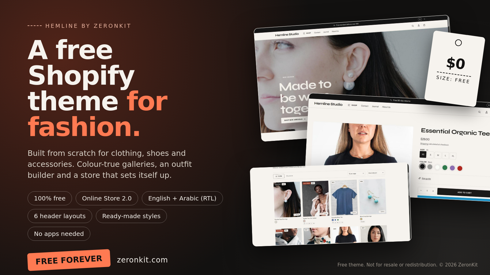
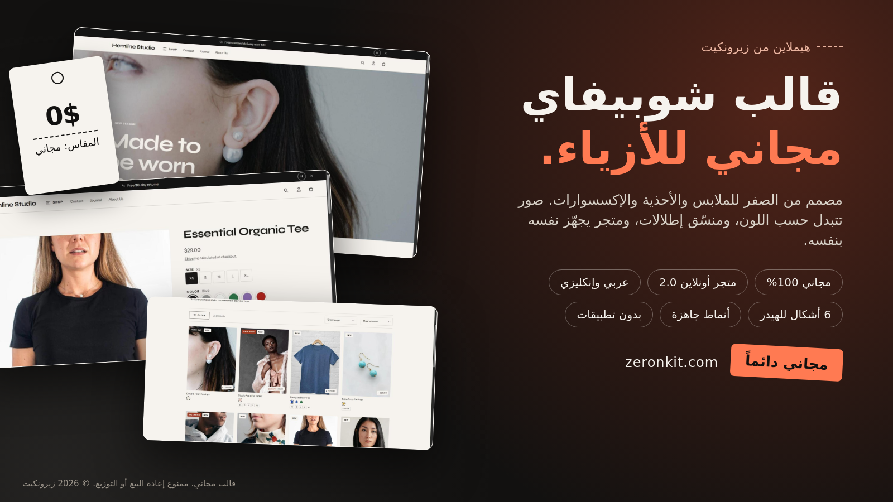

# Hemline, a free Shopify theme by ZeronKit

<h2 align="center">📘 The full guide, step by step, with 85 screenshots</h2>

&nbsp;

&nbsp;

<table><tr><td valign="top" width="50%">

### Guide contents (English)

- [1. What Hemline is](docs/guide.md#1-what-hemline-is)
- [2. Installing and updating](docs/guide.md#2-installing-and-updating)
- [3. Preparing your store content](docs/guide.md#3-preparing-your-store-content)
- [4. Theme settings](docs/guide.md#4-theme-settings)
- [5. Header group](docs/guide.md#5-header-group)
- [6. Home page sections](docs/guide.md#6-home-page-sections)
- [7. Collection and search pages](docs/guide.md#7-collection-and-search-pages)
- [8. Product page](docs/guide.md#8-product-page)
- [9. Other pages](docs/guide.md#9-other-pages)
- [10. Footer group](docs/guide.md#10-footer-group)
- [11. Languages, Arabic and right-to-left](docs/guide.md#11-languages-arabic-and-right-to-left)
- [12. Performance, accessibility, help](docs/guide.md#12-performance-accessibility-help)

</td><td valign="top" width="50%" dir="rtl">

### فهرس الشرح (العربية)

- [1. ما هو Hemline](docs/guide-ar.md#1-ما-هو-hemline)
- [2. التثبيت والتحديث](docs/guide-ar.md#2-التثبيت-والتحديث)
- [3. تجهيز محتوى المتجر](docs/guide-ar.md#3-تجهيز-محتوى-المتجر)
- [4. إعدادات القالب](docs/guide-ar.md#4-إعدادات-القالب)
- [5. مجموعة الترويسة](docs/guide-ar.md#5-مجموعة-الترويسة)
- [6. أقسام الصفحة الرئيسية](docs/guide-ar.md#6-أقسام-الصفحة-الرئيسية)
- [7. صفحات المجموعات والبحث](docs/guide-ar.md#7-صفحات-المجموعات-والبحث)
- [8. صفحة المنتج](docs/guide-ar.md#8-صفحة-المنتج)
- [9. صفحات أخرى](docs/guide-ar.md#9-صفحات-أخرى)
- [10. مجموعة التذييل](docs/guide-ar.md#10-مجموعة-التذييل)
- [11. اللغات والعربية والكتابة من اليمين إلى اليسار](docs/guide-ar.md#11-اللغات-والعربية-والكتابة-من-اليمين-إلى-اليسار)
- [12. الأداء وإمكانية الوصول والمساعدة](docs/guide-ar.md#12-الأداء-وإمكانية-الوصول-والمساعدة)

</td></tr></table>

The same guide is also on the website: [zeronkit.com/hemline-guide](https://zeronkit.com/hemline-guide/) and [zeronkit.com/hemline-guide-ar](https://zeronkit.com/hemline-guide-ar/). Theme page: [zeronkit.com/hemline](https://zeronkit.com/hemline/).

Hemline is a free Shopify theme for clothing, shoes, bags and accessories. It also suits kids, sport and pet clothing. Made by [ZeronKit](https://zeronkit.com).

**Source-available, free, not for resale.** This repository is not open source and is not under the GPL. You may use and change Hemline on stores you own or run. You may not resell, redistribute, sublicense or upload it to theme marketplaces. See [LICENSE](LICENSE).

## Download

- Latest version: [hemline-1.1.0.zip](https://api.zeronkit.com/downloads/hemline-1.1.0.zip) (also attached to the v1.1.0 release on this page when available).
- In Shopify admin: `Online Store` > `Themes` > `Import` > `Upload zip file`.

## Guides

- English: https://zeronkit.com/hemline-guide/
- العربية: https://zeronkit.com/hemline-guide-ar/

## Features

- Online Store 2.0: JSON templates, sections everywhere, header and footer section groups, nested theme blocks, app blocks.
- Six header layouts, including a desktop side bar, with a navigator menu that shows collection image tiles.
- Outfit builder: shoppers combine pieces and add the whole look to the cart in one step.
- Product gallery that shows only the chosen colour's photos, with a lightbox.
- Fit confidence: model notes per photo, a fit scale and a size guide drawer.
- Colour stories and colour swatches that work in English, French, Spanish, German and Arabic.
- Drop ledger for new arrivals, with no countdowns or fake urgency.
- Search page with suggestions, popular and recent searches, tabs and filters.
- Load more, infinite scroll and a products per page choice on collection and search pages.
- Ready-made style settings: palettes, font pairings, corners, buttons, card styles, spacing and animations.
- English and Arabic with full right-to-left support.
- No app dependencies, no build step, no frameworks. Vanilla JavaScript modules that load only when needed.

## Requirements

- A Shopify store that allows custom themes.
- Search & Discovery (free Shopify app) for filters.
- Translate & Adapt (free Shopify app) for more languages.

## Updating

Uploaded themes do not update by themselves. Duplicate your theme first, then upload the new zip and check every page before you publish it.

## Support

Free, provided as is, with no warranty. Support is best-effort and on request only through mailto:info@zeronkit.com or info@zeronkit.com. Updates are released when needed and when time allows, with no schedule.

## Licence

Copyright (c) 2026 ZeronKit. ZeronKit Free Theme Licence. Source-available, free, not for resale or redistribution. The copyright, author and signature notices must stay in the files.
