

# دليل قالب Hemline

الإصدار 1.1.0. من إعداد ZeronKit ‏(https://zeronkit.com).

يشرح هذا الدليل كل أجزاء قالب Hemline: طريقة التثبيت، وطريقة تجهيز محتوى المتجر، ووظيفة كل إعداد. التسميات المكتوبة بهذا الشكل `code style` هي التسميات الإنجليزية كما تظهر في محرر القالب في Shopify. إذا كانت لوحة Shopify لديك باللغة العربية فقد تظهر التسمية مترجمة، لكن ترتيبها ومكانها لا يتغيران.

---

## 1. ما هو Hemline

‏Hemline قالب مجاني لمتاجر Shopify المتخصصة في الملابس والأحذية والحقائب والإكسسوارات. ويناسب أيضًا ملابس الأطفال والملابس الرياضية وملابس الحيوانات الأليفة.

القالب مبني على نظام Online Store 2.0 في Shopify، وهذا يعني:

- كل صفحة مكوّنة من أقسام يمكنك إضافتها وحذفها وتغيير ترتيبها في محرر القالب.
- الترويسة والتذييل مجموعتا أقسام، فيمكن أن تضم كل منهما أكثر من قسم.
- كثير من الأقسام تقبل عناصر (blocks)، وبعض العناصر تضم عناصر أخرى.
- التطبيقات التي توفر "عناصر تطبيقات" يمكن إضافتها دون تعديل الشيفرة.

### ملخص الترخيص

- يمكنك استخدام Hemline وتعديله مجانًا على المتاجر التي تملكها أو تديرها.
- القالب ليس للبيع ولا لإعادة التوزيع. لا تبعه، ولا تشاركه، ولا ترفعه إلى أسواق القوالب، ولا تقدمه على أنه من عملك.
- يجب أن تبقى ملاحظات حقوق النشر والمؤلف والتوقيع في الملفات.
- يُقدَّم القالب كما هو، دون أي ضمان. النص الكامل في ملف `LICENSE` داخل الملف المضغوط.

### المتطلبات

1. متجر Shopify على أي خطة تسمح بالقوالب المخصصة.
2. منتجات لها صور. الملابس تعمل بأفضل شكل مع خيار `Size` للمقاس وخيار `Color` للون.
3. لعوامل التصفية في صفحات المجموعات والبحث: تطبيق Search & Discovery المجاني من Shopify.
4. لأكثر من لغة: تطبيق Translate & Adapt المجاني من Shopify.

لا يحتاج Hemline إلى أي تطبيق آخر.

---

## 2. التثبيت والتحديث

### 2.1 تنزيل القالب

1. افتح https://zeronkit.com/themes/ ونزّل الملف المضغوط لقالب Hemline. لا تفك ضغطه.

### 2.2 رفع القالب

1. في لوحة إدارة Shopify افتح `Online Store` ثم `Themes`.
2. في أعلى الصفحة اضغط `Import` واختر `Upload zip file`.
3. اختر ملف Hemline المضغوط واضغط `Upload file`.
4. انتظر حتى يظهر Hemline في مكتبة القوالب.

[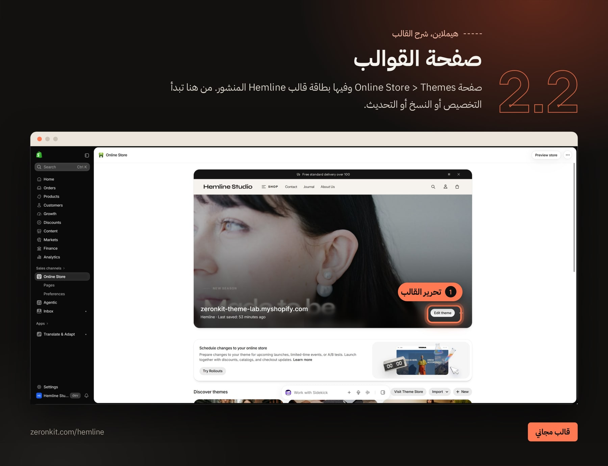](images/themes-page-ar.jpg)

[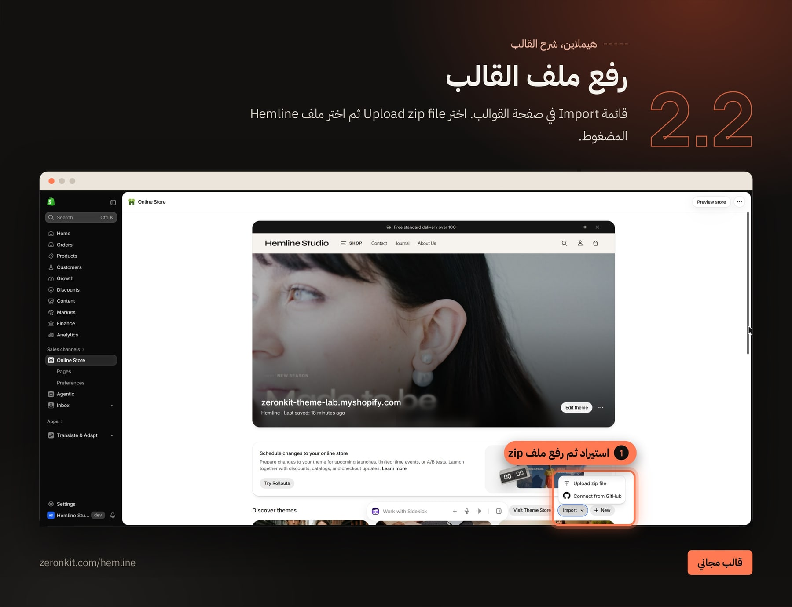](images/install-upload-zip-ar.jpg)

### 2.3 المعاينة والنشر

1. في مكتبة القوالب ابحث عن Hemline واضغط `Customize` لفتح محرر القالب.
2. راجع الصفحة الرئيسية ومجموعة ومنتجًا والسلة.
3. عندما تكون راضيًا، ارجع إلى `Themes`. في مكتبة القوالب افتح قائمة `...` بجانب Hemline واضغط `Publish`. القالب المنشور ليس فيه خيار `Publish`، فهذا الخيار موجود فقط في قوالب المكتبة.

### 2.4 التحديث بأمان

القوالب المرفوعة كملف مضغوط لا تتحدث تلقائيًا. للتحديث:

1. نزّل الإصدار الجديد من https://zeronkit.com/themes/.
2. في `Themes` افتح قائمة `...` الخاصة بقالب Hemline الحالي واضغط `Duplicate`. هذا يحفظ نسخة احتياطية كاملة من إعداداتك ومحتواك.
3. ارفع الملف المضغوط الجديد كما في الخطوة 2.2.
4. افتح النسخة الجديدة في المحرر وراجع صفحاتك. أقسامك وإعداداتك محفوظة في النسخة القديمة، لذلك اضبط النسخة الجديدة من جديد أو انقل اختياراتك إليها.
5. انشر النسخة الجديدة فقط عندما تبدو كل الصفحات صحيحة.

[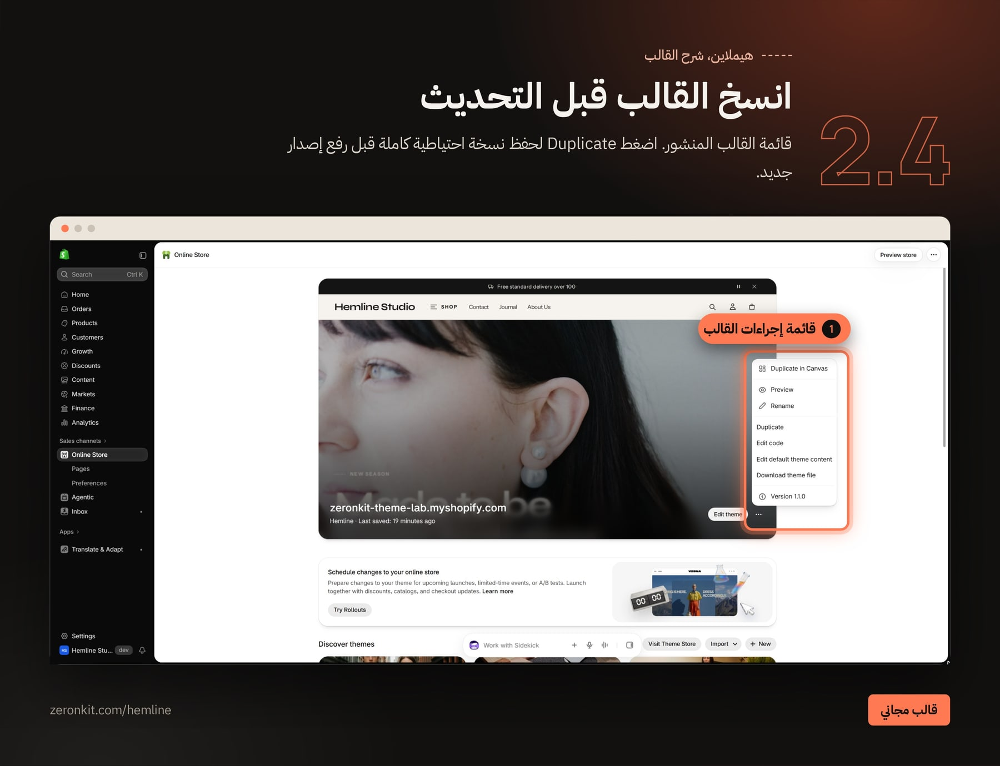](images/update-duplicate-ar.jpg)

---

## 3. تجهيز محتوى المتجر

يعرض Hemline محتوى حقيقيًا بمجرد تثبيته. وكلما كانت المنتجات والمجموعات والقوائم والصفحات مجهزة بشكل أفضل، ظهر المتجر بشكل أجمل.

### 3.1 المنتجات

1. أعطِ الملابس خيارًا باسم `Size` (مثل XS و S و M و L و XL) وخيارًا باسم `Color`.
2. يتعرف Hemline أيضًا على الأسماء Colour و Couleur و Farbe و Colore وعلى الأسماء العربية مثل "اللون" و"المقاس". يمكنك إضافة أسماء أخرى في `Theme settings` > `Product cards` > `Colour option names` و `Size option names`.
3. أضف صورتين على الأقل لكل لون.

[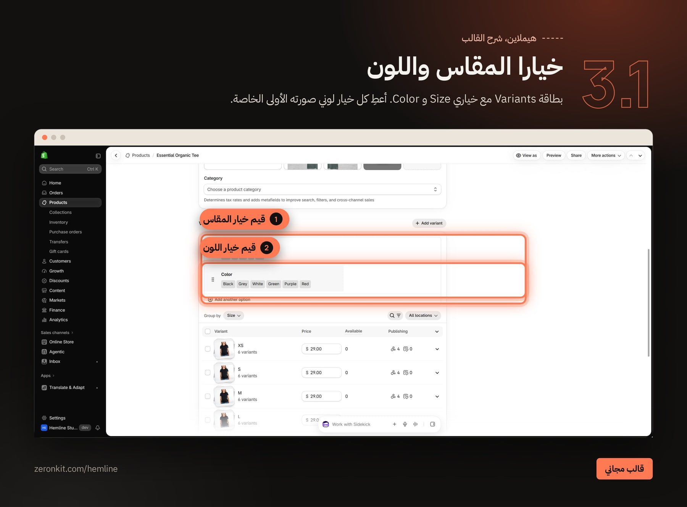](images/product-options-ar.jpg)

### 3.2 صورة رئيسية لكل لون

هذا يجعل صفحة المنتج تعرض صور اللون الذي يختاره الزائر فقط.

1. افتح المنتج في لوحة الإدارة.
2. في بطاقة `Media` رتّب الصور حسب اللون: كل صور اللون الأول، ثم كل صور اللون الثاني، وهكذا.
3. في بطاقة `Variants` اضغط على خيار من اللون الأول واختر صورته: الصورة الأولى من ذلك اللون.
4. كرر ذلك لكل لون. يمكن لكل مقاسات اللون الواحد استخدام الصورة نفسها.

يقرأ Hemline مجموعات الصور هكذا: مجموعة اللون تبدأ عند صورة خياره، وتنتهي قبل صورة خيار اللون التالي مباشرة. هذه الطريقة تعمل مع كل اللغات.

### 3.3 النص البديل للصور الإضافية

النص البديل وصف قصير للصورة. يستخدمه Hemline طريقةً ثانية لمعرفة صور كل لون، وتقرؤه برامج قراءة الشاشة بصوت مسموع.

1. اضغط على صورة في بطاقة `Media` واختر `Add alt text`.
2. اكتبه بالشكل "اسم المنتج in اللون" باللغة الإنجليزية، مثل `Linen Shirt in navy`.
3. يمكنك إضافة ملاحظة بعد فاصلة أو شرطة أو قوس، مثل `Linen Shirt in navy, close-up` أو `Linen Shirt in navy (back)`.

### 3.4 المجموعات

1. أنشئ مجموعات مثل Women و Men و Shoes و Bags و Accessories و New Arrivals و Sale.
2. أعطِ كل مجموعة صورة إن أمكن. إذا لم تكن لها صورة يستخدم Hemline صورة أول منتج فيها داخل القوائم والقوائم المصورة.
3. لقسم `Drop ledger` رتّب مجموعة New Arrivals حسب `Newest`.

### 3.5 القوائم

يستخدم Hemline قائمتين، تجدهما في `Online Store` > `Navigation`.

1. ‏`Main menu`: للترويسة ولزر التسوق. يمكن أن تكون لها ثلاثة مستويات.
   - المستوى 1: الأقسام الكبرى، مثل نساء ورجال وأطفال.
   - المستوى 2: مجموعات، مثل فساتين وقمصان.
   - المستوى 3: روابط إضافية تحت كل مجموعة.
2. ‏`Footer menu`: روابط المساعدة، مثل من نحن ودليل المقاسات والشحن والإرجاع والتواصل.

ما يفعله Hemline تلقائيًا:

- إذا كانت القائمة الرئيسية فارغة، تبني الترويسة تنقلها الخاص من مجموعاتك ومدونتك والصفحات about-us و faq و contact.
- إذا لم يحدد عنصر قائمة في التذييل أي قائمة، يستخدم `Footer menu`. وإذا كانت فارغة أيضًا يعرض صفحاتك الشائعة (about-us و contact و faq و size-guide و shipping-and-returns و returns و shipping) والمدونة والبحث.
- أول عنصر في القائمة يكرر زر التسوق فقط (مثل "Shop" يربط إلى كل المنتجات) يُخفى تلقائيًا.

[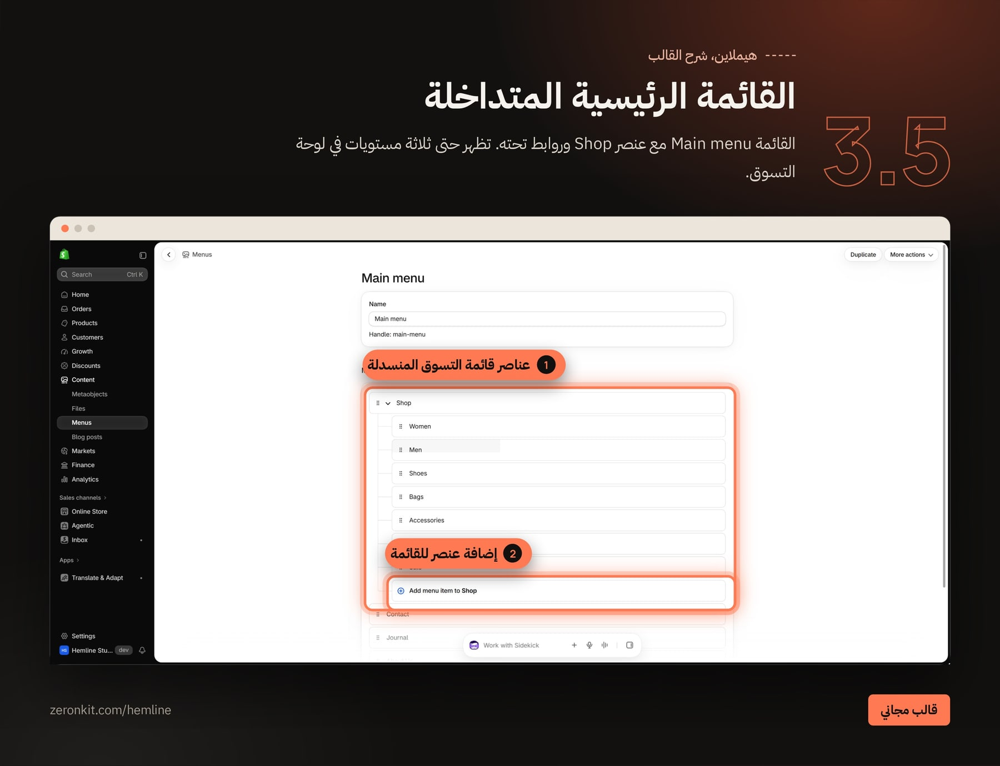](images/menus-main-menu-ar.jpg)

### 3.6 صفحات ذات معرّفات خاصة

المعرّف (handle) هو الجزء الأخير من رابط الصفحة، مثل `/pages/size-guide`. يبحث Hemline عن هذه المعرّفات:

| المعرّف | ماذا يفعل به Hemline |
| --- | --- |
| `about-us` | يُستخدم في التنقل التلقائي في الترويسة والتذييل. |
| `faq` | يُستخدم في التنقل التلقائي في الترويسة والتذييل. |
| `contact` | يعرض نموذج تواصل يعمل حتى مع قالب الصفحة الافتراضي. ويُستخدم في التنقل التلقائي. |
| `size-guide` | يُفتح كدرج دليل المقاسات في كل صفحة منتج عندما لا يكون هناك دليل آخر. ويظهر في التذييل التلقائي. |
| `shipping-and-returns` | يظهر في التذييل التلقائي. |

[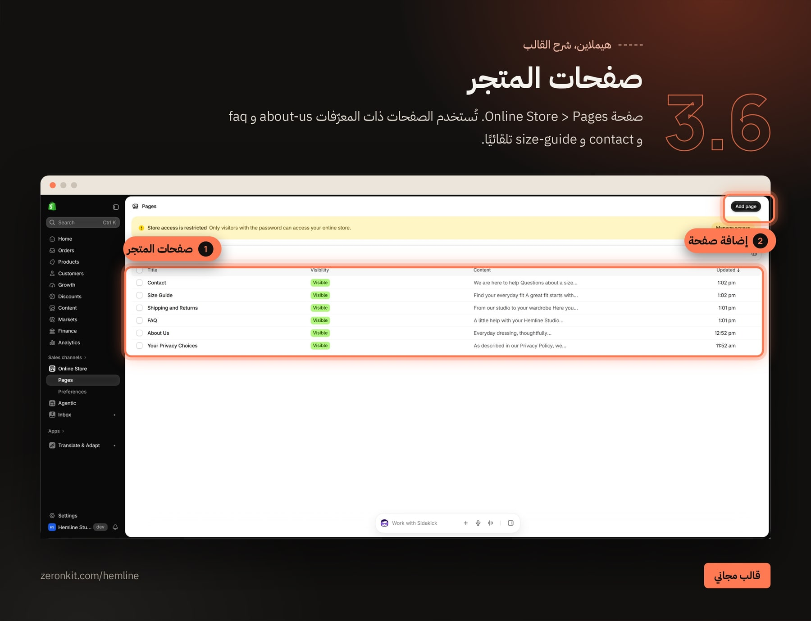](images/pages-list-ar.jpg)

[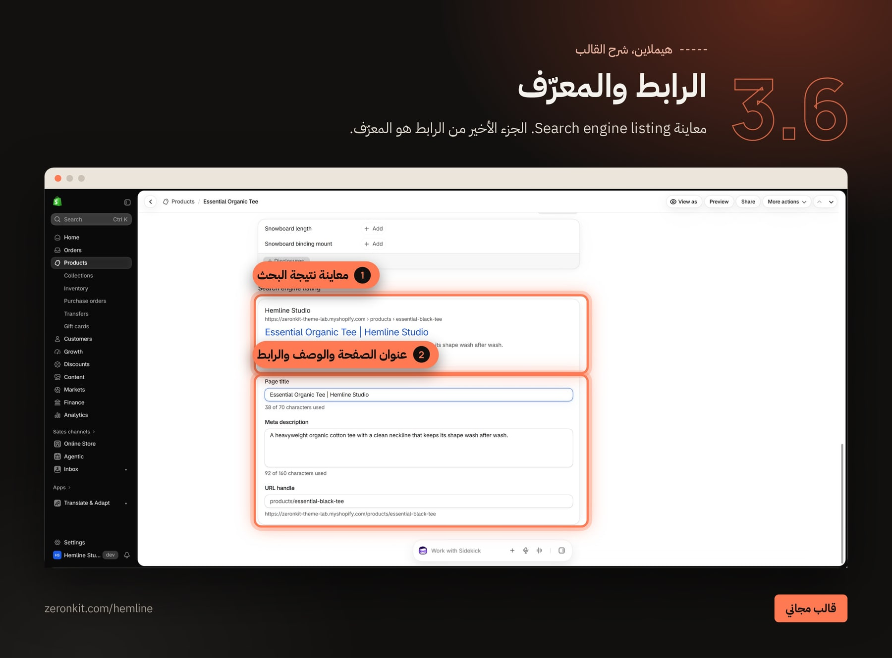](images/product-search-listing-ar.jpg)

### 3.7 الحقول الوصفية (Metafields)

تضيف الحقول الوصفية معلومات إضافية للمنتجات. أنشئ تعريفاتها مرة واحدة:

1. افتح `Settings` > `Custom data` > `Products`.
2. اضغط `Add definition`.
3. أدخل الاسم، ثم namespace and key، ثم النوع من الجدول.
4. احفظ. سيظهر الحقل الجديد في أسفل صفحة كل منتج في لوحة الإدارة.

| Namespace and key | النوع | الوظيفة | مثال |
| --- | --- | --- | --- |
| `hemline.model_info` | Multi-line text | سطر لكل صورة، يظهر تحت تلك الصورة. السطر 1 للصورة 1. | `Model is 178 cm and wears M` |
| `hemline.fit` | Single line text | يعرض مقياس القصّة. استخدم واحدة فقط من: `runs_small` أو `true_to_size` أو `runs_large`. | `true_to_size` |
| `hemline.size_guide` | Page reference | صفحة دليل المقاسات لهذا المنتج فقط. | صفحة "مقاسات الأحذية" |
| `hemline.materials` | Rich text أو Multi-line text | يملأ تبويب الخامات والعناية. يعمل أيضًا حقل Shopify الأصلي `custom.material`. | `100% organic cotton` |
| `hemline.care` | Rich text أو Multi-line text | يظهر تحت "العناية" في التبويب نفسه. | `Wash at 30°C` |
| `hemline.fit_notes` | Rich text أو Multi-line text | يملأ تبويب المقاس. | `Relaxed fit through the body` |

[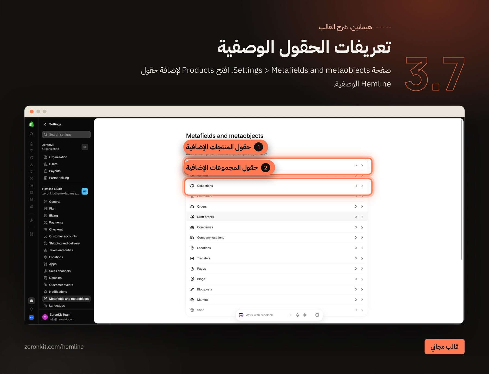](images/custom-data-ar.jpg)

[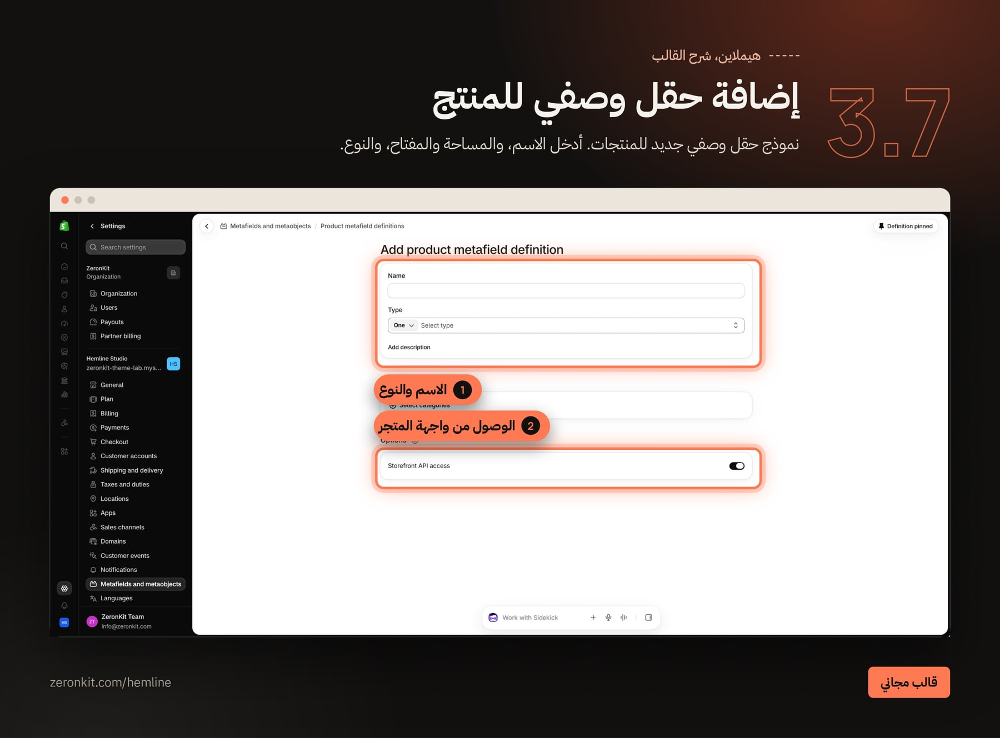](images/metafield-definition-ar.jpg)

### 3.8 أقسام الوصف

لا تحتاج إلى الحقول الوصفية لملء التبويبات. في وصف المنتج يمكنك إضافة عناوين من نوع `Heading 3` بهذه الكلمات:

- ‏`Materials` و `Care` و `Fit` و `Shipping and returns`

ينقل Hemline كل قسم منها إلى تبويب خاص به في صفحة المنتج. ويعرض مكان الوصف عندها المقدمة وأي عناوين أخرى فقط، مثل قائمة `Details`.

[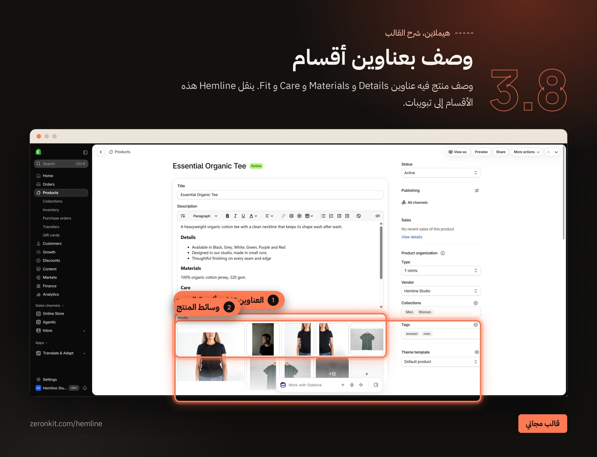](images/product-description-headings-ar.jpg)

---

## 4. إعدادات القالب

افتح محرر القالب واضغط أيقونة الترس `Theme settings` على اليسار. تظهر المجموعات بهذا الترتيب.

[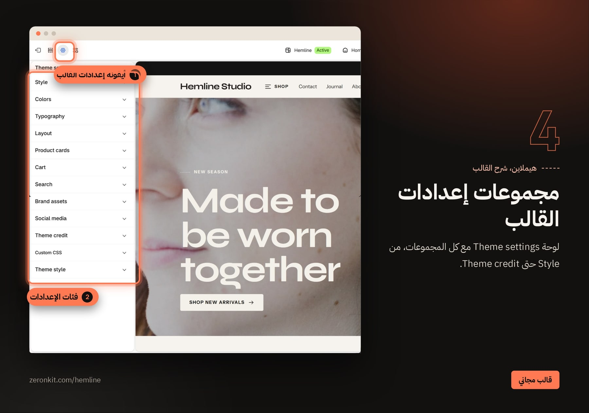](images/theme-settings-list-ar.jpg)

### 4.1 أنماط القالب الجاهزة

في أعلى `Theme settings` تعرض Shopify أنماط القالب. كل نمط يغيّر إعدادات كثيرة دفعة واحدة: الألوان والخطوط والزوايا والأزرار وشكل البطاقات والمسافات.

| النمط | المظهر |
| --- | --- |
| `Default` | ألوان ورقية دافئة، عناوين بخط Syne، زوايا ناعمة، بطاقات معلّقة. |
| `Track` | أبيض وأزرق باردان للملابس الرياضية، عناوين ضيقة عريضة، زوايا حادة، بطاقات بإطار. |
| `Playground` | كريمي وأخضر دافئان للأطفال والحيوانات، عناوين مستديرة، أزرار دائرية، بطاقات بسيطة. |
| `Noir` | خلفية داكنة، عناوين بخط ذي زوائد، أزرار بإطار، نص فوق الصورة. |

اختيار نمط يستبدل قيمك الحالية لتلك الإعدادات. انسخ القالب أولًا إذا أردت الاحتفاظ بها.

[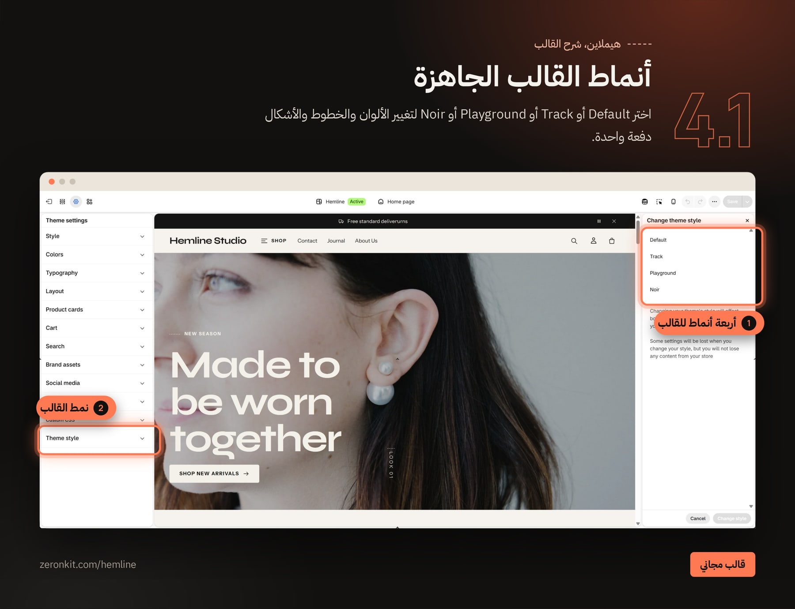](images/theme-styles-ar.jpg)

### 4.2 Style

اختيارات جاهزة للمتجر كله. اختر هنا أولًا ثم عدّل التفاصيل في المجموعات التالية.

- ‏`Palette`: تستبدل نظامي الألوان 1 و3 بمجموعة جاهزة. الخيارات: `Custom (use the colour schemes)` و `Paper` و `Ink (dark)` و `Sand` و `Sage` و `Blush` و `High contrast` و `Ocean` و `Terracotta` و `Mono` و `Olive`. استخدم `Custom` إذا أردت تعديل كل نظام ألوان بنفسك.
- ‏`Background style`:
  - ‏`Solid`: لون واحد.
  - ‏`Soft gradient`: تدرج خفيف جدًا من الأعلى إلى الأسفل.
  - ‏`Two-tone sections`: كل قسم ثانٍ في الصفحة يأخذ درجة أغمق قليلًا.
  - ‏`Dark mode`: خلفية داكنة ونص فاتح للنظام الرئيسي.
- ‏`Font pairing`: الخيار `Custom (font pickers)` يستخدم الخطوط من `Typography`. أما التنسيقات الأخرى فتستخدم خطوطًا موجودة على جهاز الزائر، فلا يُحمَّل شيء إضافي: `Modern sans` و `Editorial serif and sans` و `Classic serif` و `Mono headings` و `Soft rounded` و `Arabic friendly`. اختر `Arabic friendly` إذا كان معظم نصك بالعربية.
- ‏`Heading scale`: أحجام العناوين `Compact` أو `Balanced` أو `Bold`.
- ‏`Corners`: ‏`Sharp` أو `Soft` أو `Round` أو `Custom` (يستخدم `Layout` > `Corner radius`).
- ‏`Button style`: ‏`Solid` أو `Outline` أو `Underline` أو `Pill`. يبقى زر الإضافة إلى السلة وزر الدفع واضحين في كل الأنماط.
- ‏`Product card style`:
  - ‏`Hang tag`: السعر معلّق على الصورة مثل بطاقة الملابس.
  - ‏`Minimal`: السعر تحت الاسم دون بطاقة.
  - ‏`Framed`: للبطاقة إطار رفيع.
  - ‏`Text over image`: الاسم والسعر فوق الصورة.
- ‏`Spacing`: مسافات ‏`Tight` أو `Regular` أو `Airy` بين الأقسام.
- ‏`Animations`: ‏`Off` أو `Subtle` أو `Expressive`. الزوار الذين يطلبون من أجهزتهم تقليل الحركة لا يرون أي حركة.

[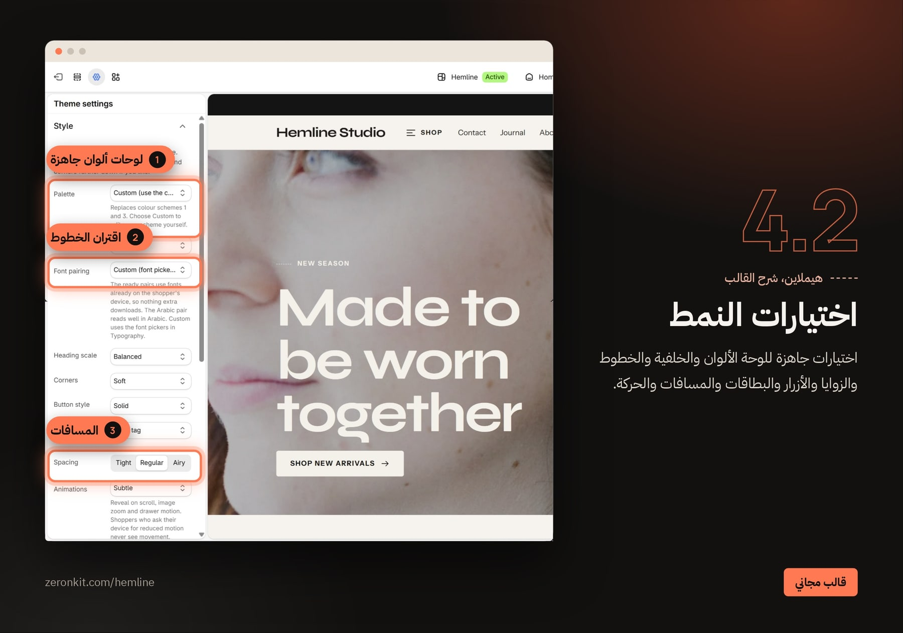](images/settings-style-ar.jpg)

### 4.3 Colors

- قائمة أنظمة الألوان: ستة أنظمة جاهزة. 1 ورقي، 2 حبري، 3 رملي، 4 أخضر مريمية، 5 وردي، 6 تباين عالٍ. اضغط على نظام لتغيير ألوانه: `Background` و `Background gradient` و `Text` و `Accent and links` و `Button` و `Button label`. لكل قسم إعداد `Color scheme` خاص به يختار واحدًا من هذه الأنظمة.
- ‏`Page color scheme`: لون الصفحة خلف الأقسام.
- ‏`Drawer and pop-up color scheme`: يُستخدم لدرج السلة وعوامل التصفية ودليل المقاسات.

حافظ على تباين النص بنسبة 4.5:1 أو أعلى. الأنظمة الجاهزة تحقق ذلك.

[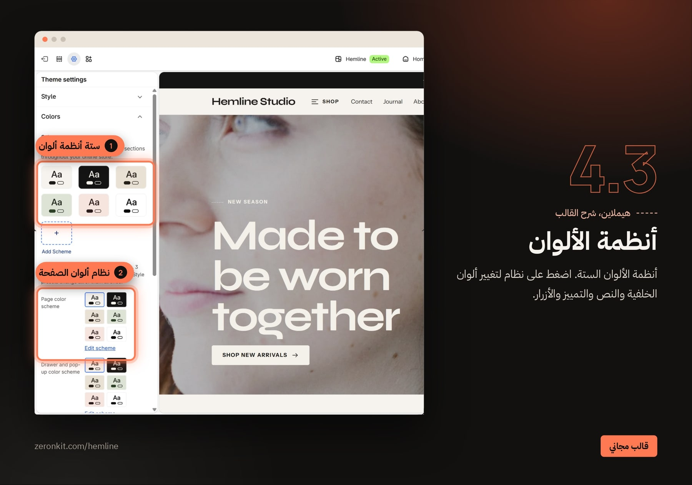](images/settings-colors-ar.jpg)

### 4.4 Typography

- ‏`Heading font` و `Body font`: اختر من مكتبة خطوط Shopify. يُستخدمان عندما يكون `Style` > `Font pairing` على `Custom`.
- ‏`Heading size` و `Body size`: يكبّران أو يصغّران كل العناوين أو كل النصوص.
- معظم خطوط المكتبة لا تحتوي على الحروف العربية. يستخدم النص العربي تلقائيًا خطًا عربيًا مناسبًا من الجهاز.

[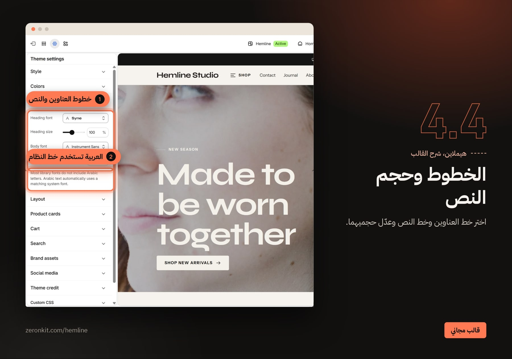](images/settings-typography-ar.jpg)

### 4.5 Layout

- ‏`Page width`: أقصى عرض للمحتوى على الشاشات الكبيرة.
- ‏`Corner radius`: يُستخدم عندما يكون `Style` > `Corners` على `Custom`.

[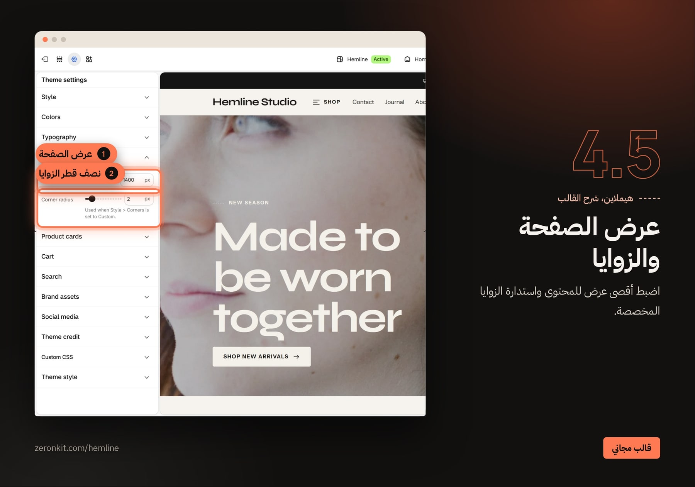](images/settings-layout-ar.jpg)

### 4.6 Product cards

- ‏`Image ratio`: ‏`Portrait 3:4` أو `Portrait 2:3` أو `Portrait 4:5` أو `Square`.
- ‏`Show second image on hover`: يعرض الصورة التالية من اللون نفسه عند مرور الفأرة على البطاقة.
- ‏`Show sizes in stock`: يعرض المقاسات، ويشطب المقاسات النافدة.
- ‏`Show colour swatches`: يعرض نقاط الألوان. يمكن للزائر الضغط على نقطة لرؤية ذلك اللون على البطاقة.
- ‏`Show vendor`: يعرض اسم العلامة التجارية فوق اسم المنتج.
- ‏`Size option names` و `Colour option names`: أسماء خيارات إضافية تفصل بينها فواصل، إذا كانت خياراتك تستخدم كلمات أخرى.
- ‏`Show New badge for`: عدد الأيام التي يُعدّ فيها المنتج جديدًا بعد نشره. اختر 0 لإخفاء الشارة.

[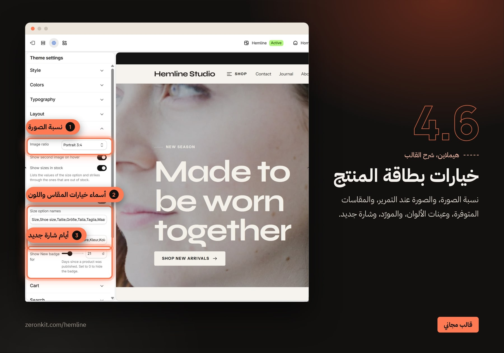](images/settings-product-cards-ar.jpg)

### 4.7 Cart

- ‏`Cart type`: ‏`Drawer` يفتح لوحة جانبية بعد الإضافة إلى السلة. ‏`Page` ينتقل إلى صفحة السلة.
- ‏`Enable order note`: يسمح للزائر بكتابة ملاحظة في صفحة السلة.
- ‏`Show currency codes`: يعرض الأسعار بالشكل `€25,00 EUR`. مفيد إذا كنت تبيع بعدة عملات.

[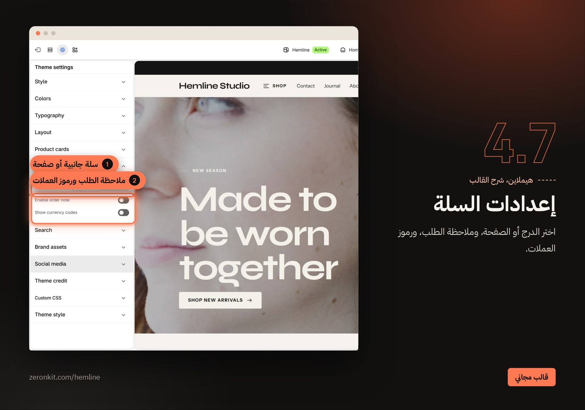](images/settings-cart-ar.jpg)

### 4.8 Search

- ‏`Enable search suggestions`: يعرض نتائج فورية أثناء الكتابة.
- ‏`Popular searches`: كلمات تفصل بينها فواصل. تظهر كأقراص في نافذة البحث وفي صفحة البحث وعند عدم وجود نتائج.

[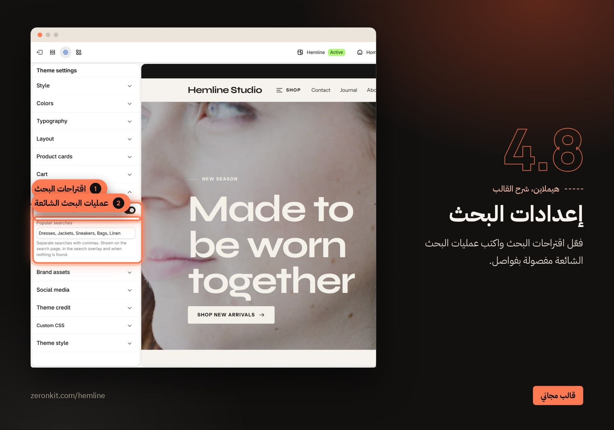](images/settings-search-ar.jpg)

### 4.9 Brand assets

- ‏`Favicon`: الأيقونة الصغيرة في تبويبات المتصفح. استخدم صورة مربعة بحجم 32 × 32 بكسل أو أكبر.
- ‏`Brand logo for sharing and gift cards`: يُستخدم في نتائج البحث ومعاينات مواقع التواصل وفي صفحة بطاقة الهدايا.

[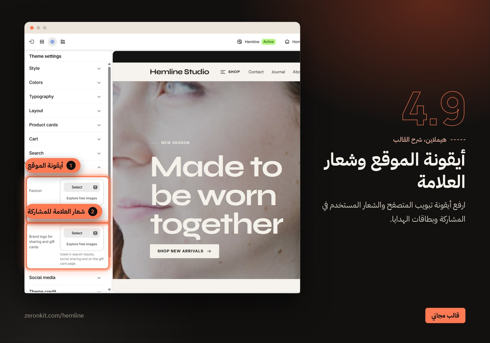](images/settings-brand-assets-ar.jpg)

### 4.10 Social media

الصق الرابط الكامل لكل حساب، مثل `https://instagram.com/yourshop`. تظهر الأيقونات في التذييل لكل حقل مملوء.

### 4.11 Theme credit

- ‏`Show "Theme by ZeronKit" credit in the footer`: مفعّل افتراضيًا. يمكنك إيقافه إن أردت.

[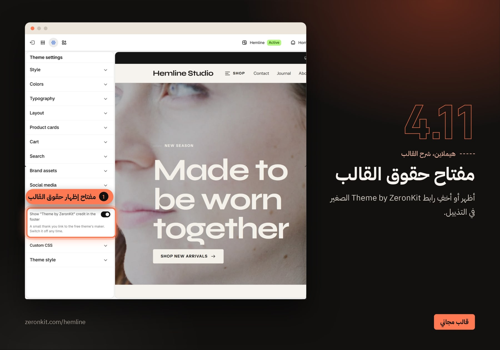](images/settings-theme-credit-ar.jpg)

### 4.12 Custom CSS

تضيف Shopify حقل `Custom CSS` في أسفل `Theme settings` وفي كل قسم. استخدمه للتعديلات الصغيرة فقط. يبقى عند تغيير الإعدادات الأخرى، لكن عليك نسخه بنفسك عند تحديث القالب.

---

## 5. مجموعة الترويسة

اضغط على منطقة الترويسة في المعاينة أو اختر `Header` من الشريط الجانبي. تضم مجموعة الترويسة `Announcement bar` و `Header`.

### 5.1 Announcement bar (شريط الإعلانات)

الإعدادات:

- ‏`Show announcement bar`: تشغيل الشريط أو إيقافه.
- ‏`Display`:
  - ‏`Static`: كل الرسائل جنبًا إلى جنب.
  - ‏`Rotating fade`: رسالة واحدة في كل مرة.
  - ‏`Marquee`: شريط يتحرك ببطء.
- ‏`Time per message`: مدة ظهور كل رسالة في الأوضاع المتحركة.
- ‏`Pause on hover`: يوقف الحركة عند مرور الفأرة فوق الشريط.
- ‏`Let shoppers close the bar`: يضيف زر إغلاق. يبقى الشريط المغلق مخفيًا حتى إغلاق تبويب المتصفح.
- ‏`Color scheme`.

العناصر: أضف عنصر `Message` لكل رسالة.

- ‏`Text`: نص الرسالة. يعمل الخط العريض والمائل.
- ‏`Link`: اختياري. يتحول النص إلى رابط.
- ‏`Icon`: ‏`None` أو `Delivery` أو `Returns` أو `New` أو `Offer` أو `Gift`.

الأوضاع المتحركة تعرض دائمًا زر إيقاف مؤقت من أجل إمكانية الوصول. اكتفِ برسالتين أو ثلاث.

[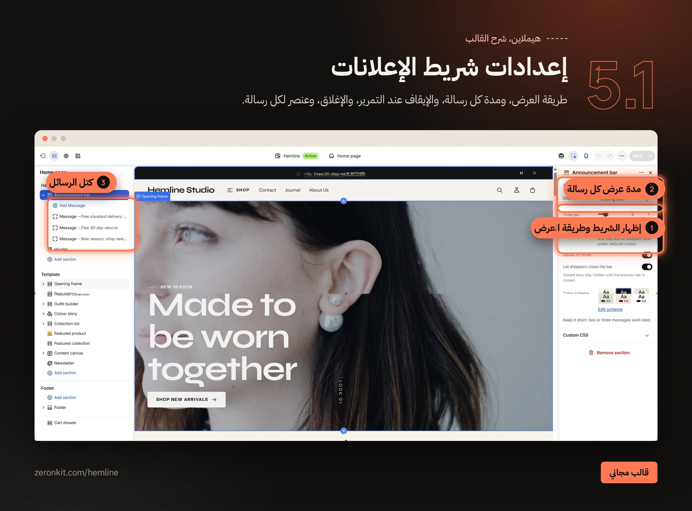](images/announcement-settings-ar.jpg)

### 5.2 Header (الترويسة)

[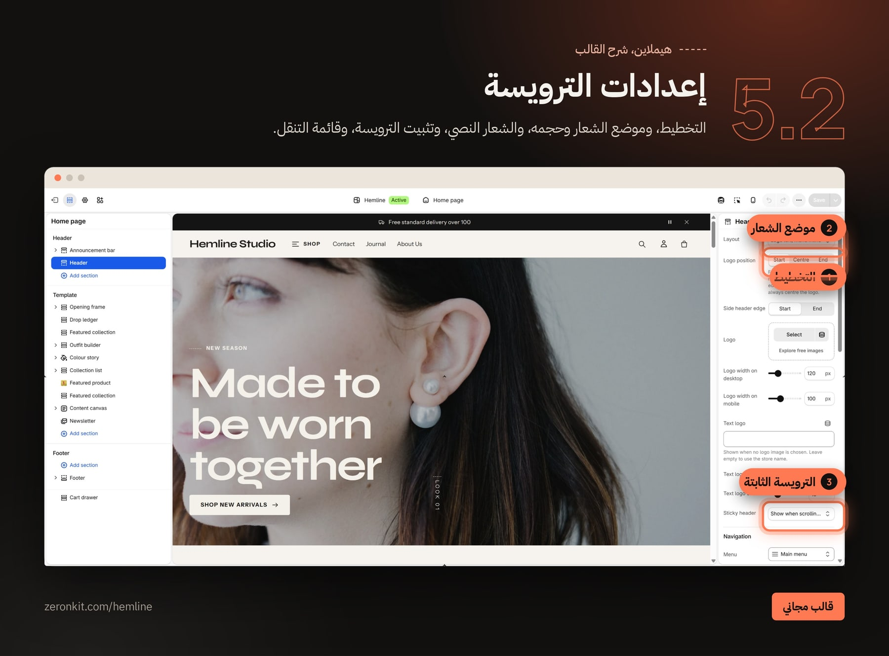](images/header-settings-ar.jpg)

#### Layout

للإعداد `Layout` ستة خيارات. على الجوال يظهر دائمًا شريط مضغوط فيه زر القائمة والشعار والأيقونات.

| التخطيط | الشكل على الحاسوب | يناسب |
| --- | --- | --- |
| `Logo left, menu inline` | الشعار، ثم الروابط، ثم الأيقونات في النهاية. | معظم المتاجر. |
| `Logo centred, menu below` | الشعار في الوسط والروابط في صف أسفله. | المتاجر الكلاسيكية. |
| `Logo centred, menu split` | الروابط على جانبي الشعار. | القوائم الصغيرة من 4 إلى 6 روابط. |
| `Minimal, menu button only` | زر القائمة والشعار والأيقونات. | المتاجر البسيطة جدًا أو كثيرة الأقسام. |
| `Editorial masthead` | صف علوي رفيع، شعار كبير، والروابط أسفله. | العلامات ذات الاسم أو الشعار القوي. |
| `Side bar (desktop)` | شريط ثابت على الجانب فيه الشعار وقائمة عمودية والأيقونات. | متاجر بأسلوب الكتالوج. |

[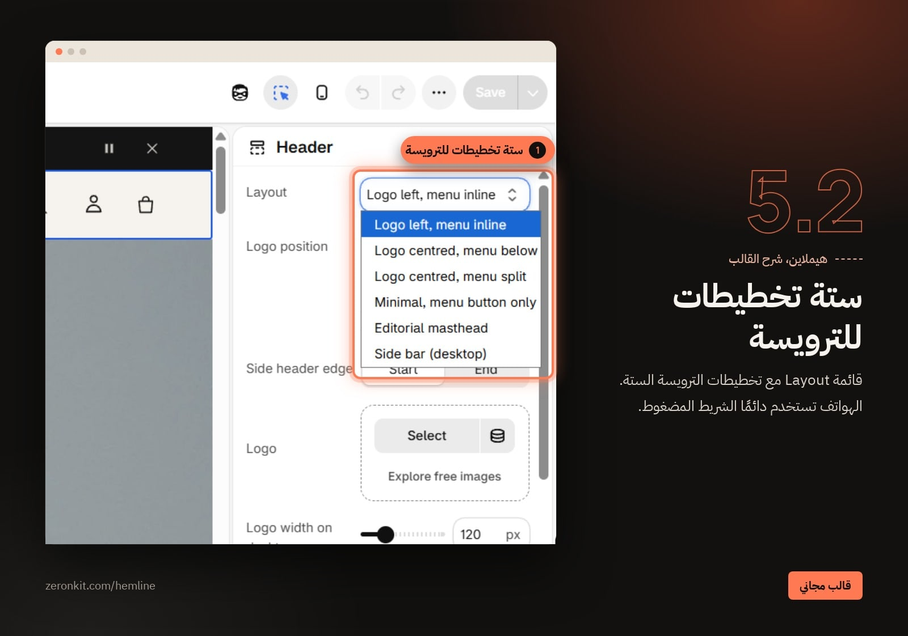](images/header-layout-select-ar.jpg)

[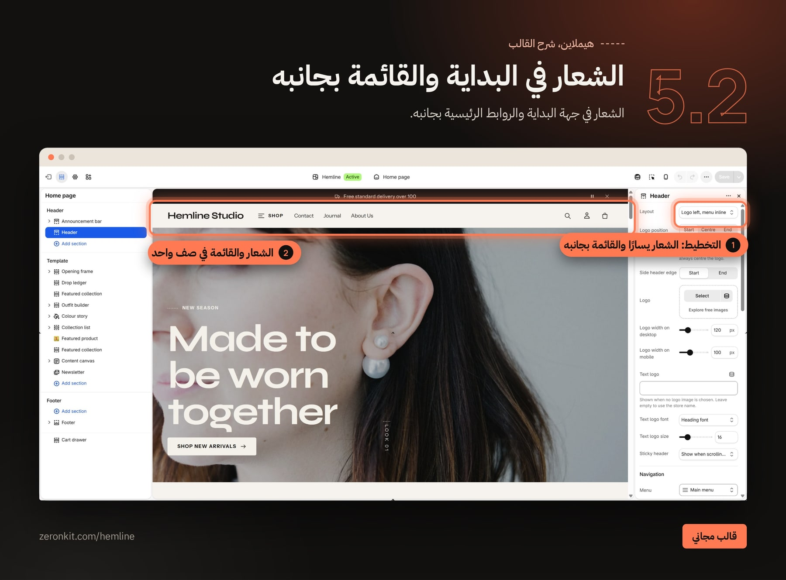](images/header-layout-inline-ar.jpg)

[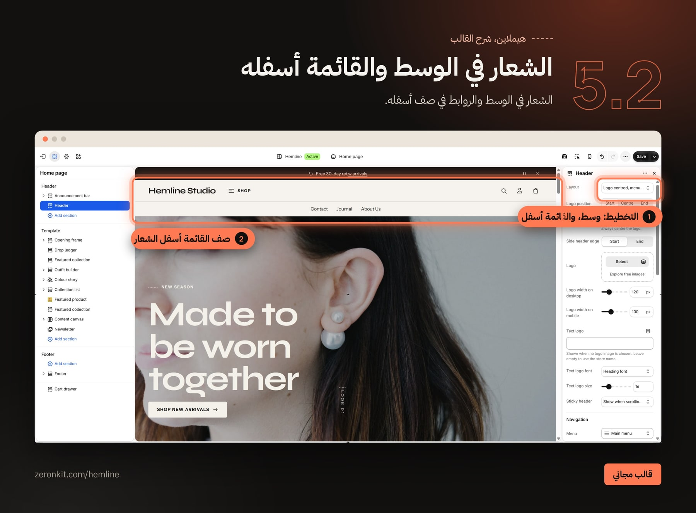](images/header-layout-below-ar.jpg)

[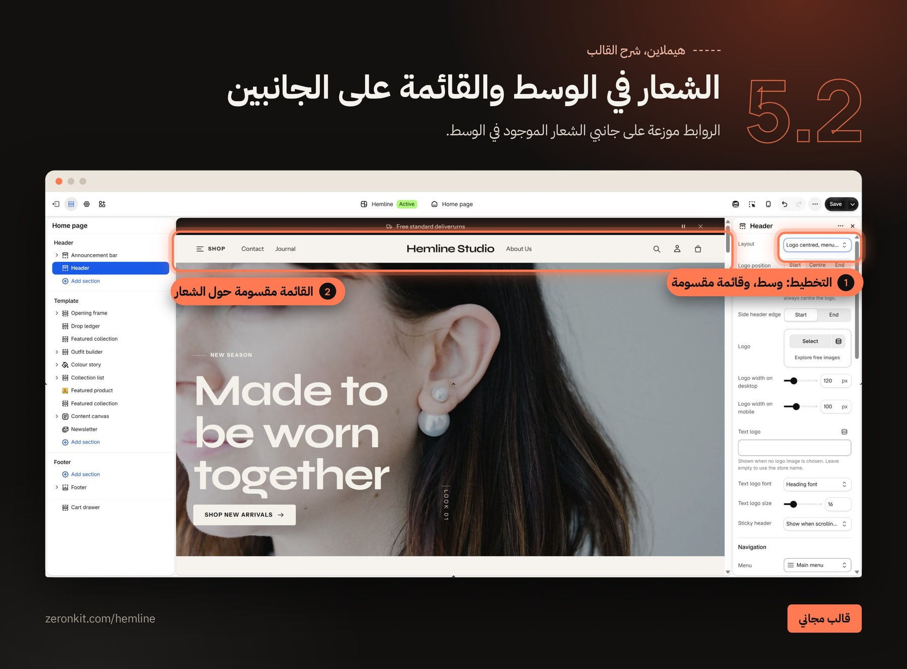](images/header-layout-split-ar.jpg)

[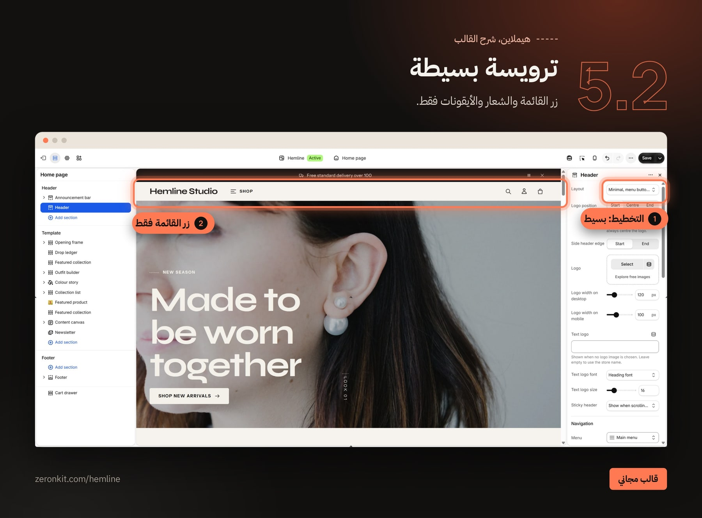](images/header-layout-minimal-ar.jpg)

[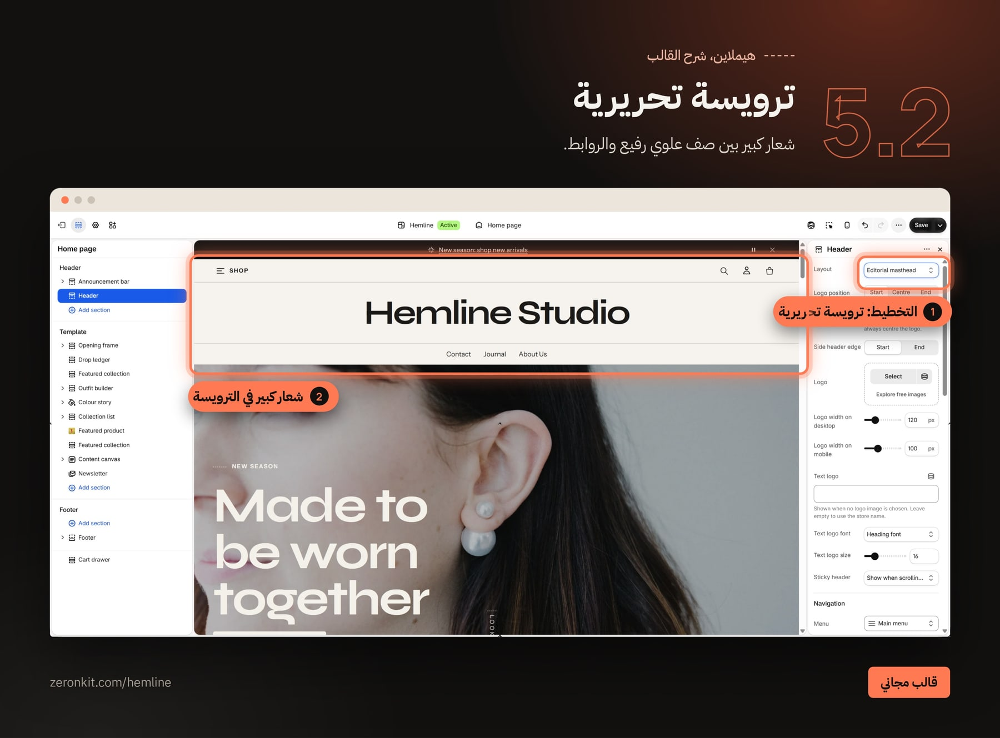](images/header-layout-editorial-ar.jpg)

[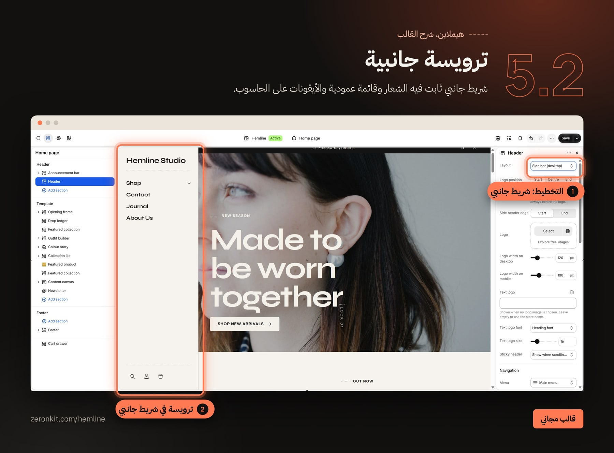](images/header-layout-side-ar.jpg)

#### الشعار

- ‏`Logo position`: ‏`Start` أو `Centre` أو `End`. يعمل مع `Logo left, menu inline` و `Logo centred, menu below` و `Minimal, menu button only`. التخطيطات الموزعة والتحريرية والجانبية تضع الشعار في الوسط دائمًا.
- ‏`Side header edge`: ‏`Start` أو `End`. لتخطيط الشريط الجانبي فقط.
- ‏`Logo`: صورة شعارك. إذا لم تكن هناك صورة يظهر اسم المتجر كنص.
- ‏`Logo width on desktop` و `Logo width on mobile`.
- ‏`Text logo`: نص يظهر بدل اسم المتجر عند عدم اختيار صورة شعار.
- ‏`Text logo font`: ‏`Heading font` أو `Body font` أو `Serif` أو `Monospace`.
- ‏`Text logo size`.

#### الترويسة المثبتة

‏`Sticky header`:

- ‏`Not sticky`: تختفي الترويسة مع التمرير.
- ‏`Always visible`: تبقى الترويسة في الأعلى دائمًا.
- ‏`Show when scrolling up`: تختفي عند التمرير لأسفل وتعود عند التمرير لأعلى.

#### التنقل

- ‏`Menu`: قائمة الترويسة وزر التسوق. الافتراضية: `Main menu`.
- ‏`Show the Shop navigator button`: يعرض الزر الذي يفتح لوحة التسوق على الحاسوب. على الجوال تكون لوحة التسوق هي القائمة دائمًا.
- ‏`Navigator button label`: النص على هذا الزر، مثل `Shop`.
- ‏`Hide the first menu item`: يخفي أول رابط في الأعلى. استخدمه إذا كان أول عنصر في قائمتك يكرر زر التسوق.
- ‏`Quick link menu`: صف اختياري من الروابط الصغيرة أسفل الترويسة، مثل نساء ورجال وأطفال ورياضة.

تُفتح لوحة التسوق من الجانب. تظهر الأقسام الكبرى مرقمة في جهة البداية. وتظهر المجموعات كصور مصغرة مع عدد المنتجات، والروابط الأخرى في مجموعات. على الجوال ينزلق كل مستوى مع زر `Back`.

[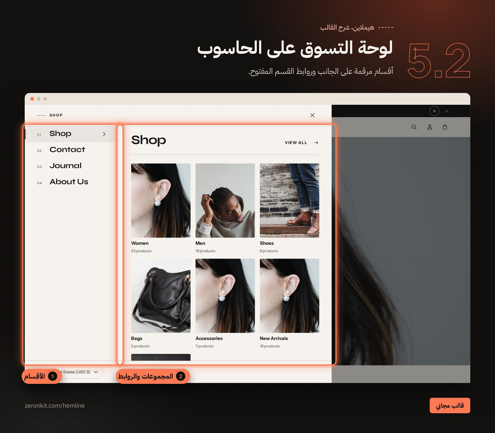](images/navigator-open-desktop-ar.jpg)

[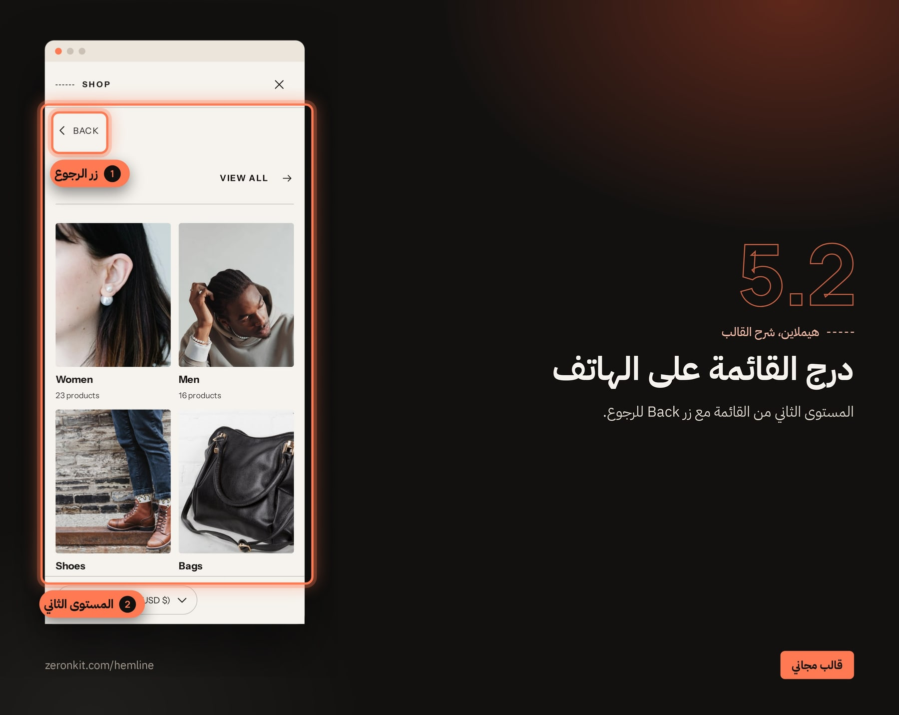](images/navigator-open-mobile-ar.jpg)

#### الأيقونات والاختيارات

- ‏`Show search`: أيقونة البحث. تفتح بحثًا بملء الشاشة مع اقتراحات.
- ‏`Show account`: أيقونة حساب العميل. تستخدم زر الحساب الخاص بـ Shopify.
- ‏`Customer account menu`: القائمة داخل نافذة الحساب. الافتراضية: `Customer account main menu`.
- ‏`Show cart`: أيقونة السلة مع عدد المنتجات.
- ‏`Show country/region selector` و `Show language selector`: يعرضان الاختيارين في الترويسة على الحاسوب. يوجدان دائمًا في لوحة التسوق، ويمكن أن يظهرا في التذييل أيضًا.

#### الترويسة الشفافة

- ‏`Transparent over the first section on the home page`: تظهر الترويسة فوق القسم الأول، وهو غالبًا `Opening frame`. وتصبح ملوّنة عند التمرير.
- ‏`Text and icon colour when transparent`: غالبًا أبيض فوق صورة داكنة.
- ‏`Logo when transparent`: نسخة فاتحة من شعارك.

#### الألوان

- ‏`Color scheme`: شريط الترويسة.
- ‏`Menu and search color scheme`: لوحة التسوق ونافذة البحث.

#### اللغات التي تُكتب من اليمين إلى اليسار

مع العربية والعبرية والفارسية والأردية ينقلب التصميم كله تلقائيًا. الشعار والقوائم والشريط الجانبي والأدراج والأسهم تنتقل إلى الجهة المقابلة. لا تحتاج إلى تغيير أي إعداد.

---

## 6. أقسام الصفحة الرئيسية

اضغط `Add section` في الشريط الجانبي لإضافة أقسام، واسحبها لتغيير ترتيبها.

كثير من الأقسام تمتلئ تلقائيًا ببيانات المتجر إذا تركت المنتج أو المجموعة فارغة. اختيارك أنت يكون له الأولوية دائمًا.

[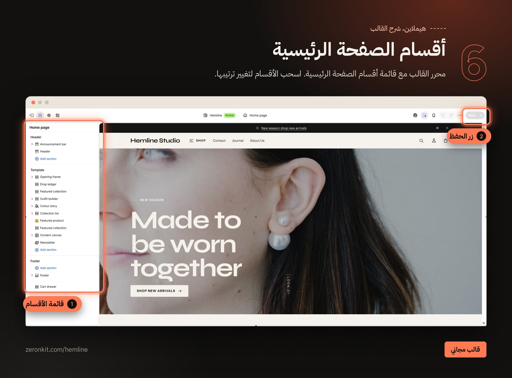](images/editor-home-ar.jpg)

[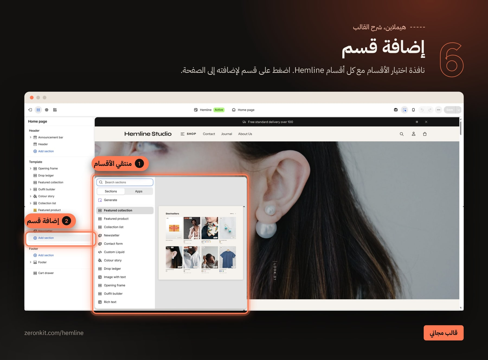](images/home-add-section-ar.jpg)

[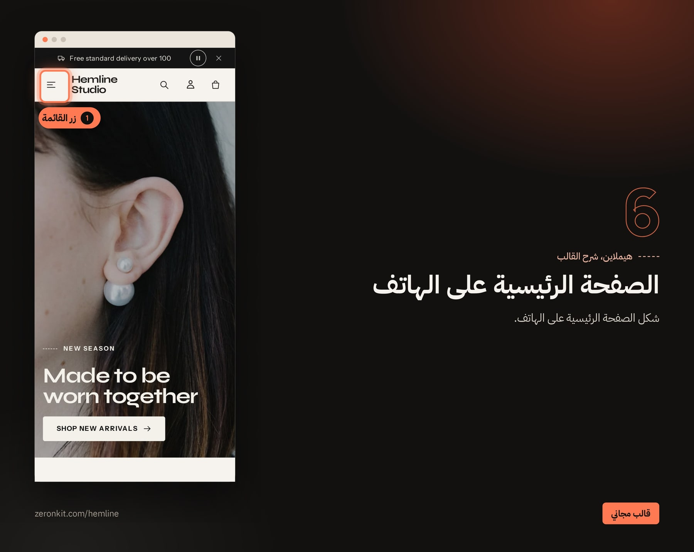](images/mobile-home-ar.jpg)

[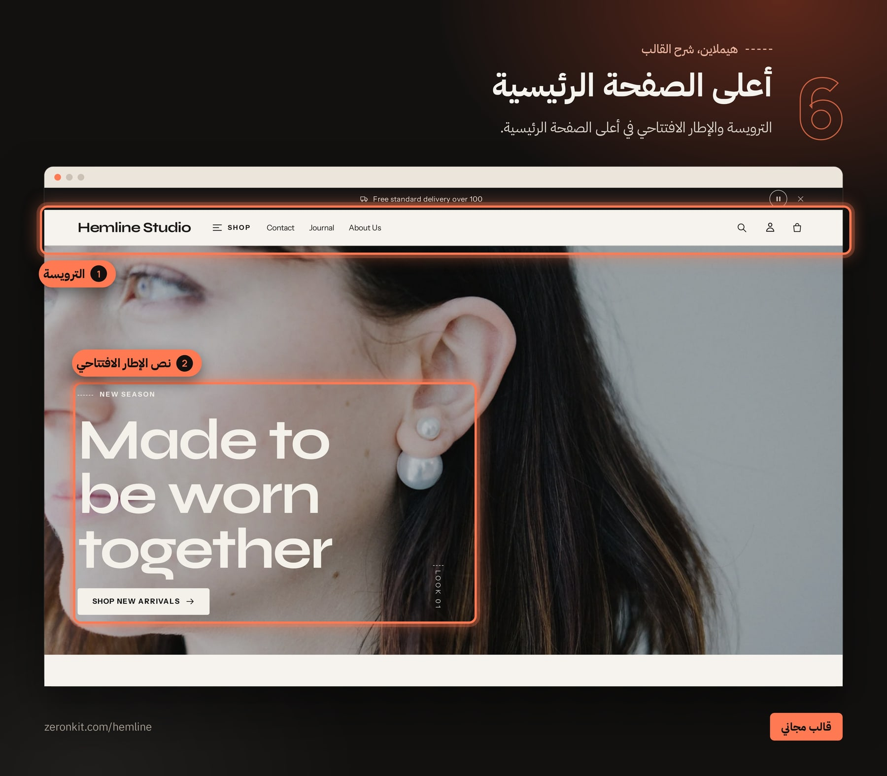](images/sf-home-hero-ar.jpg)

### 6.1 Opening frame (الإطار الافتتاحي)

صورة أو فيديو كبير مع نص فوقه.

- ‏`Image`: الصورة الرئيسية.
- ‏`Mobile image`: صورة مختلفة اختيارية للجوال، مثل قصّة طولية.
- ‏`Use image from collection`: يُستخدم عند عدم اختيار صورة.
- ‏`Video`: فيديو قصير صامت يعمل بشكل متكرر، ويحل محل الصورة. يمكن للزائر إيقافه.
- ‏`Load image first`: أبقه مفعّلًا عندما يكون هذا أول قسم في الصفحة، فهو يسرّع ظهور الصفحة.
- ‏`Height`: ‏`Short` أو `Tall` أو `Full screen`.
- ‏`Content position`: ‏`Bottom start` أو `Center` أو `Bottom end` أو `Top start`.
- ‏`Image overlay`: يُغمّق الصورة ليسهل قراءة النص.
- ‏`Frame label`: تسمية عمودية صغيرة على الحافة، مثل رقم الإطار في شريط الفيلم. اتركها فارغة لإخفائها.
- ‏`Color scheme`: لون النص ولون الطبقة.

العناصر: `Heading` و `Text` و `Button` و `Group` و `Image` و `Custom Liquid` وعناصر التطبيقات.

تلقائيًا: إذا لم تكن هناك صورة ولا مجموعة ولا فيديو، يستخدم Hemline صورة أول منتج في المتجر.

[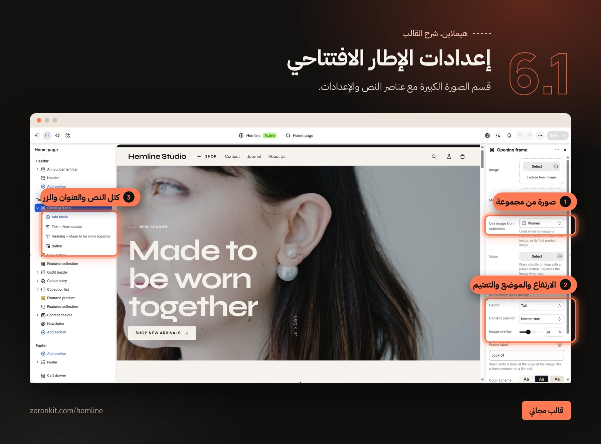](images/section-opening-frame-ar.jpg)

### 6.2 Drop ledger (سجل الإصدار)

يعرض المنتجات الجديدة كقائمة إصدار مرقمة، مع تاريخ عادي ودون عدّاد تنازلي.

- ‏`Drop status`: ‏`Live` يعرض المنتجات. ‏`Upcoming` يعرض نموذج اشتراك بدلًا منها.
- ‏`Drop code`: رمز قصير يظهر بحروف كبيرة مفرّغة، مثل `D/04` أو `SS25`.
- ‏`Heading` و `Release date text` (نص عادي مثل `14 March`) و `Text`.
- ‏`Collection`: رتّب هذه المجموعة من الأحدث إلى الأقدم. إذا تركتها فارغة يعرض أحدث منتجات المتجر كله.
- ‏`Products to show` و `Columns on desktop`.
- ‏`Color scheme`.

[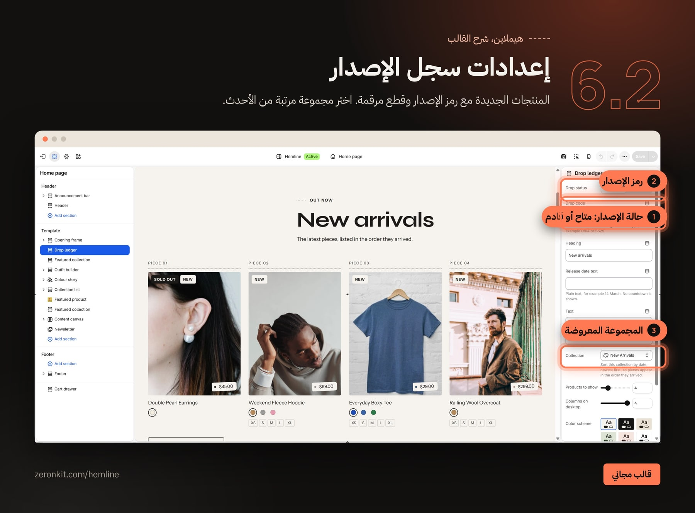](images/section-drop-ledger-ar.jpg)

[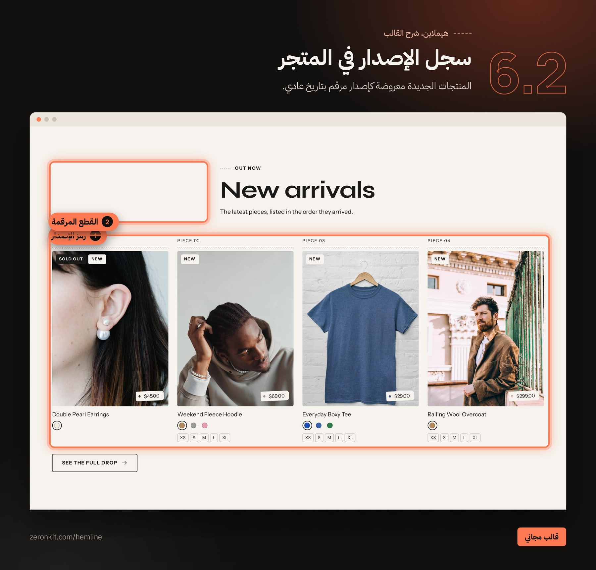](images/sf-drop-ledger-ar.jpg)

### 6.3 Featured collection (مجموعة مميزة)

شبكة أو صف قابل للتمرير من المنتجات.

- ‏`Eyebrow text`: سطر صغير فوق العنوان.
- ‏`Heading`.
- ‏`Collection`. إذا كانت فارغة يعرض أحدث منتجات المتجر.
- ‏`Products to show` و `Columns on desktop`.
- ‏`Layout`: ‏`Grid` أو `Scrolling row`.
- ‏`Show arrows on the scrolling row`: زرّا السابق والتالي. يظهران فقط عندما يكون في الصف منتجات أكثر مما تتسع له الشاشة.
- ‏`Show View all link`.
- ‏`Color scheme`.

[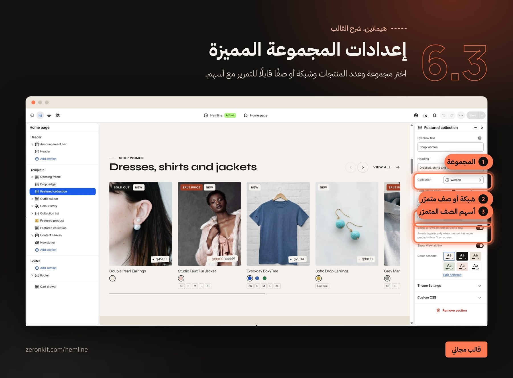](images/section-featured-collection-ar.jpg)

[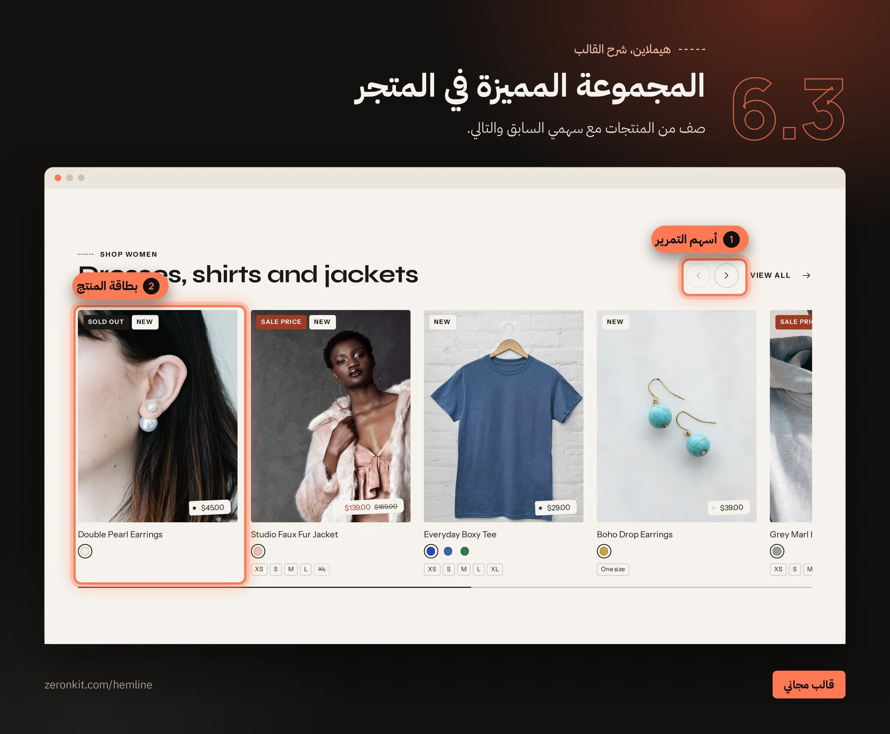](images/sf-featured-collection-ar.jpg)

### 6.4 Outfit builder (منسّق الإطلالة)

يختار الزائر قطعة واحدة من كل صف، ويحدد المقاسات، ويرى المجموع، ثم يضيف الإطلالة كلها إلى السلة بضغطة واحدة.

إعدادات القسم:

- ‏`Eyebrow text` و `Heading` و `Text`.
- ‏`Button label`: مثل `Add the look to cart`.
- ‏`Color scheme`.

العناصر: عنصر `Outfit row` لكل نوع من القطع.

- ‏`Row label`: مثل `Top` و `Bottom` و `Shoes` و `Accessory`.
- ‏`Products`: حتى 8 منتجات.
- ‏`Always include this row`: يخفي خيار استبعاد هذا الصف.

تلقائيًا: الصف الذي ليس فيه منتجات يمتلئ بمنتجات يطابق نوعها أو وسومها أو اسمها اسم الصف. مثلًا `Shoes` يجد الأحذية الرياضية والجزم وأحذية أوكسفورد. وتُستبعد المنتجات النافدة.

[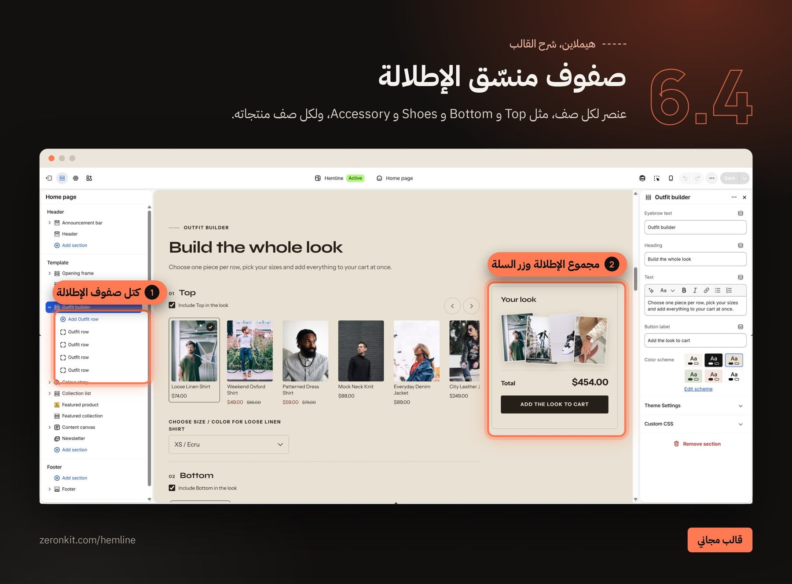](images/section-outfit-builder-ar.jpg)

[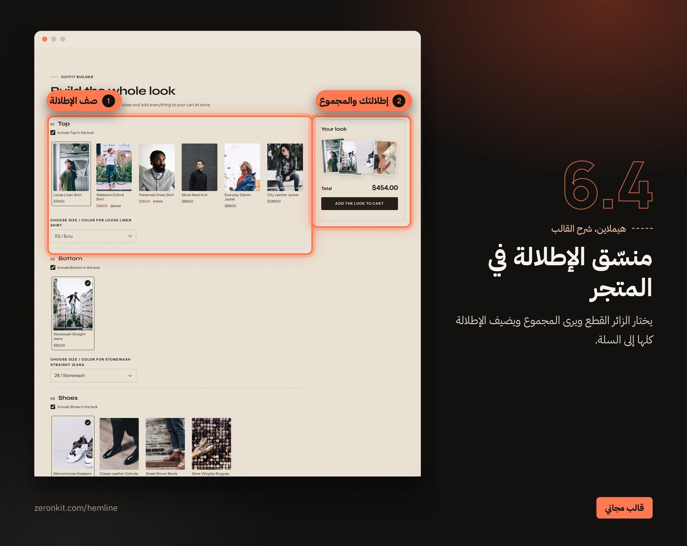](images/outfit-builder-storefront-ar.jpg)

### 6.5 Colour story (قصة الألوان)

يتيح للزوار التصفح حسب اللون.

- ‏`Eyebrow text` و `Heading`.
- ‏`Collection for colour chips`: يعرض Hemline كل لون موجود في هذه المجموعة كقرص. وكل قرص يفتح المجموعة مصفّاة بذلك اللون. إذا كانت فارغة يستخدم كل المنتجات.
- ‏`Color scheme`.

العناصر: `Palette`.

- ‏`Palette name` و `Short note`.
- من `Colour 1` إلى `Colour 4`: أشرطة الألوان.
- ‏`Image`: صورة اختيارية.
- ‏`Collection` أو `Custom link`. إذا تُركا فارغين تُستخدم مجموعات المتجر بالترتيب.

أقراص الألوان تحتاج إلى عامل تصفية للون في تطبيق Search & Discovery.

[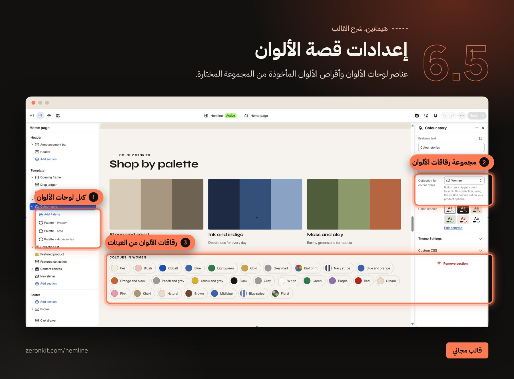](images/section-colour-story-ar.jpg)

[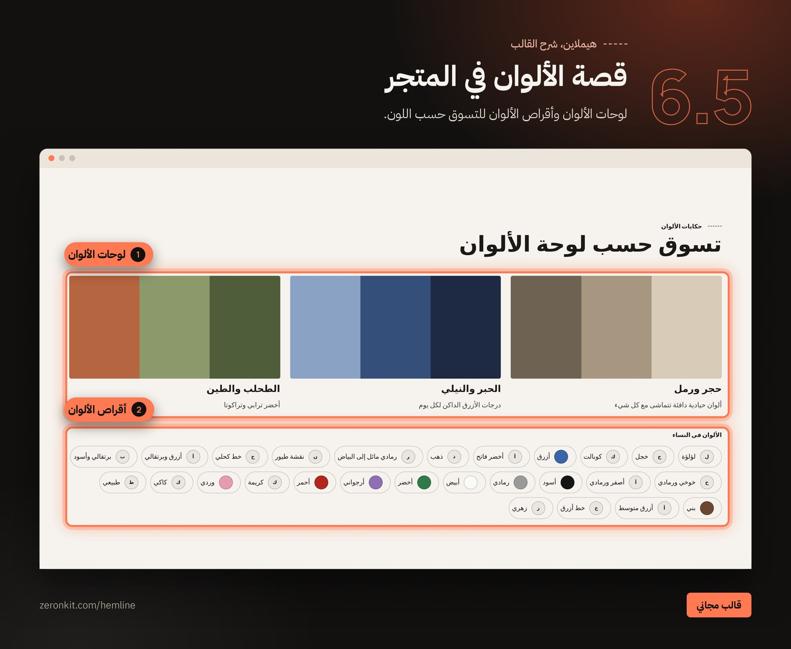](images/sf-colour-story-ar.jpg)

### 6.6 Collection list (قائمة المجموعات)

- ‏`Heading` و `Columns on desktop` و `Color scheme`.
- العناصر: `Collection`. اختر مجموعة واحدة لكل عنصر.

تلقائيًا: العناصر الفارغة تعرض مجموعاتك التي فيها منتجات بالترتيب. والمجموعة التي ليس لها صورة تعرض صورة أول منتج فيها.

[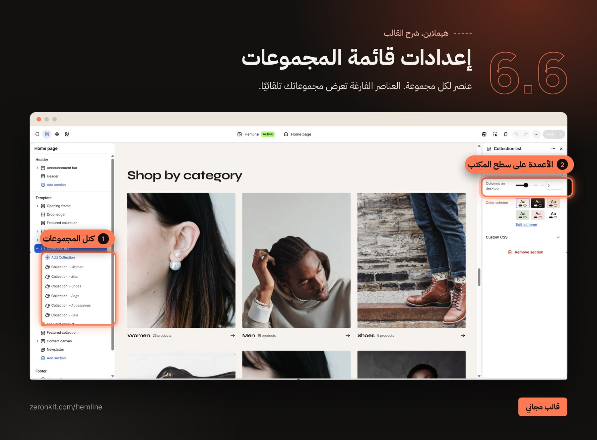](images/section-collection-list-ar.jpg)

[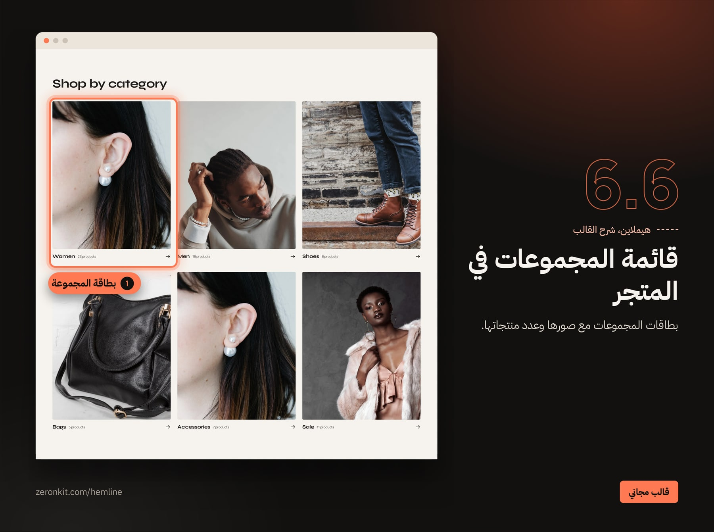](images/sf-collection-list-ar.jpg)

### 6.7 Featured product (منتج مميز)

- ‏`Product`. إذا كان فارغًا يعرض أول منتج متوفر.
- ‏`Eyebrow text` و `Media to show` و `Show accelerated checkout buttons` و `Color scheme`.

يمكن للزائر اختيار اللون والمقاس والإضافة إلى السلة دون مغادرة الصفحة.

[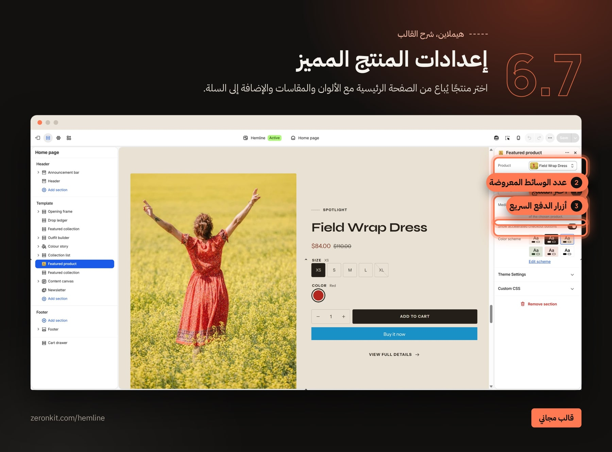](images/section-featured-product-ar.jpg)

[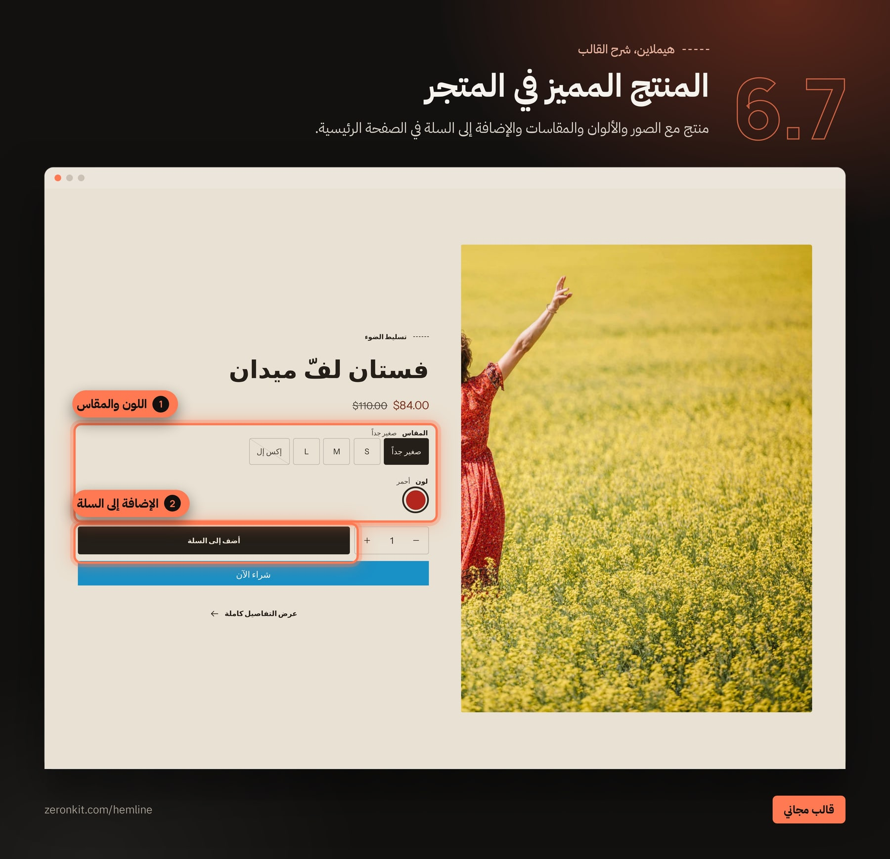](images/sf-featured-product-ar.jpg)

### 6.8 مساحة المحتوى، والنص المنسّق، والصورة مع النص

‏`Content canvas` قسم حر للنصوص والصور. تعرضه قائمة `Add section` مرتين: باسم `Rich text` وباسم `Image with text`.

- ‏`Layout`: ‏`Stacked` أو `Two columns`.
- ‏`Spacing` و `Narrow content` و `Color scheme`.

العناصر (عناصر القالب، وتعمل في عدة أقسام):

- ‏`Heading`: النص، و `Size` ‏(`Extra large` و `Large` و `Medium` و `Small`)، و `HTML tag`، و `Alignment`.
- ‏`Text`: نص منسّق مع `Style` ‏(`Body` و `Large` و `Small` و `Eyebrow`) و `Alignment`.
- ‏`Button`: ‏`Button label` و `Link` و `Style` ‏(`Solid` و `Outline` و `Text link`) و `Show arrow`.
- ‏`Image`: ‏`Image` و `Use image from collection` و `Image ratio` و `Width` و `Caption`. إذا كانت فارغة تُستخدم صورة منتج من المتجر.
- ‏`Group`: يضم عناصر أخرى. ‏`Direction` ‏(`Vertical` أو `Horizontal`) و `Alignment` و `Spacing` و `Use its own color scheme`.
- ‏`Custom Liquid`: لمقتطفات الشيفرة الصغيرة.

[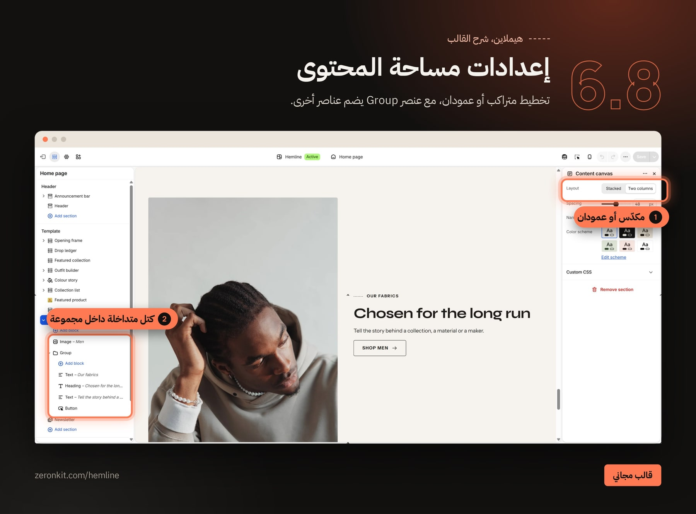](images/section-content-canvas-ar.jpg)

### 6.9 Newsletter (النشرة البريدية)

- ‏`Heading` و `Text` و `Color scheme`.
- يُضاف المشتركون إلى `Customers` مع الوسم `newsletter`.

### 6.10 Contact form (نموذج التواصل)

يمكن إضافته إلى أي صفحة، ومنها الصفحة الرئيسية. انظر القسم 9.5.

### 6.11 Apps و Custom Liquid

- ‏`Apps`: يضم عناصر التطبيقات المثبتة.
- ‏`Custom Liquid`: لمقتطفات الشيفرة الصغيرة.

---

## 7. صفحات المجموعات والبحث

### 7.1 صفحة المجموعة (Product grid)

افتح مجموعة في المحرر: اختر `Collections` > `Default collection` من قائمة الصفحات في الأعلى.

- ‏`Show collection description` و `Show collection image`.
- ‏`Products per page`: من 8 إلى 48.
- ‏`Pagination`:
  - ‏`Numbered pages`: أرقام الصفحات في الأسفل.
  - ‏`Load more button`: زر يضيف المنتجات التالية إلى الصفحة نفسها، ويعرض "Showing 24 of 120".
  - ‏`Infinite scroll`: تُحمَّل المنتجات التالية تلقائيًا أثناء التمرير.
- ‏`Let shoppers choose how many products to show`: يضيف اختيار `Show` بقيم 12 و24 و36 و48 في الصفحة. يُحفظ الاختيار طوال الزيارة.
- ‏`Columns on desktop` و `Columns on mobile`.
- ‏`Enable filtering`: يعرض زر `Filter`. تأتي عوامل التصفية من تطبيق Search & Discovery.
- ‏`Show colour bar`: يعرض عامل تصفية اللون كصف من أقراص الألوان فوق المنتجات.
- ‏`Enable sorting`.
- ‏`Color scheme`.

### 7.2 صفحة البحث

- حقل بحث كبير مع اقتراحات فورية مجمّعة: اقتراحات ومنتجات ومجموعات وصفحات ومقالات. استخدم أسهم لوحة المفاتيح للتنقل بينها.
- قبل البحث: عمليات بحث شائعة، وعمليات البحث الأخيرة (تُحفظ في متصفح الزائر فقط، مع زر `Clear`)، والمنتجات الجديدة.
- بعد البحث: تبويبات `All` و `Products` و `Articles` و `Pages`، والمجموعات المطابقة كأقراص، وعوامل التصفية والترتيب للمنتجات.
- عند عدم وجود نتائج: تلميح عن الإملاء، وعمليات بحث شائعة، ومنتجات مقترحة.

إعدادات `Search results`:

- ‏`Products per page` و `Pagination` و `Let shoppers choose how many products to show` و `Columns on desktop` و `Enable filtering` و `Enable sorting`.
- ‏`Suggested collection when nothing is found`. إذا كانت فارغة تُعرض أحدث المنتجات.
- ‏`Color scheme`.

تُضبط عمليات البحث الشائعة في `Theme settings` > `Search`.

---

## 8. صفحة المنتج

افتح منتجًا في المحرر: `Products` > `Default product`.

### 8.1 إعدادات القسم (Product information)

- ‏`Color scheme`.
- ‏`Gallery layout`: ‏`Contact sheet` (صورة أولى كبيرة ثم عمودان) أو `Single column`.
- ‏`Keep product details in view while scrolling`.
- ‏`Show only the selected colour's images`: يعرض المعرض صور اللون المختار فقط. انظر 3.2 و 3.3.

### 8.2 المعرض والعرض المكبّر

1. الصور مرقمة مثل إطارات ورقة التلامس في التصوير، مثل `01 / 04`.
2. عندما يختار الزائر لونًا، يعرض المعرض صور ذلك اللون ويبدأ الترقيم من جديد.
3. الضغط على صورة يفتح عرضًا مكبّرًا بملء الشاشة. يمكن للزائر السحب أو استخدام أزرار الأسهم أو أسهم لوحة المفاتيح، والإغلاق بزر Esc.
4. الفيديو والنماذج ثلاثية الأبعاد لا تُحمَّل إلا عندما يضغط الزائر تشغيل. وتوفر النماذج ثلاثية الأبعاد خيار `View in your space` على الهواتف المدعومة.
5. ملاحظات العارض من `hemline.model_info` تظهر تحت كل صورة.

### 8.3 العناصر

أضف هذه العناصر واحذفها وغيّر ترتيبها:

- ‏`Title`: ‏`Show vendor`.
- ‏`Price`: يعرض سعر التخفيض وسعر الوحدة وملاحظة الضريبة وملاحظة الشحن.
- ‏`Variant picker`: ‏`Style` يكون `Buttons` أو `Dropdown`. خيارات اللون تظهر كعينات ألوان. لون العينة يأتي من إعدادات العينات في Shopify على قيمة الخيار. إذا لم يُضبط، يعرف Hemline أسماء الألوان الشائعة بالإنجليزية والفرنسية والإسبانية والألمانية والعربية. وتأخذ النقوش مثل المخطط والمطبوع والزهري نقشًا صغيرًا.
- ‏`Fit and size guide`:
  - ‏`Size guide page`: تُفتح في درج جانبي.
  - ‏`Default model note`: تظهر عندما لا تكون للمنتج ملاحظات عارض.
  - يظهر مقياس القصّة عند ضبط `hemline.fit`.
  - ترتيب دليل المقاسات: حقل المنتج `hemline.size_guide`، ثم هذا الإعداد، ثم الصفحة ذات المعرّف `size-guide`.
- ‏`Buy buttons`: ‏`Show quantity selector` و `Show accelerated checkout buttons` ‏(Shop Pay و Apple Pay وغيرها) و `Show pickup availability`. تظهر خيارات الاشتراك ورسالة الدفع بالتقسيط من Shop Pay تلقائيًا عند توفرها.
- ‏`Description`.
- ‏`Collapsible tab`: انظر 8.4.
- ‏`Complementary products`: ‏`Heading` و `Products to show`. تُختار المنتجات في تطبيق Search & Discovery.
- ‏`Text`: ملاحظة قصيرة، مثل المساعدة في اختيار المقاس.
- ‏`Custom Liquid` وعناصر التطبيقات.

### 8.4 التبويبات القابلة للطي ومصادر المحتوى

لكل عنصر `Collapsible tab`:

- ‏`Heading`: عنوان التبويب.
- ‏`Content source`:
  - ‏`Automatic, from the heading`: يختار Hemline المصدر من كلمات العنوان.
  - ‏`Materials and care`: حقلا المنتج `hemline.materials` (أو `custom.material`) و `hemline.care`، ثم قسما Materials و Care في الوصف، ثم نصك، ثم نص افتراضي.
  - ‏`Shipping and returns`: نصك، ثم قسم Shipping في الوصف، ثم نص افتراضي. وتُضاف روابط سياسة الشحن وسياسة الاسترداد.
  - ‏`Fit`: ‏`hemline.fit_notes`، ثم قسم Fit في الوصف، ثم نصك، ثم نص افتراضي.
  - ‏`Custom text only`: نصك وصفحتك فقط.
- ‏`Content`: نصك الخاص للتبويب.
- ‏`Page content`: يضيف محتوى صفحة.

لا يظهر أي تبويب فارغًا أبدًا. اقرأ النص الافتراضي للشحن والإرجاع وغيّره إن لم يناسب متجرك.

### 8.5 Related products (منتجات ذات صلة)

يعرض قسم `Related products` تحت المنتج منتجات تختارها Shopify تلقائيًا.

- ‏`Heading` و `Products to show` و `Columns on desktop` و `Color scheme`.

### 8.6 توفر الاستلام

إذا كنت تستخدم الاستلام المحلي، يعرض صندوق الشراء أين يمكن استلام المقاس المختار اليوم. اضبطه في `Settings` > `Shipping and delivery` > `Local pickup`.

---

## 9. صفحات أخرى

### 9.1 درج السلة وصفحة السلة

1. عندما يكون `Cart type` على `Drawer`، تُفتح السلة كلوحة جانبية بعد إضافة منتج.
2. يمكن للزائر تغيير الكميات وحذف المنتجات في الدرج وفي صفحة السلة.
3. تظهر الخصومات لكل منتج وللطلب كله. وتظهر أسماء الاشتراكات تحت كل منتج.
4. تظهر أزرار الدفع السريع تحت زر الدفع عندما تكون مضبوطة.
5. في صفحة السلة ملاحظة طلب اختيارية (`Theme settings` > `Cart` > `Enable order note`).

### 9.2 صفحة بطاقة الهدايا

يرى العملاء هذه الصفحة عندما تصلهم بطاقة هدايا. تعرض الرصيد، والرمز مع زر نسخ، ورمز QR، وزر `Add to Apple Wallet`، وشعارك أو اسم متجرك. لا إعدادات لها في المحرر. يأتي الشعار من `Theme settings` > `Brand assets`.

### 9.3 صفحة 404

تظهر عندما تكون الصفحة غير موجودة. فيها رسم لبطاقة ملابس تتأرجح، وحقل بحث، وروابط لمجموعات شائعة، وصف من المنتجات. في المحرر: `Others` > `404 page`. الإعدادات: `Heading` و `Color scheme`.

### 9.4 المدونة والمقالات

- ‏`Blog posts`: ‏`Posts per page` و `Color scheme`. تظهر الوسوم كأقراص تصفية.
- ‏`Blog post`: ‏`Show author` و `Color scheme`. تظهر التعليقات عندما تكون مفعّلة للمدونة في لوحة الإدارة.

### 9.5 الصفحات ونموذج التواصل

الصفحات العادية تعرض عنوان الصفحة ومحتواها.

صفحة التواصل تستخدم القالب `page.contact`. تعرض محتوى الصفحة ثم قسم `Contact form`.

1. في لوحة الإدارة أنشئ صفحة باسم Contact واختر القالب `contact` (أو أعطها المعرّف `contact`).
2. في المحرر افتح `Pages` > `Contact`.

إعدادات `Contact form`:

- ‏`Show contact form`: تشغيل النموذج أو إيقافه.
- ‏`Heading` و `Intro text` و `Button label` و `Success message`.
- ‏`Layout`: ‏`Form only` أو `Form and information column`.
- عمود المعلومات الجانبي: `Contact email` و `Opening hours` و `Address` و `Links menu`.
- ‏`Color scheme`.

عناصر الحقول. أضفها واحذفها وغيّر ترتيبها. لكل منها `Label` و `Placeholder` و `Required` و `Width` ‏(`Half width` أو `Full width`):

- ‏`Name field` و `Email field` و `Phone field` و `Order number field` و `Topic dropdown` (مع `Topics` تفصل بينها فواصل) و `Message field` و `Consent checkbox` (مع `Consent text`).

حقل البريد الإلكتروني مطلوب دائمًا لتتمكن Shopify من إرسال الرسالة. تصل الرسائل إلى بريد المرسل الخاص بمتجرك (`Settings` > `Notifications` > `Sender email`). وتحمي Shopify النموذج من الرسائل المزعجة.

### 9.6 صفحة كلمة المرور

تظهر عندما يكون لمتجرك كلمة مرور (`Online Store` > `Preferences` > `Password protection`). تعرض رسالتك، واشتراكًا اختياريًا في النشرة، وحقلًا لكلمة المرور. الإعدادات: `Show newsletter sign-up` و `Color scheme`.

---

## 10. مجموعة التذييل

اضغط على التذييل في المحرر أو اختر `Footer` من الشريط الجانبي.

الإعدادات:

- ‏`Layout`: ‏`Columns` أو `Brand and columns` (اسم المتجر ونص في جهة البداية) أو `Centred`.
- ‏`Show store name` و `Text under the store name`.
- ‏`Color scheme`.
- ‏`Show social icons`: يستخدم الروابط من `Theme settings` > `Social media`.
- ‏`Show Follow on Shop`: زر متابعة في تطبيق Shop. يحتاج إلى تفعيل Shop Pay.
- ‏`Show country/region selector` و `Show language selector`.
- ‏`Show payment icons`: أيقونات طرق الدفع التي تقبلها.
- ‏`Show policy links`: يعرض كل سياسة كتبتها في `Settings` > `Policies`: الخصوصية والشروط والاسترداد والشحن ومعلومات التواصل.
- ‏`Show Powered by Shopify`.

العناصر:

- ‏`Menu`: ‏`Heading` و `Menu`. إذا كانت القائمة فارغة يستخدم `Footer menu`، ثم صفحاتك الشائعة والمدونة.
- ‏`Text`: ‏`Heading` و `Text`.
- ‏`Newsletter`: ‏`Heading` و `Text`. الحقل بالعرض الكامل والزر أسفله.
- عناصر التطبيقات.

عبارة `Theme by ZeronKit` تُشغَّل أو تُوقف من `Theme settings` > `Theme credit`.

---

## 11. اللغات والعربية والكتابة من اليمين إلى اليسار

### 11.1 إضافة لغة

1. افتح `Settings` > `Languages` واضغط `Add language`.
2. اختر اللغة، مثل العربية، وانشرها عندما تكون الترجمة جاهزة.
3. ثبّت تطبيق Translate & Adapt المجاني لترجمة المنتجات والمجموعات والصفحات والقوائم ونصوص القالب. يمكنه الترجمة تلقائيًا.

### 11.2 ما يترجمه القالب بنفسه

- كل نصوص القالب، مثل `Add to cart` وأسماء عوامل التصفية ورسائل السلة وتسميات النماذج، تأتي بترجمة إنجليزية وعربية.
- محرر القالب نفسه مترجم إلى العربية أيضًا.
- صيغ الجمع تتبع قواعد كل لغة.

### 11.3 الكتابة من اليمين إلى اليسار

مع العربية والعبرية والفارسية والأردية يقوم Hemline بما يلي:

1. يضبط اتجاه الصفحة من اليمين إلى اليسار.
2. يقلب التصميم: القوائم والأدراج والشريط الجانبي والأسهم والصفوف المتحركة وبطاقة السعر.
3. يستخدم خطًا يدعم الحروف العربية عندما لا يحتوي الخط المختار عليها. أو اختر `Style` > `Font pairing` > `Arabic friendly`.

### 11.4 أسماء الألوان في اللغات الأخرى

عندما يترجم Translate & Adapt قيم الخيارات، تبقى عينات الألوان تعرض اللون الصحيح. يعرف Hemline كلمات الألوان الشائعة بالعربية والفرنسية والإسبانية والألمانية. وللحصول على ألوان دقيقة، اضبط لون العينة على قيمة الخيار في لوحة الإدارة، فهو يعمل في كل اللغات.

---

## 12. الأداء وإمكانية الوصول والمساعدة

### 12.1 الأداء

- ملف برمجي رئيسي واحد صغير. الملفات الأخرى تُحمَّل فقط في الصفحات التي تحتاجها.
- تُحمَّل الصور بالحجم المناسب لكل شاشة، والصور الأبعد في الصفحة تُحمَّل عند الوصول إليها.
- الفيديو والنماذج ثلاثية الأبعاد لا تُحمَّل إلا بطلب الزائر.
- نصائح: استخدم صورًا بعرض 2000 بكسل تقريبًا، وأبقِ `Load image first` مفعّلًا للقسم الأول فقط، ولا تُكثر من التطبيقات.

### 12.2 إمكانية الوصول

- كل شيء يعمل بلوحة المفاتيح، والتركيز ظاهر دائمًا.
- للأزرار والحقول تسميات لبرامج قراءة الشاشة.
- تباين النص 4.5:1 أو أعلى في الأنظمة الجاهزة.
- مساحات اللمس 24 بكسل على الأقل، ومعظمها 44 بكسل.
- يمكن إيقاف الأجزاء المتحركة، ولا يتحرك شيء لمن يفضّل تقليل الحركة.

### 12.3 حل المشكلات

1. **عينات الألوان رمادية أو تظهر بحرف.**
   اسم اللون غير معروف. افتح المنتج، واضغط على قيمة خيار اللون، واضبط لون العينة أو صورتها. أو استخدم اسم لون شائعًا مثل navy أو olive أو stone.

2. **عينات الألوان تظهر كأزرار نصية.**
   اسم الخيار غير معروف. أضف اسم خيارك إلى `Theme settings` > `Product cards` > `Colour option names`.

3. **المعرض لا يغيّر الصور عند اختيار لون.**
   أعطِ كل لون صورة خاصة بخياره (3.2) ورتّب الصور حسب اللون. وتأكد أن `Show only the selected colour's images` مفعّل.

4. **المعرض يعرض صورة واحدة فقط للون.**
   صور ذلك اللون ليست متجاورة في بطاقة `Media`، أو صورة خيار اللون التالي تأتي مبكرًا. أعد ترتيب الصور.

5. **الصفحة الرئيسية فارغة أو تعرض صورًا بديلة.**
   لا توجد منتجات في المتجر بعد، أو المنتجات غير متاحة في قناة البيع Online Store. تمتلئ الأقسام تلقائيًا عند وجود منتجات.

6. **قائمة الترويسة فارغة.**
   إعداد `Menu` يشير إلى قائمة فارغة. املأ `Main menu` في `Online Store` > `Navigation`، أو اتركها فارغة لاستخدام التنقل التلقائي.

7. **أرى "Shop" مرتين في الترويسة.**
   أول عنصر في قائمتك يكرر زر التسوق. فعّل `Hide the first menu item`، أو غيّر اسم زر التسوق.

8. **عوامل التصفية لا تظهر في صفحات المجموعات.**
   ثبّت Search & Discovery وأضف عوامل التصفية في `Filters`. وتأكد أن `Enable filtering` مفعّل.

9. **شريط الألوان لا يظهر.**
   تحتاج إلى عامل تصفية للون في Search & Discovery، وإلى تفعيل `Show colour bar`.

10. **رابط دليل المقاسات لا يظهر.**
    اختر صفحة في عنصر `Fit and size guide`، أو اضبط `hemline.size_guide` على المنتج، أو أنشئ صفحة بالمعرّف `size-guide`.

11. **تبويب الشحن والإرجاع يذكر إرجاعًا مجانيًا لا أقدّمه.**
    اكتب نصك في إعداد `Content` للتبويب، أو أضف قسم Shipping and returns إلى وصف المنتج.

12. **نموذج التواصل لا يرسل.**
    تحقق من `Settings` > `Notifications` > `Sender email`، وتحقق من مجلد الرسائل المزعجة.

13. **أزرار الدفع السريع لا تظهر.**
    فعّل Shop Pay أو Apple Pay أو غيرها في `Settings` > `Payments`، وتحقق من إعداد `Show accelerated checkout buttons`.

14. **الصفحة العربية تظهر من اليسار إلى اليمين.**
    يجب أن تكون اللغة العربية منشورة في `Settings` > `Languages`، وأن يحتوي الرابط على `/ar`. عندها يقلب Hemline التصميم بنفسه.

15. **صور المجموعات لا تظهر في القائمة.**
    أضف صورة للمجموعة. إذا لم تكن لها صورة يستخدم Hemline صورة أول منتج، لذلك يجب أن يكون في المجموعة منتج واحد على الأقل له صورة.

16. **اختيار "Show" في صفحات المجموعات لا يعمل.**
    يحتاج إلى JavaScript وإلى سلة تعمل. امسح ذاكرة المتصفح المؤقتة وحاول مرة أخرى.

17. **الحركة أكثر من اللازم.**
    اضبط `Theme settings` > `Style` > `Animations` على `Subtle` أو `Off`.

18. **التحديث أزال تعديلاتي.**
    القوالب المرفوعة تبدأ من جديد، ونسختك القديمة ما زالت تحتفظ بإعداداتك. انسخ القالب دائمًا قبل التحديث (2.4).

### 12.4 الدعم

- الدعم بأفضل جهد ممكن وعند الطلب فقط، وهو غير مضمون.
- التواصل: info@zeronkit.com.
- تصدر التحديثات عند الحاجة وعندما يسمح الوقت، دون جدول محدد.

### 12.5 سجل التغييرات

**1.1.0**

- ستة تخطيطات للترويسة، منها شريط جانبي، مع خيارات موضع الشعار والشعار النصي.
- لوحة تسوق جديدة مع صور مصغرة للمجموعات.
- شريط إعلانات بأوضاع ثابت وتلاشٍ وشريط متحرك.
- إعدادات النمط: لوحات ألوان، وأنماط خلفية، وتنسيقات خطوط، وزوايا، وأزرار، وأنماط بطاقات، ومسافات، وحركة.
- ستة أنظمة ألوان وأربعة أنماط للقالب.
- معرض منتج مصفّى حسب اللون مع عرض مكبّر، وتغيير اللون على بطاقات المنتجات.
- صفحة بحث مع اقتراحات وعمليات بحث شائعة وأخيرة وتبويبات وحالة مفيدة عند عدم وجود نتائج.
- زر تحميل المزيد والتمرير اللانهائي واختيار عدد المنتجات في صفحات المجموعات والبحث.
- تبويبات منتج لا تظهر فارغة أبدًا.
- نموذج تواصل قابل للتخصيص.
- صفحة 404 مصممة.
- عينات ألوان وأسماء خيارات تعمل بالإنجليزية والفرنسية والإسبانية والألمانية والعربية.
- ترخيص جديد: مجاني لمتجرك، وليس للبيع أو إعادة التوزيع.

**1.0.0**

- الإصدار الأول.

