# Hemline theme guide

Version 1.1.0. Made by ZeronKit (https://zeronkit.com).

This guide explains every part of the Hemline theme: how to install it, how to prepare your store content, and what every setting does. Labels in `code style` are the exact labels you see in the Shopify theme editor.

---

## 1. What Hemline is

Hemline is a free Shopify theme for clothing, shoes, bags and accessories. It also suits kids, sport and pet clothing.

It is built on Shopify Online Store 2.0. That means:

- Every page is made of sections that you can add, remove and reorder in the theme editor.
- The header and footer are section groups, so they can hold more than one section.
- Many sections accept blocks, and some blocks can hold other blocks.
- Apps that offer "app blocks" can be added without editing code.

### Licence summary

- Hemline is free to use and to change on stores that you own or run.
- It is not for resale or redistribution. Do not sell it, share it, upload it to theme marketplaces or present it as your own work.
- Copyright, author and signature notices must stay in the files.
- It is provided as is, with no warranty. The full text is in the `LICENSE` file in the download.

### Requirements

1. A Shopify store on any plan that allows custom themes.
2. Products with photos. Clothing works best with a `Size` option and a `Color` option.
3. For filters on collection and search pages: the free Shopify app Search & Discovery.
4. For more than one language: the free Shopify app Translate & Adapt.

Hemline does not need any other app.

---

## 2. Installing and updating

### 2.1 Download the theme

1. Go to https://zeronkit.com/themes/ and download the Hemline zip file. Do not unzip it.

### 2.2 Upload the theme

1. In Shopify admin, open `Online Store` and then `Themes`.
2. At the top of the page, click `Import` and choose `Upload zip file`.
3. Select the Hemline zip file and click `Upload file`.
4. Wait until Hemline appears in the theme library.

[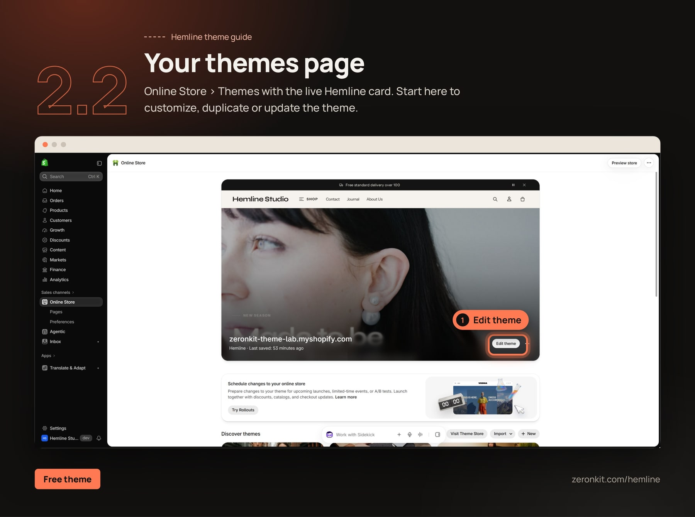](images/themes-page-en.jpg)

[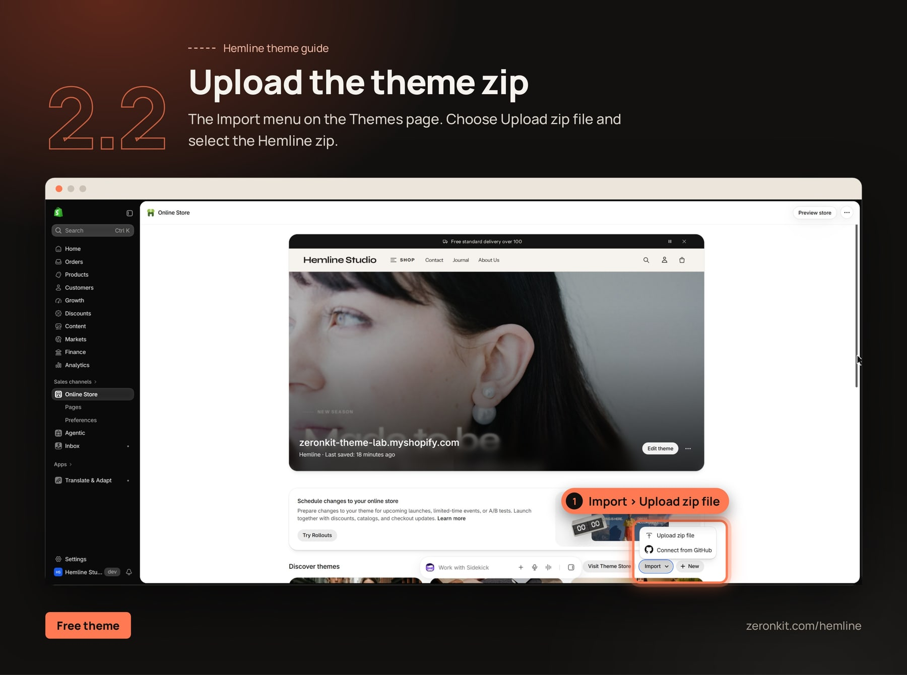](images/install-upload-zip-en.jpg)

### 2.3 Preview and publish

1. In the theme library, find Hemline and click `Customize` to open the theme editor.
2. Check the home page, a collection, a product and the cart.
3. When you are happy, go back to `Themes`. In the theme library, open the `...` menu next to Hemline and click `Publish`. The live theme has no `Publish` item, only the themes in the library have it.

### 2.4 Updating safely

Themes uploaded as a zip file do not update by themselves. To update:

1. Download the new version from https://zeronkit.com/themes/.
2. In `Themes`, open the `...` menu of your current Hemline and click `Duplicate`. This keeps a full backup of your settings and content.
3. Upload the new zip file as described in 2.2.
4. Open the new copy in the editor and check your pages. Your sections and settings are stored in the old copy, so set up the new copy again or copy your choices across.
5. Publish the new copy only when every page looks right.

[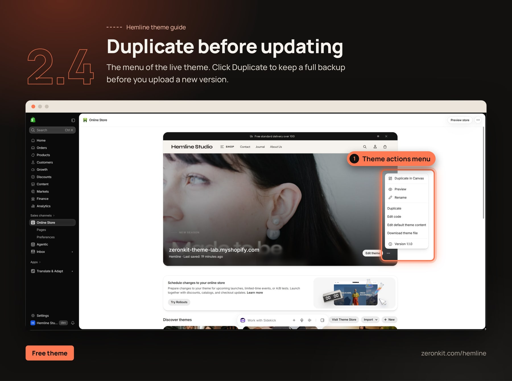](images/update-duplicate-en.jpg)

---

## 3. Preparing your store content

Hemline shows real content as soon as it is installed. The better your products, collections, menus and pages are prepared, the better the store looks.

### 3.1 Products

1. Give clothing an option called `Size` (for example XS, S, M, L, XL) and an option called `Color`.
2. Hemline also recognises the names Colour, Couleur, Farbe, Colore and the Arabic names. You can add more names in `Theme settings` > `Product cards` > `Colour option names` and `Size option names`.
3. Add at least two photos per colour.

[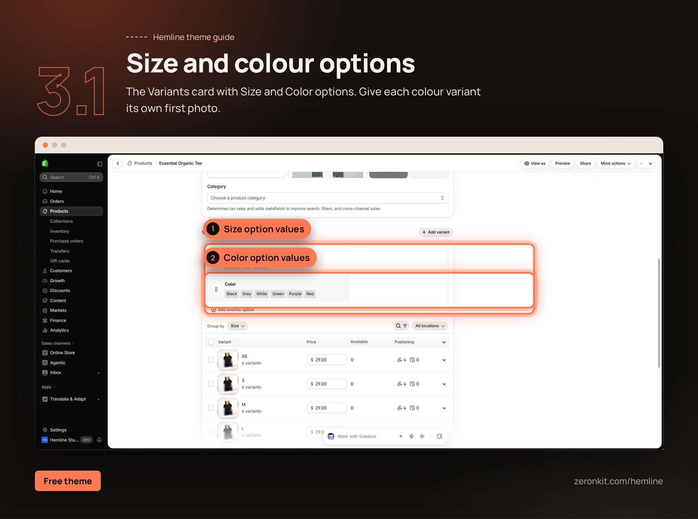](images/product-options-en.jpg)

### 3.2 One featured image per colour variant

This makes the product page show only the photos of the colour the shopper picks.

1. Open the product in Shopify admin.
2. In the `Media` card, order the photos by colour: all photos of the first colour, then all photos of the second colour, and so on.
3. In the `Variants` card, click a variant of the first colour and choose its image: the first photo of that colour.
4. Repeat for every colour. All sizes of one colour can use the same image.

Hemline reads the photo groups like this: a colour's group starts at its variant image and ends just before the next colour's variant image. This works in every language.

### 3.3 Alt text for extra photos

Alt text is the short description of a photo. Hemline uses it as a second way to find a colour's photos, and screen readers read it aloud.

1. Click a photo in the `Media` card and choose `Add alt text`.
2. Write it as "Product title in colour", for example `Linen Shirt in navy`.
3. You can add a note after a comma, a dash or a bracket, for example `Linen Shirt in navy, close-up` or `Linen Shirt in navy (back)`.

### 3.4 Collections

1. Create collections such as Women, Men, Shoes, Bags, Accessories, New Arrivals and Sale.
2. Give each collection an image if you can. Without one, Hemline uses the first product photo of the collection in menus and lists.
3. For the `Drop ledger` section, sort the New Arrivals collection by `Newest`.

### 3.5 Menus

Hemline uses two menus. Find them in `Online Store` > `Navigation`.

1. `Main menu`: the header and the navigator. It can have three levels.
   - Level 1: departments, for example Women, Men, Kids.
   - Level 2: groups or collections, for example Dresses, Shirts.
   - Level 3: extra links under a group.
2. `Footer menu`: help links, for example About us, Size guide, Shipping and returns, Contact.

What Hemline does automatically:

- If the main menu is empty, the header builds its own navigation from your collections, your blog and the pages about-us, faq and contact.
- If a footer menu block has no menu, it uses the `Footer menu`. If that is empty too, it lists your common pages (about-us, contact, faq, size-guide, shipping-and-returns, returns, shipping), your blog and search.
- A first menu item that only repeats the navigator button (for example "Shop" linking to all products) is hidden automatically.

[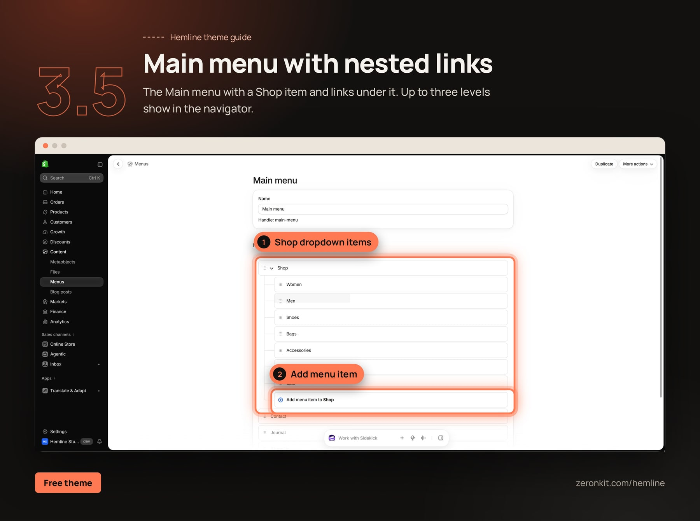](images/menus-main-menu-en.jpg)

### 3.6 Pages with special handles

The handle is the last part of a page web address, for example `/pages/size-guide`. Hemline looks for these handles:

| Handle | What Hemline does with it |
| --- | --- |
| `about-us` | Used in the automatic header and footer navigation. |
| `faq` | Used in the automatic header and footer navigation. |
| `contact` | Shows a working contact form even with the default page template. Used in automatic navigation. |
| `size-guide` | Opens as the size guide drawer on every product page when no other size guide is set. Listed in the automatic footer. |
| `shipping-and-returns` | Listed in the automatic footer. |

[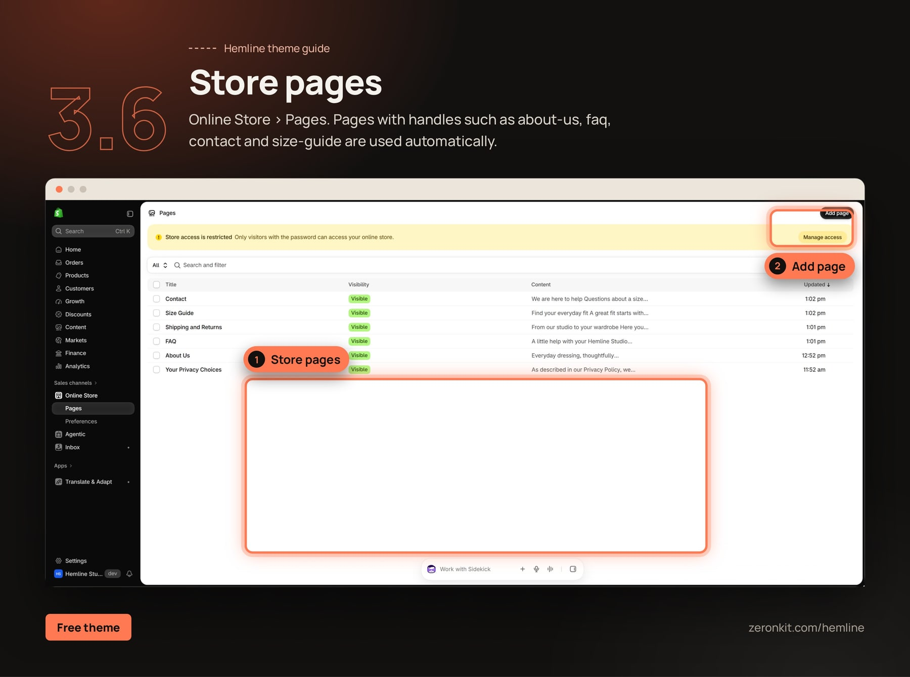](images/pages-list-en.jpg)

[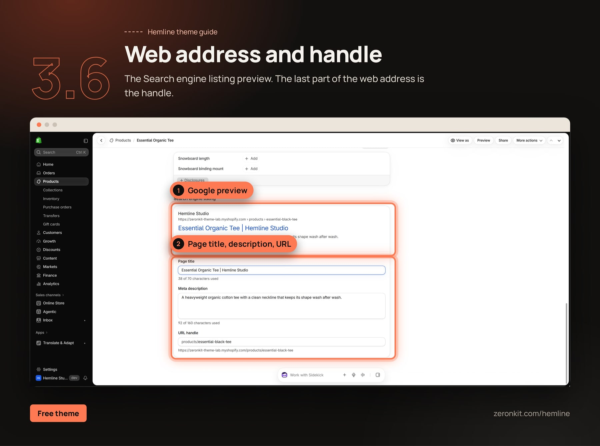](images/product-search-listing-en.jpg)

### 3.7 Metafields

Metafields add extra information to products. Create the definitions once:

1. Open `Settings` > `Custom data` > `Products`.
2. Click `Add definition`.
3. Enter the name, the namespace and key, and the type from the table.
4. Save. The new field appears at the bottom of every product page in admin.

| Namespace and key | Type | What it does | Example |
| --- | --- | --- | --- |
| `hemline.model_info` | Multi-line text | One line per photo, shown under that photo. Line 1 is for photo 1. | `Model is 178 cm and wears M` |
| `hemline.fit` | Single line text | Shows a fit scale. Use exactly one of `runs_small`, `true_to_size`, `runs_large`. | `true_to_size` |
| `hemline.size_guide` | Page reference | The size guide page for this product only. | the page "Shoe sizes" |
| `hemline.materials` | Rich text or multi-line text | Fills the Materials and care tab. Shopify's own `custom.material` also works. | `100% organic cotton` |
| `hemline.care` | Rich text or multi-line text | Shown under "Care" in the same tab. | `Wash at 30°C` |
| `hemline.fit_notes` | Rich text or multi-line text | Fills the Fit tab. | `Relaxed fit through the body` |

[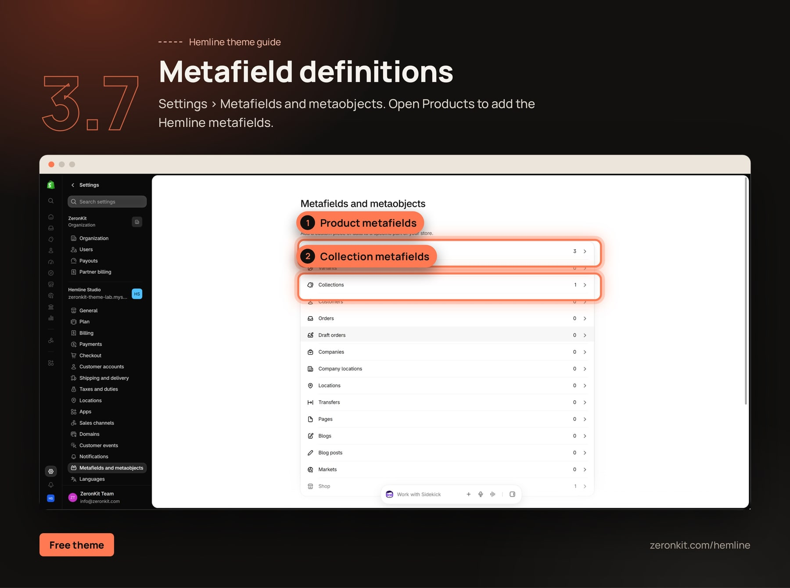](images/custom-data-en.jpg)

[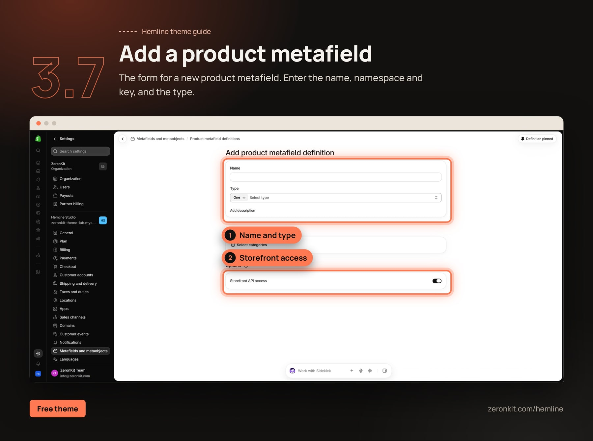](images/metafield-definition-en.jpg)

### 3.8 Description sections

You do not need metafields for tabs. In the product description you can add headings of type `Heading 3` with these words:

- `Materials`, `Care`, `Fit`, `Shipping and returns`

Hemline moves each of these sections into its own tab on the product page. The description area then shows only the introduction and any other headings, for example a `Details` list.

[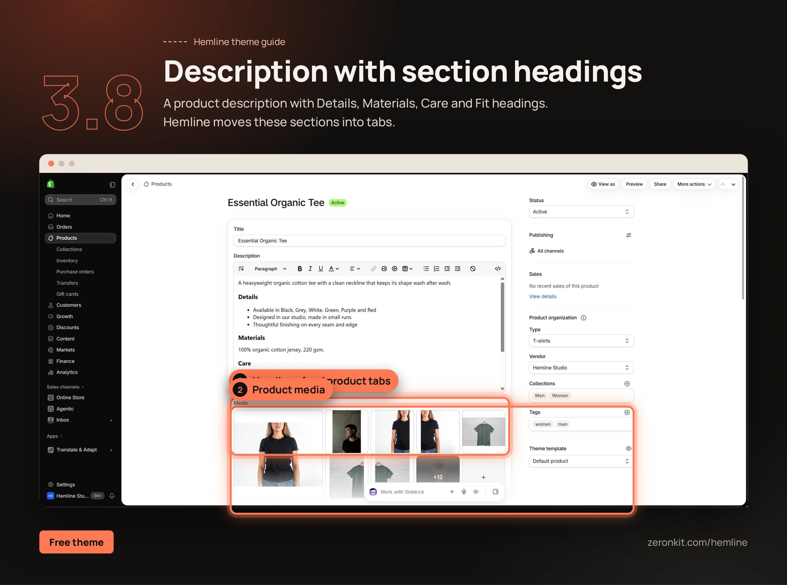](images/product-description-headings-en.jpg)

---

## 4. Theme settings

Open the theme editor and click the gear icon `Theme settings` on the left. The groups appear in this order.

[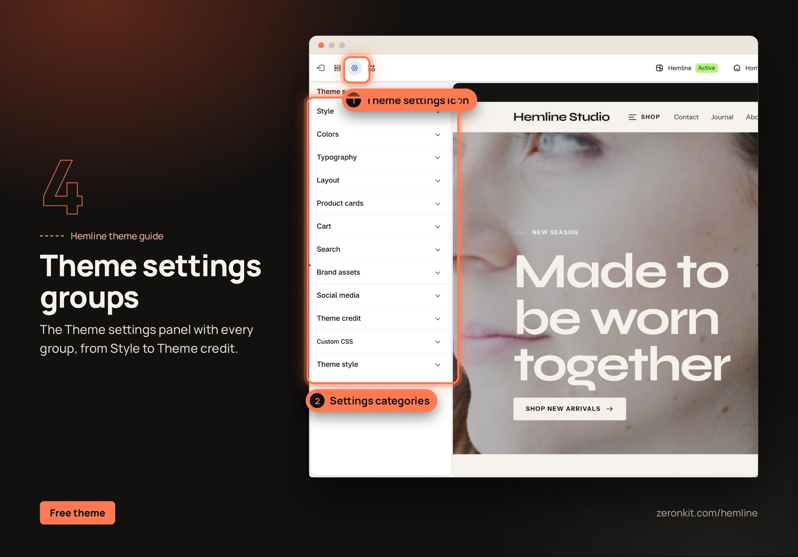](images/theme-settings-list-en.jpg)

### 4.1 Theme style presets

At the top of `Theme settings`, Shopify shows the theme styles. Each style changes many settings at once: colours, fonts, corners, buttons, card style and spacing.

| Style | Look |
| --- | --- |
| `Default` | Warm paper tones, Syne headings, soft corners, hang tag cards. |
| `Track` | Cool white and blue for sport, narrow bold headings, sharp corners, framed cards. |
| `Playground` | Warm cream and green for kids and pets, rounded headings, pill buttons, minimal cards. |
| `Noir` | Dark background, serif headings, outline buttons, text over image cards. |

Choosing a style replaces your current values of those settings. Duplicate the theme first if you want to keep them.

[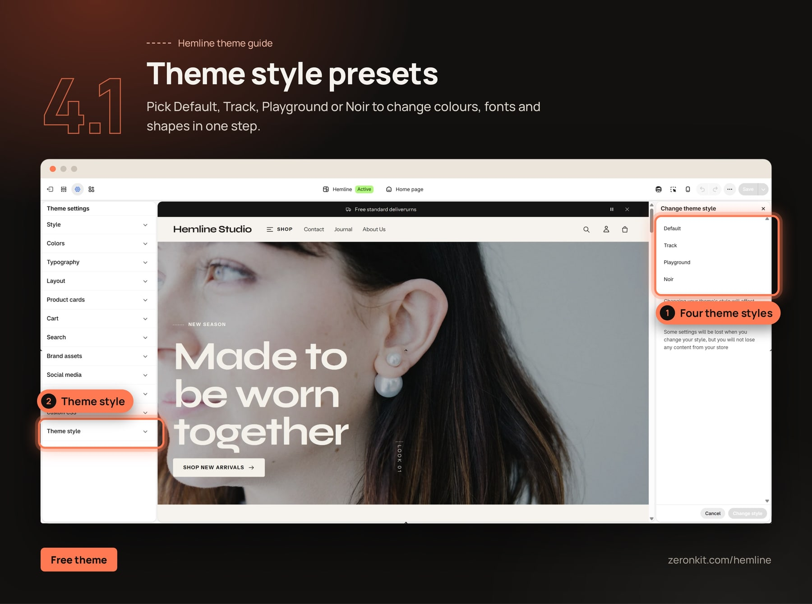](images/theme-styles-en.jpg)

### 4.2 Style

Ready-made choices for the whole store. Pick here first, then fine-tune further down.

- `Palette`: replaces colour schemes 1 and 3 with a ready set. Options: `Custom (use the colour schemes)`, `Paper`, `Ink (dark)`, `Sand`, `Sage`, `Blush`, `High contrast`, `Ocean`, `Terracotta`, `Mono`, `Olive`. Use `Custom` when you want to edit every colour scheme yourself.
- `Background style`:
  - `Solid`: one plain colour.
  - `Soft gradient`: a very light fade from top to bottom.
  - `Two-tone sections`: every second section on a page gets a slightly darker tone.
  - `Dark mode`: dark background with light text for the main scheme.
- `Font pairing`: `Custom (font pickers)` uses the fonts from `Typography`. The other pairs use fonts already on the shopper's device, so nothing extra downloads: `Modern sans`, `Editorial serif and sans`, `Classic serif`, `Mono headings`, `Soft rounded`, `Arabic friendly`. Choose `Arabic friendly` if most of your text is Arabic.
- `Heading scale`: `Compact`, `Balanced` or `Bold` heading sizes.
- `Corners`: `Sharp`, `Soft`, `Round`, or `Custom` (uses `Layout` > `Corner radius`).
- `Button style`: `Solid`, `Outline`, `Underline` or `Pill`. Add to cart and checkout buttons stay easy to see in every style.
- `Product card style`:
  - `Hang tag`: the price hangs off the photo like a garment tag.
  - `Minimal`: price under the title, no tag.
  - `Framed`: the card has a thin frame.
  - `Text over image`: title and price sit on the photo.
- `Spacing`: `Tight`, `Regular` or `Airy` space between sections.
- `Animations`: `Off`, `Subtle` or `Expressive`. Shoppers who ask their device for reduced motion never see movement.

[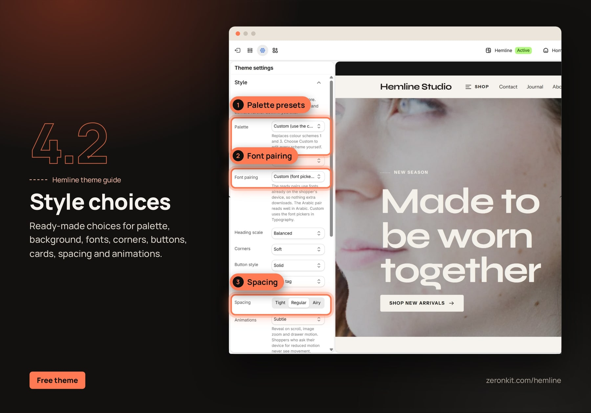](images/settings-style-en.jpg)

### 4.3 Colors

- The colour scheme list: six schemes come ready. 1 Paper, 2 Ink, 3 Sand, 4 Sage, 5 Blush, 6 High contrast. Click a scheme to change its `Background`, `Background gradient`, `Text`, `Accent and links`, `Button` and `Button label` colours. Every section has its own `Color scheme` setting that picks one of these schemes.
- `Page color scheme`: the colour of the page behind sections.
- `Drawer and pop-up color scheme`: used by the cart drawer, filters and size guide.

Keep text contrast at 4.5:1 or higher. The ready schemes already do this.

[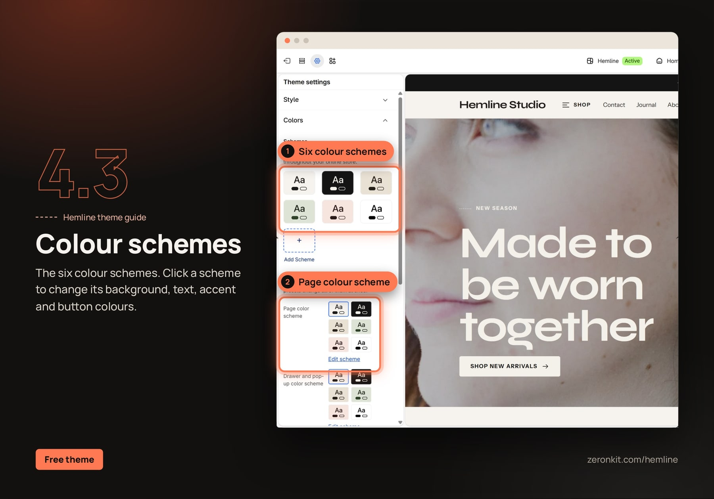](images/settings-colors-en.jpg)

### 4.4 Typography

- `Heading font` and `Body font`: choose from the Shopify font library. Used when `Style` > `Font pairing` is `Custom`.
- `Heading size` and `Body size`: scale all headings or all text.
- Most library fonts have no Arabic letters. Arabic text automatically uses a matching Arabic font from the device.

[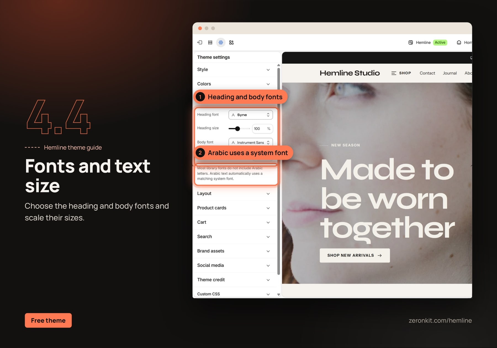](images/settings-typography-en.jpg)

### 4.5 Layout

- `Page width`: the widest the content can be on large screens.
- `Corner radius`: used when `Style` > `Corners` is `Custom`.

[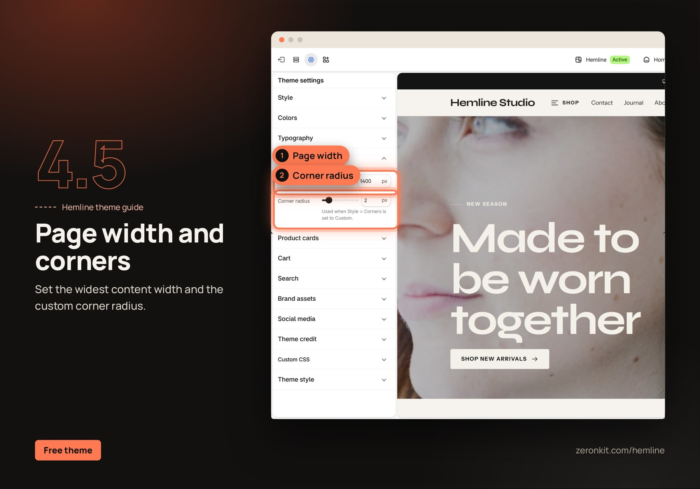](images/settings-layout-en.jpg)

### 4.6 Product cards

- `Image ratio`: `Portrait 3:4`, `Portrait 2:3`, `Portrait 4:5` or `Square`.
- `Show second image on hover`: shows the next photo of the same colour when the mouse is over the card.
- `Show sizes in stock`: lists the sizes. Sold out sizes are crossed out.
- `Show colour swatches`: shows colour dots. Shoppers can tap a dot to see that colour on the card.
- `Show vendor`: shows the brand name above the title.
- `Size option names` and `Colour option names`: extra option names, separated by commas, if your options use other words.
- `Show New badge for`: number of days a product counts as new after it is published. Set 0 to hide the badge.

[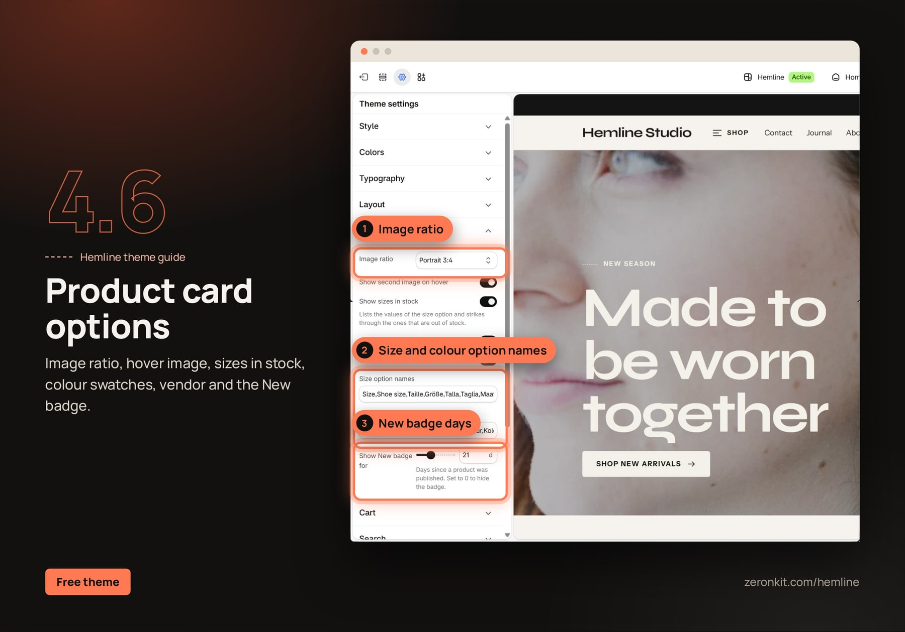](images/settings-product-cards-en.jpg)

### 4.7 Cart

- `Cart type`: `Drawer` opens a side panel after adding to cart. `Page` goes to the cart page.
- `Enable order note`: lets shoppers write a note on the cart page.
- `Show currency codes`: shows prices like `€25,00 EUR`. Useful if you sell in several currencies.

[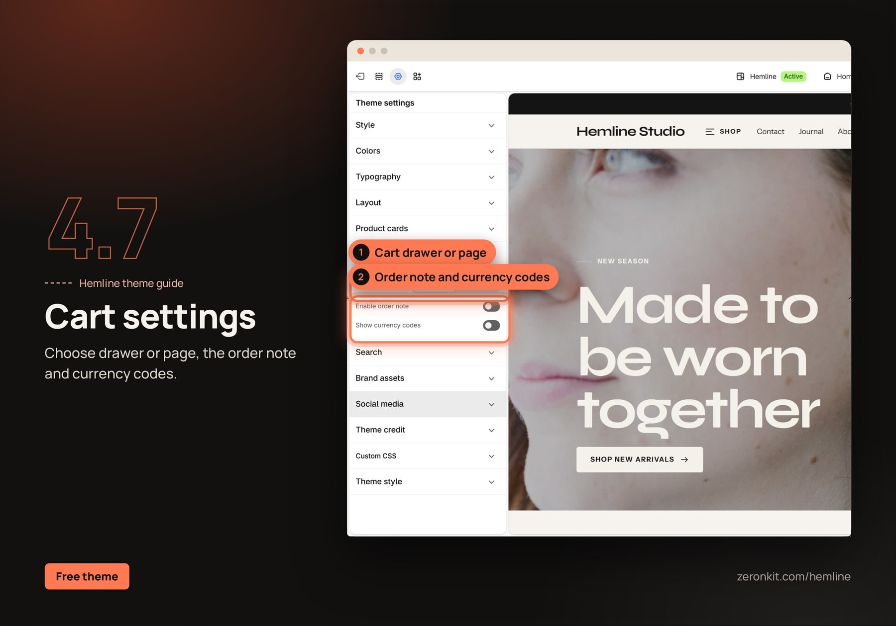](images/settings-cart-en.jpg)

### 4.8 Search

- `Enable search suggestions`: shows live results while the shopper types.
- `Popular searches`: words separated by commas. They appear as chips in the search overlay, on the search page and when nothing is found.

[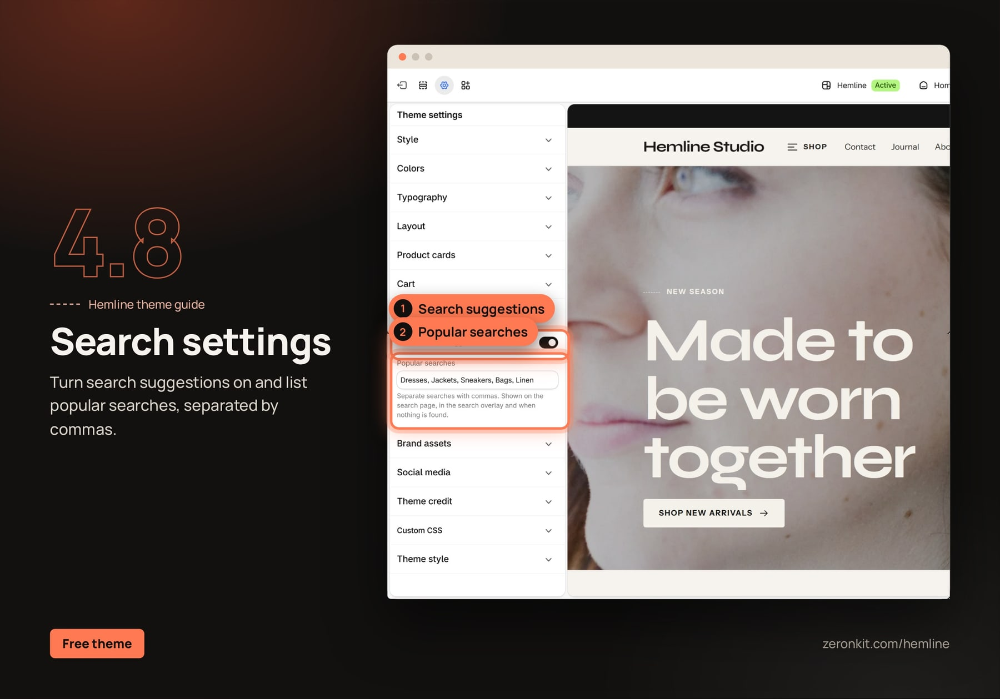](images/settings-search-en.jpg)

### 4.9 Brand assets

- `Favicon`: the small icon in browser tabs. Use a square image of 32 x 32 px or larger.
- `Brand logo for sharing and gift cards`: used in search results, social media previews and on the gift card page.

[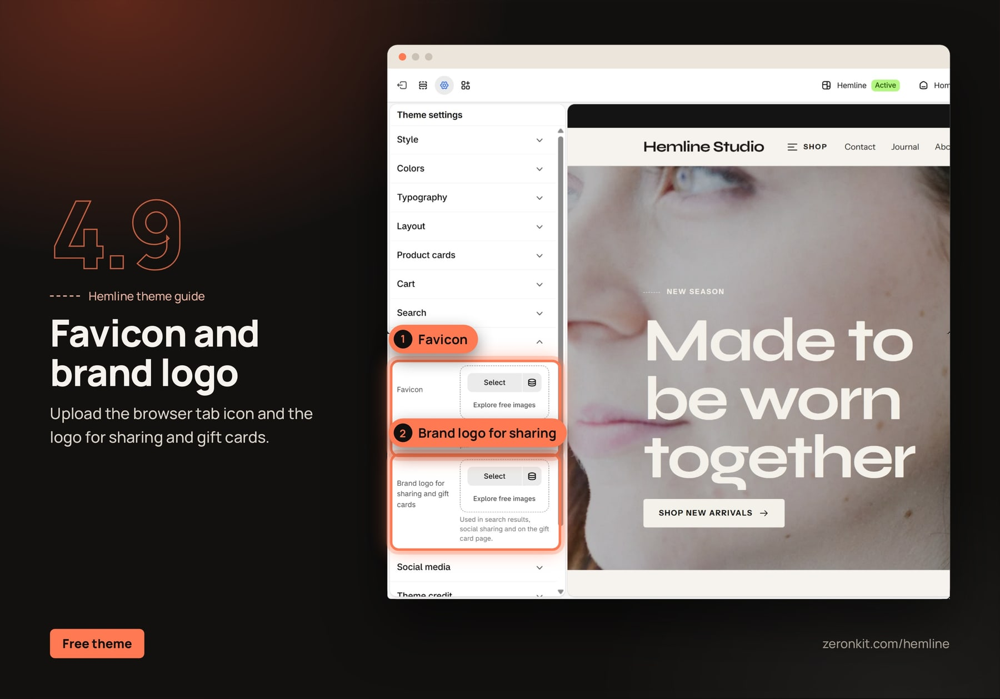](images/settings-brand-assets-en.jpg)

### 4.10 Social media

Paste the full web address of each profile, for example `https://instagram.com/yourshop`. Icons appear in the footer for every filled field.

### 4.11 Theme credit

- `Show "Theme by ZeronKit" credit in the footer`: on by default. Switch it off if you prefer.

[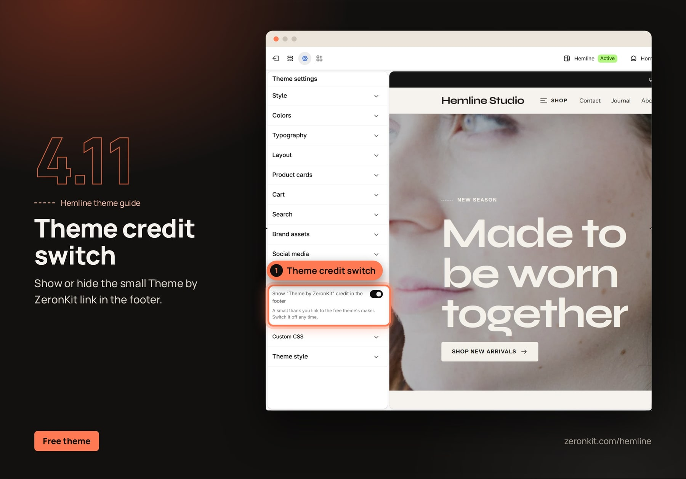](images/settings-theme-credit-en.jpg)

### 4.12 Custom CSS

Shopify adds a `Custom CSS` field at the bottom of `Theme settings` and in every section. Use it only for small changes. It stays when you change other settings, but you must copy it by hand when you update the theme.

---

## 5. Header group

Click the header area in the editor preview or choose `Header` in the left sidebar. The header group holds the `Announcement bar` and the `Header`.

### 5.1 Announcement bar

Settings:

- `Show announcement bar`: switch the bar on or off.
- `Display`:
  - `Static`: all messages side by side.
  - `Rotating fade`: one message at a time.
  - `Marquee`: a slow moving ribbon.
- `Time per message`: how long each message shows in the moving modes.
- `Pause on hover`: stops the movement while the mouse is over the bar.
- `Let shoppers close the bar`: adds a close button. A closed bar stays hidden until the browser tab is closed.
- `Color scheme`.

Blocks: add one `Message` block per message.

- `Text`: the message. Bold and italic work.
- `Link`: optional. The text becomes a link.
- `Icon`: `None`, `Delivery`, `Returns`, `New`, `Offer` or `Gift`.

Moving modes always show a pause button for accessibility. Keep two or three messages.

[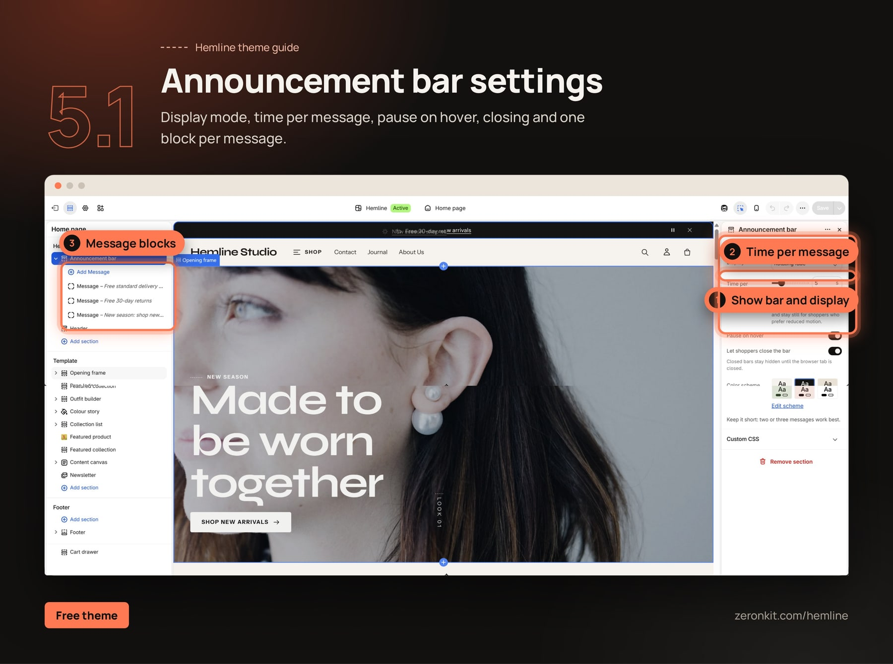](images/announcement-settings-en.jpg)

### 5.2 Header

[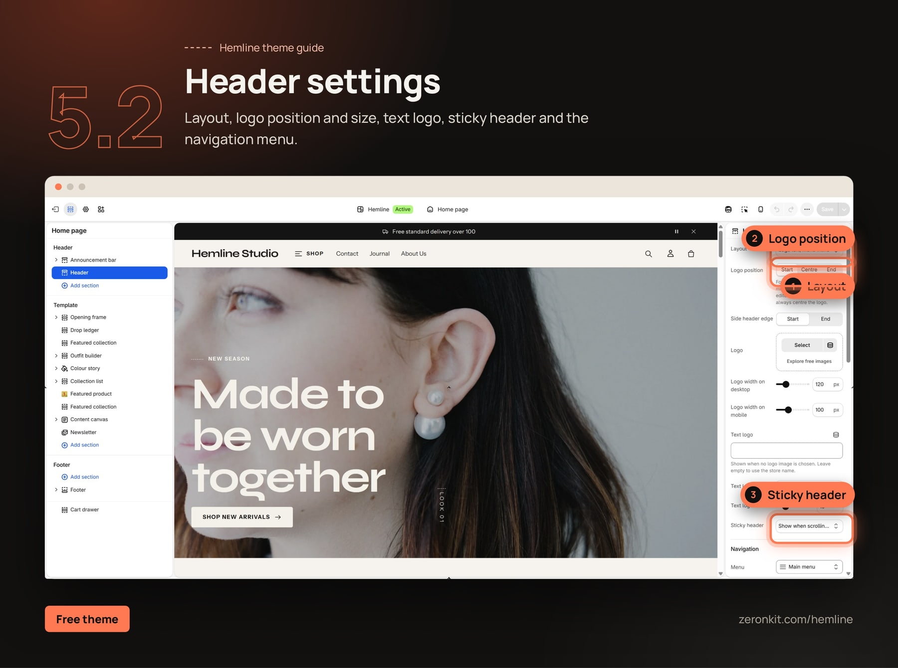](images/header-settings-en.jpg)

#### Layout

`Layout` has six choices. Phones always show a compact bar with a menu button, the logo and the icons.

| Layout | Desktop look | Good for |
| --- | --- | --- |
| `Logo left, menu inline` | Logo, then top links, icons at the end. | Most stores. |
| `Logo centred, menu below` | Logo in the middle, links on a row below. | Classic boutiques. |
| `Logo centred, menu split` | Links on both sides of a centred logo. | Small menus of 4 to 6 links. |
| `Minimal, menu button only` | Menu button, logo and icons. | Very clean stores, many departments. |
| `Editorial masthead` | Thin top row, a large logo, links below. | Brands with a strong name or wordmark. |
| `Side bar (desktop)` | A fixed bar on the side with logo, vertical menu and icons. | Lookbook style stores. |

[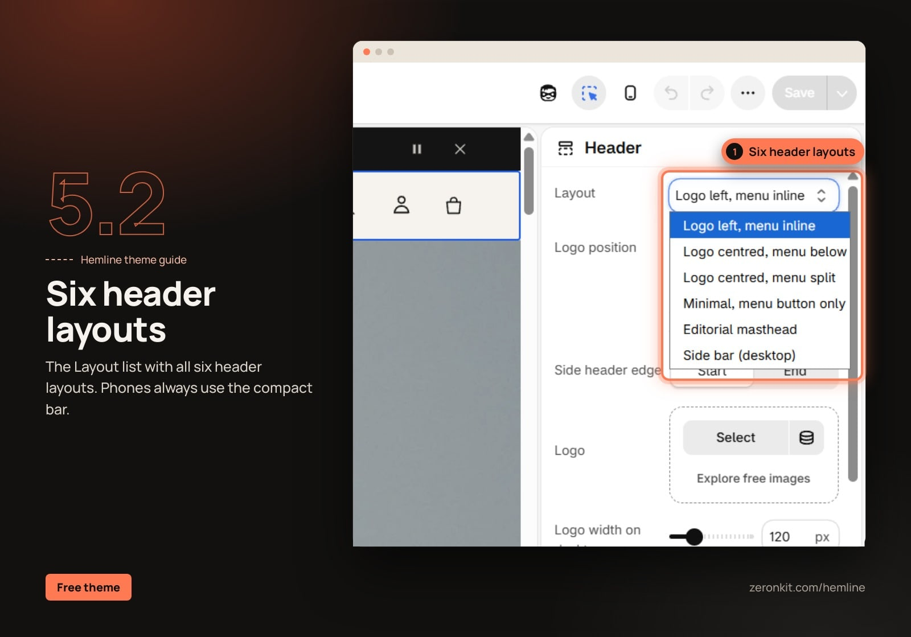](images/header-layout-select-en.jpg)

[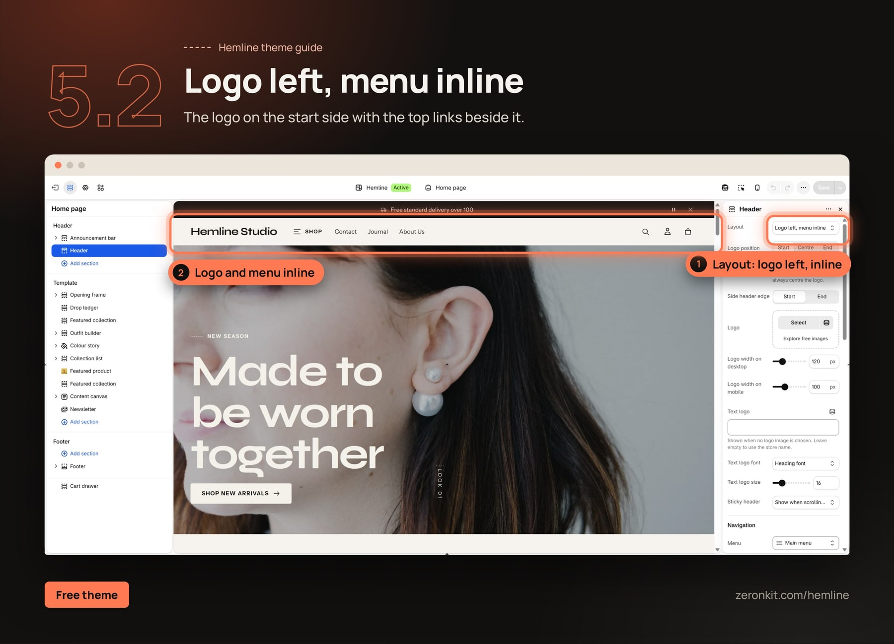](images/header-layout-inline-en.jpg)

[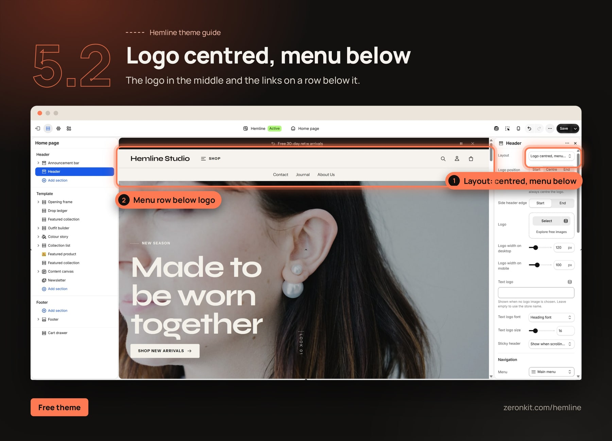](images/header-layout-below-en.jpg)

[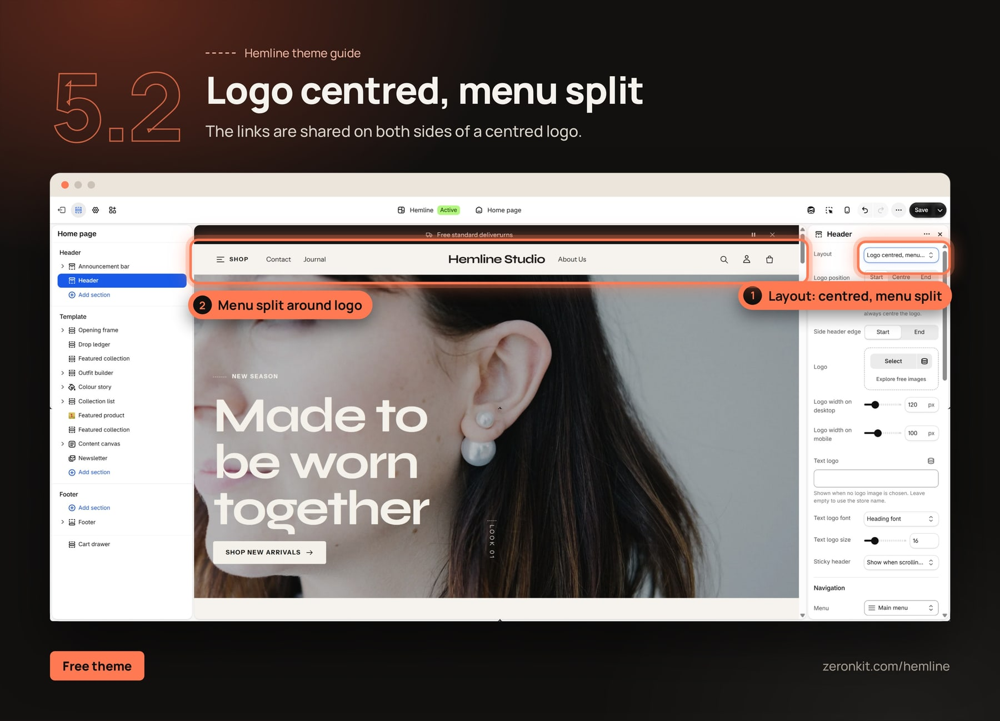](images/header-layout-split-en.jpg)

[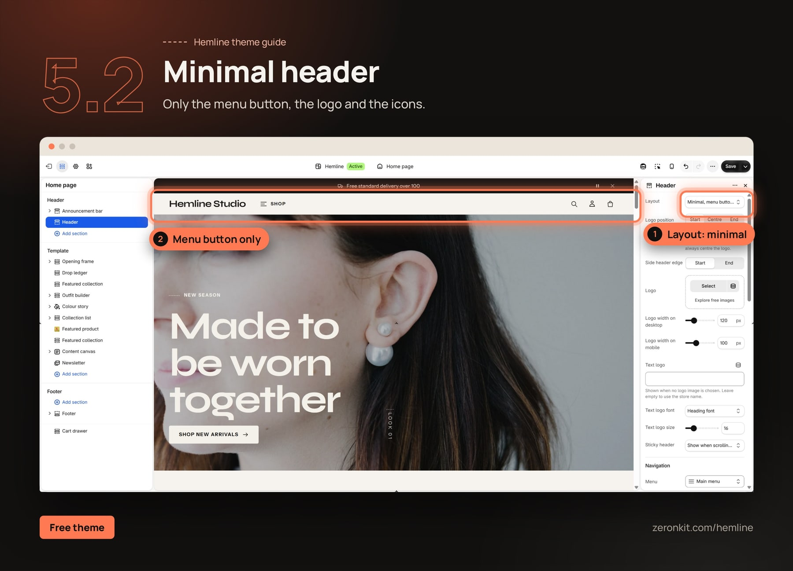](images/header-layout-minimal-en.jpg)

[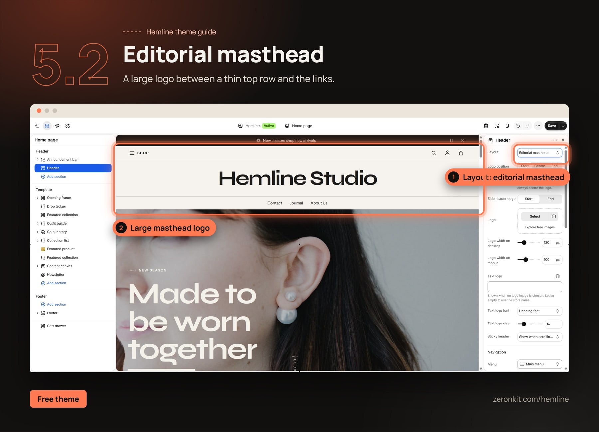](images/header-layout-editorial-en.jpg)

[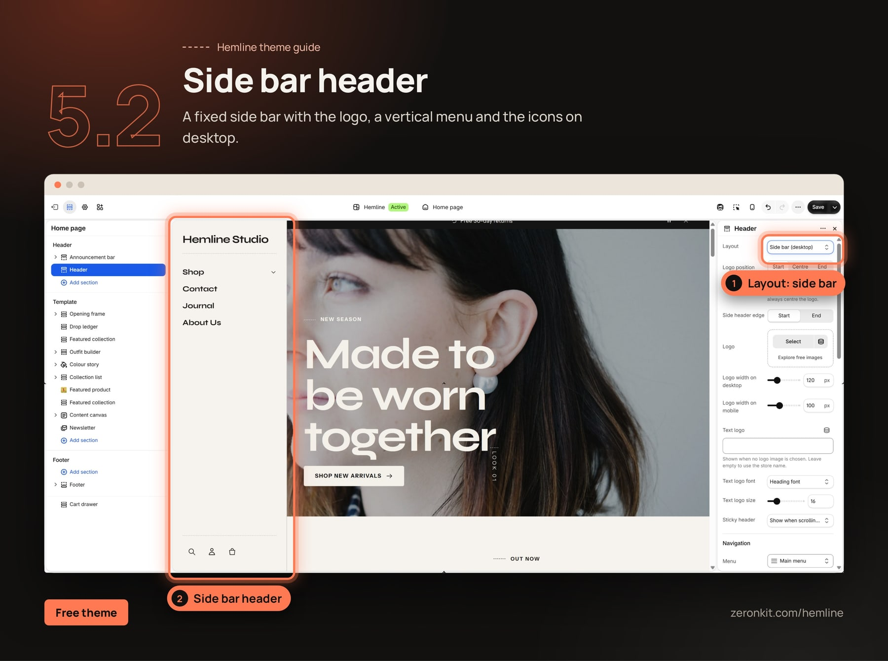](images/header-layout-side-en.jpg)

#### Logo

- `Logo position`: `Start`, `Centre` or `End`. Works for `Logo left, menu inline`, `Logo centred, menu below` and `Minimal, menu button only`. The split, editorial and side layouts always centre the logo.
- `Side header edge`: `Start` or `End`. Only for the side bar layout.
- `Logo`: your logo image. Without one, the store name is shown as text.
- `Logo width on desktop` and `Logo width on mobile`.
- `Text logo`: text to show instead of the store name when no logo image is chosen.
- `Text logo font`: `Heading font`, `Body font`, `Serif` or `Monospace`.
- `Text logo size`.

#### Sticky header

`Sticky header`:

- `Not sticky`: the header scrolls away.
- `Always visible`: the header stays at the top.
- `Show when scrolling up`: the header hides while the shopper scrolls down and comes back when they scroll up.

#### Navigation

- `Menu`: the menu for the header and the navigator. Default: `Main menu`.
- `Show the Shop navigator button`: shows the button that opens the navigator on desktop. On phones the navigator is always the menu.
- `Navigator button label`: the text on that button, for example `Shop`.
- `Hide the first menu item`: hides the first top link. Use it if your first menu item repeats the navigator button.
- `Quick link menu`: an optional row of small pill links under the header, for example Women, Men, Kids, Sport.

The navigator opens from the side. Departments are listed with numbers on the start side. Collections show as image tiles with product counts. Other links are listed in groups. On phones each level slides in with a `Back` button.

[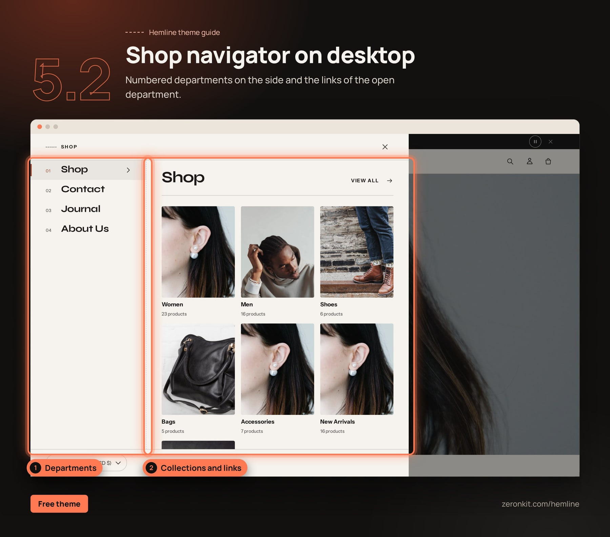](images/navigator-open-desktop-en.jpg)

[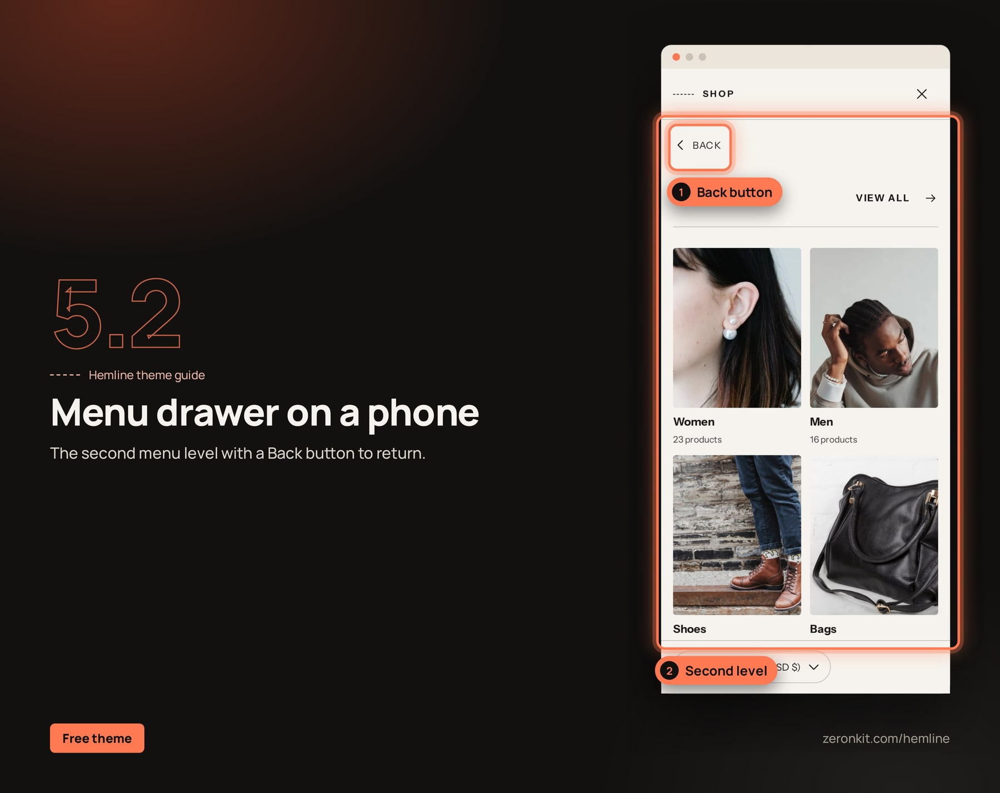](images/navigator-open-mobile-en.jpg)

#### Icons and selectors

- `Show search`: the search icon. It opens a full screen search with suggestions.
- `Show account`: the customer account icon. It uses Shopify's account button.
- `Customer account menu`: the menu inside the account window. Default: `Customer account main menu`.
- `Show cart`: the cart icon with the item count.
- `Show country/region selector` and `Show language selector`: show the selectors in the header on desktop. They are always in the navigator and can also be in the footer.

#### Transparent header

- `Transparent over the first section on the home page`: the header sits on top of the first section, usually the `Opening frame`. It turns solid when the shopper scrolls.
- `Text and icon colour when transparent`: usually white on a dark photo.
- `Logo when transparent`: a light version of your logo.

#### Colors

- `Color scheme`: the header bar.
- `Menu and search color scheme`: the navigator and the search window.

#### Right-to-left languages

For Arabic, Hebrew, Persian and Urdu, the whole layout flips automatically. The logo, menus, side bar, drawers and arrows change side. You do not need to change any setting.

---

## 6. Home page sections

Click `Add section` in the left sidebar to add sections. Drag them to change the order.

Many sections fill themselves with store data when you leave a product or collection empty. Your own choice always wins.

[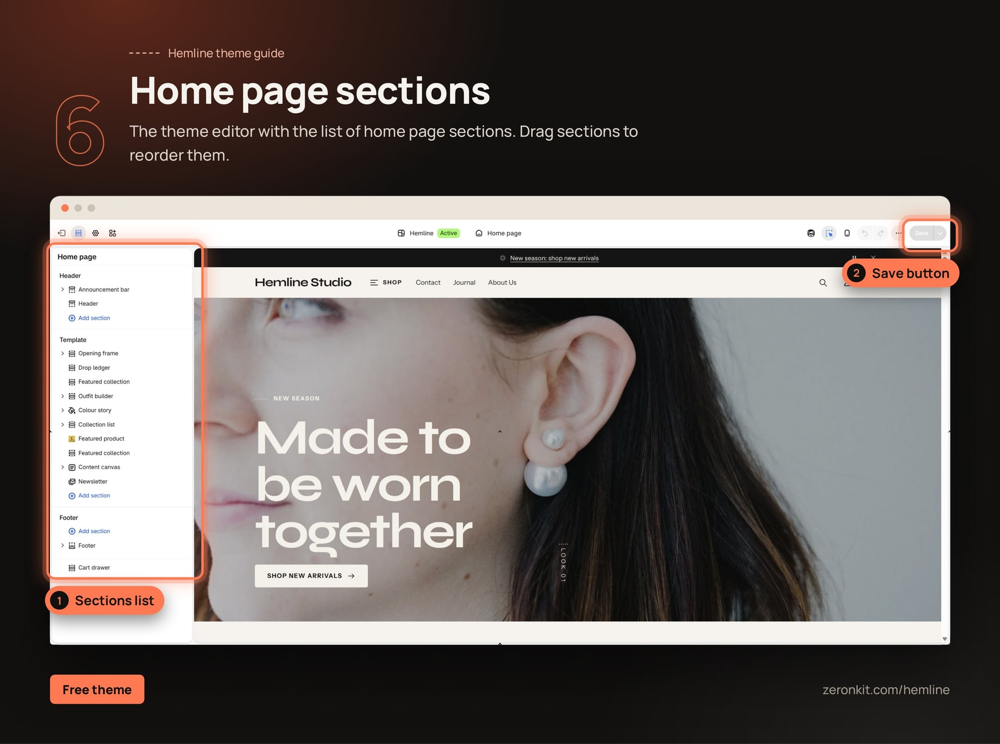](images/editor-home-en.jpg)

[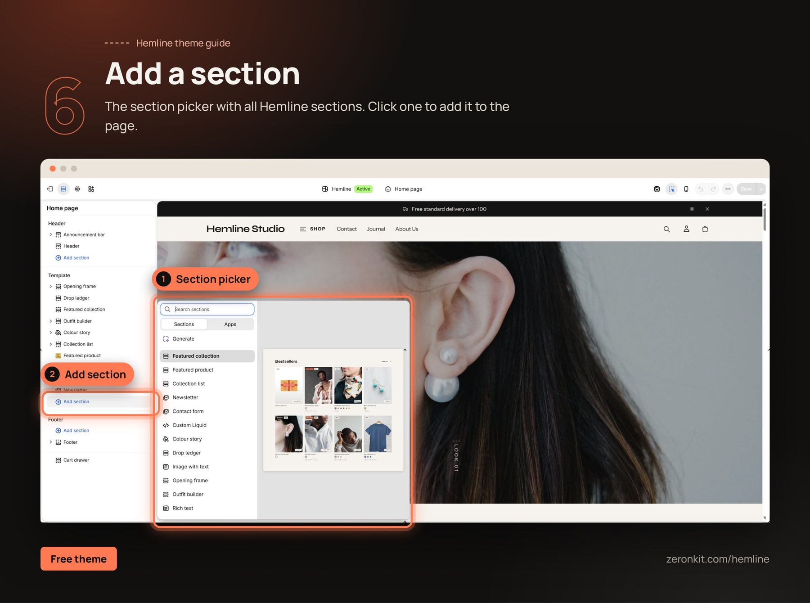](images/home-add-section-en.jpg)

[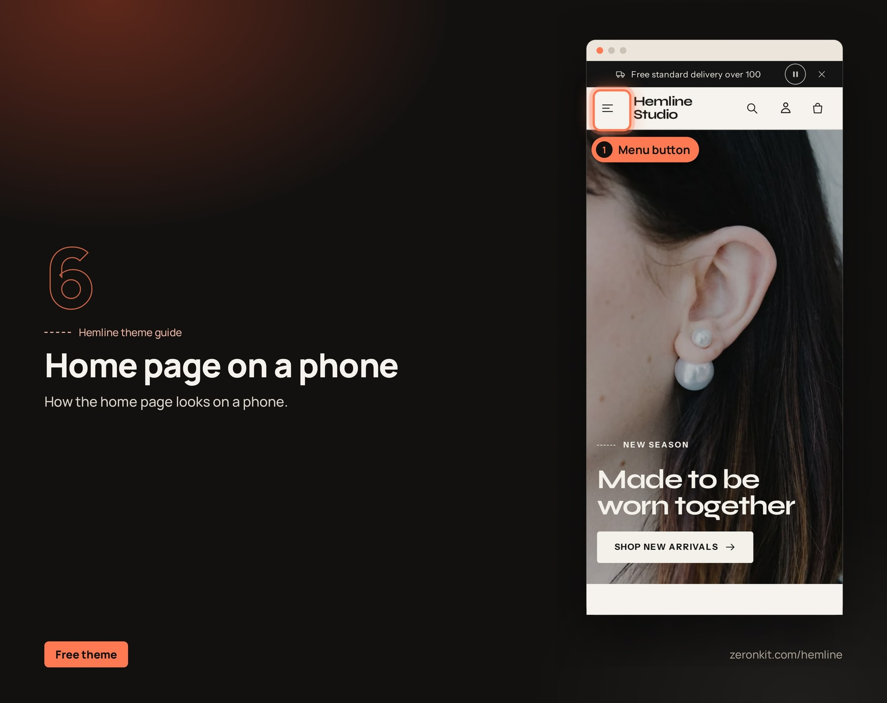](images/mobile-home-en.jpg)

[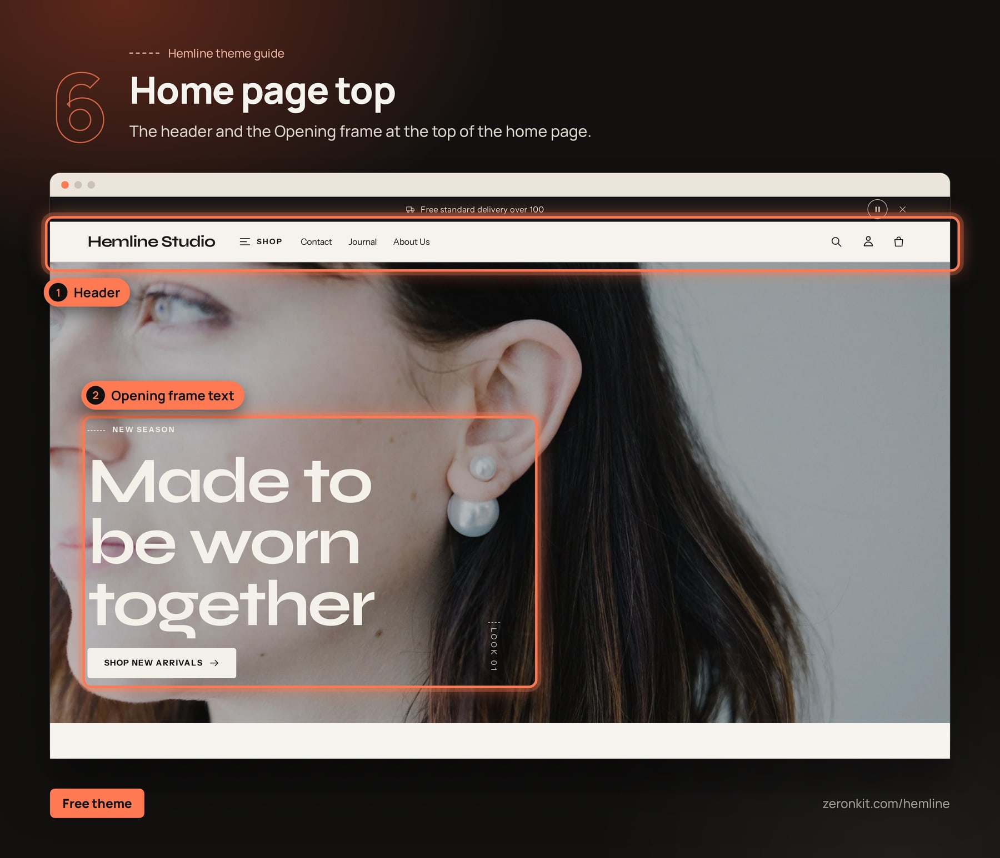](images/sf-home-hero-en.jpg)

### 6.1 Opening frame

A large image or video with text on top.

- `Image`: the main photo.
- `Mobile image`: an optional different photo for phones, for example a tall crop.
- `Use image from collection`: used when no image is chosen.
- `Video`: a short silent video that plays on loop. It replaces the image. Shoppers can pause it.
- `Load image first`: keep this on when this is the first section on the page. It makes the page appear faster.
- `Height`: `Short`, `Tall` or `Full screen`.
- `Content position`: `Bottom start`, `Center`, `Bottom end` or `Top start`.
- `Image overlay`: darkens the photo so the text is easy to read.
- `Frame label`: a small vertical label at the edge, like a frame number on a film roll. Leave empty to hide it.
- `Color scheme`: text colour and overlay colour.

Blocks: `Heading`, `Text`, `Button`, `Group`, `Image`, `Custom Liquid` and app blocks.

Automatic: with no image, no collection and no video, Hemline uses the first product photo in the store.

[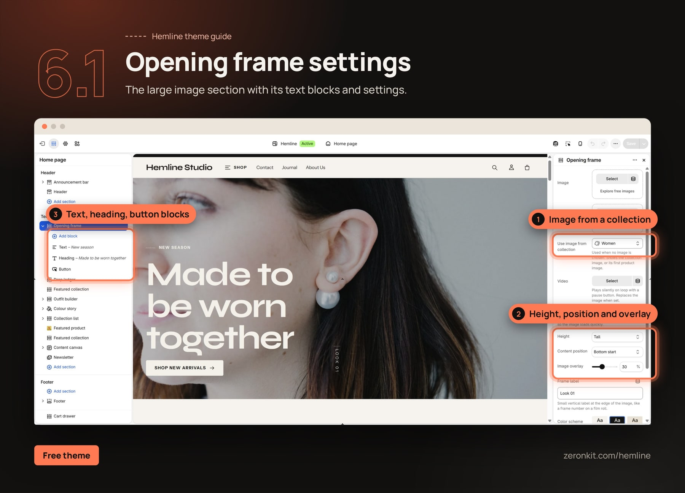](images/section-opening-frame-en.jpg)

### 6.2 Drop ledger

New arrivals shown as a numbered release sheet, with a plain date and no countdown.

- `Drop status`: `Live` shows the products. `Upcoming` shows a sign-up form instead.
- `Drop code`: a short code shown in large outlined letters, for example `D/04` or `SS25`.
- `Heading`, `Release date text` (plain text, for example `14 March`) and `Text`.
- `Collection`: sort this collection by newest first. Empty: the newest products of the whole store.
- `Products to show` and `Columns on desktop`.
- `Color scheme`.

[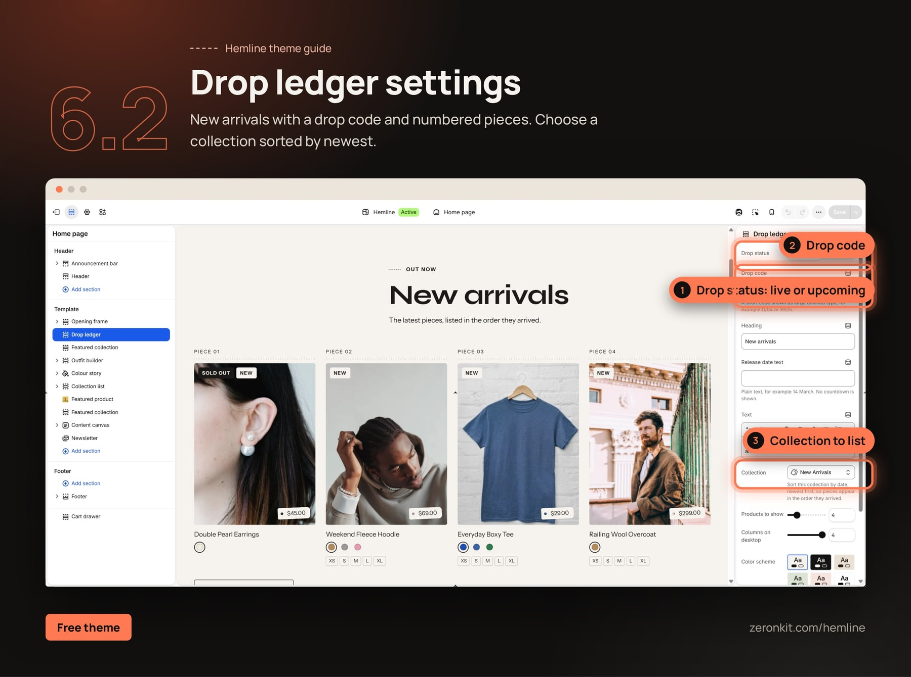](images/section-drop-ledger-en.jpg)

[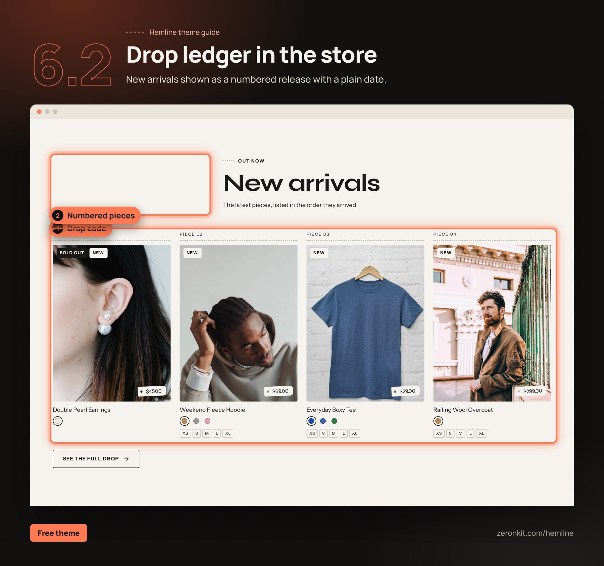](images/sf-drop-ledger-en.jpg)

### 6.3 Featured collection

A grid or a scrolling row of products.

- `Eyebrow text`: a small line above the heading.
- `Heading`.
- `Collection`. Empty: the newest products of the store.
- `Products to show` and `Columns on desktop`.
- `Layout`: `Grid` or `Scrolling row`.
- `Show arrows on the scrolling row`: previous and next buttons. They appear only when the row has more products than fit on screen.
- `Show View all link`.
- `Color scheme`.

[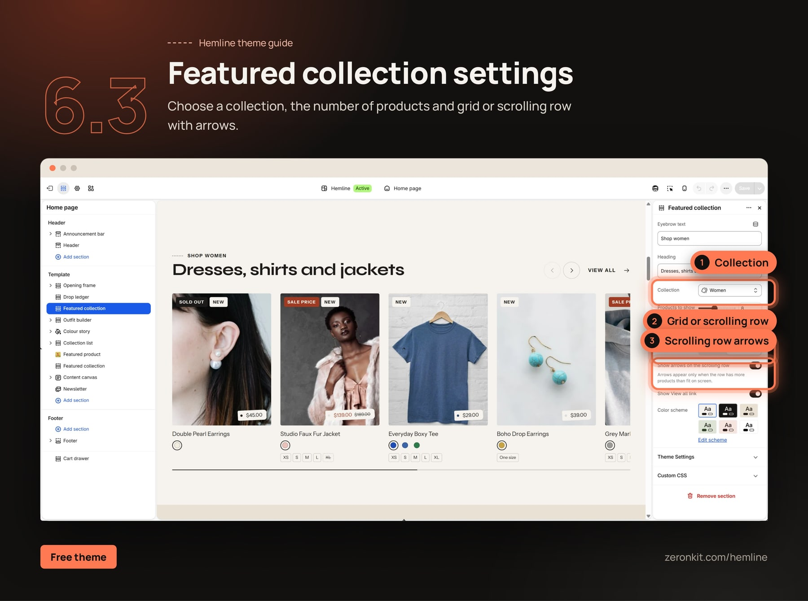](images/section-featured-collection-en.jpg)

[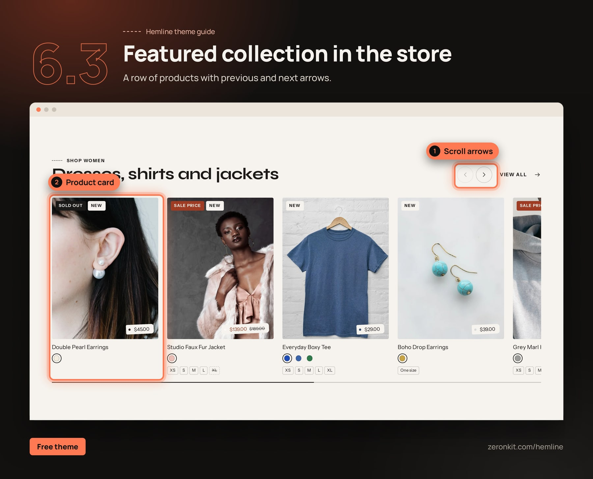](images/sf-featured-collection-en.jpg)

### 6.4 Outfit builder

Shoppers choose one piece per row, pick sizes, see the total and add the whole look to the cart in one click.

Section settings:

- `Eyebrow text`, `Heading`, `Text`.
- `Button label`: for example `Add the look to cart`.
- `Color scheme`.

Blocks: one `Outfit row` per type of piece.

- `Row label`: for example `Top`, `Bottom`, `Shoes`, `Accessory`.
- `Products`: up to 8 products.
- `Always include this row`: hides the option to leave this row out.

Automatic: a row without products fills itself with products whose type, tags or title match the row label. For example `Shoes` finds sneakers, boots and oxfords. Sold out products are skipped.

[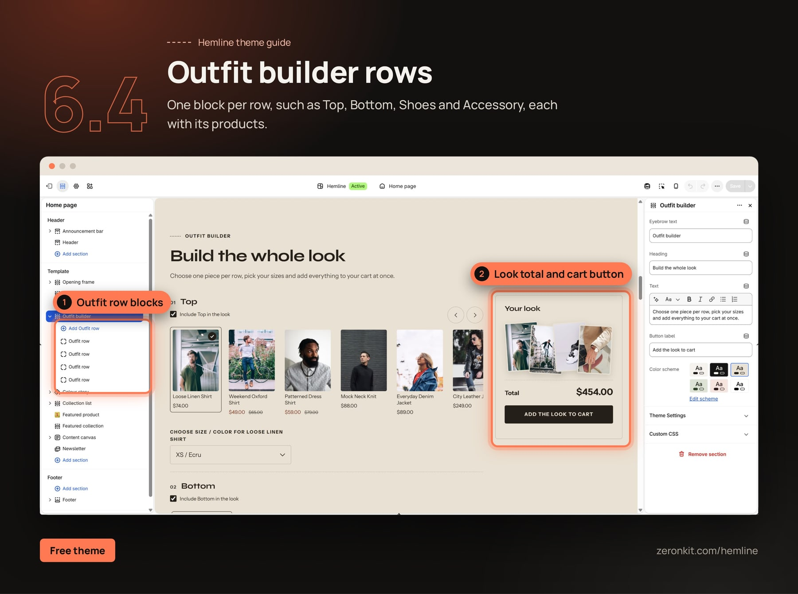](images/section-outfit-builder-en.jpg)

[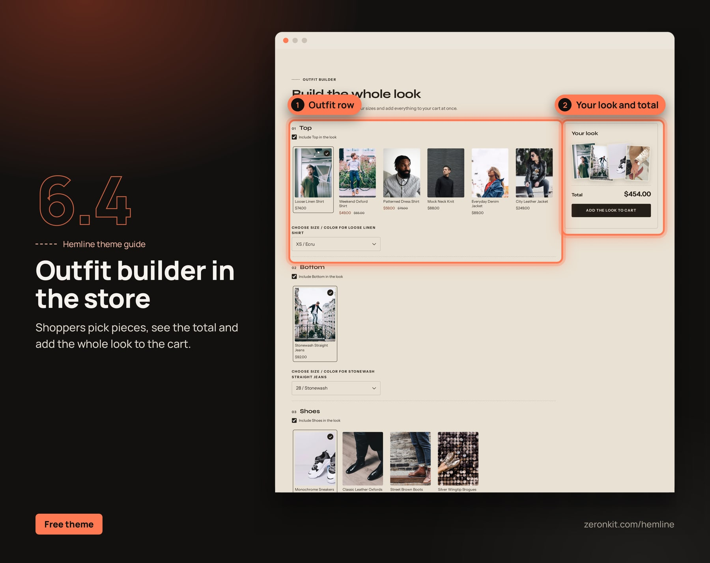](images/outfit-builder-storefront-en.jpg)

### 6.5 Colour story

Lets shoppers browse by colour.

- `Eyebrow text`, `Heading`.
- `Collection for colour chips`: Hemline lists every colour found in this collection as a chip. Each chip opens the collection filtered by that colour. Empty: all products.
- `Color scheme`.

Blocks: `Palette`.

- `Palette name` and `Short note`.
- `Colour 1` to `Colour 4`: the colour bars.
- `Image`: optional photo.
- `Collection` or `Custom link`. Empty: the store's collections are used in order.

The colour chips need a colour filter in the Search & Discovery app.

[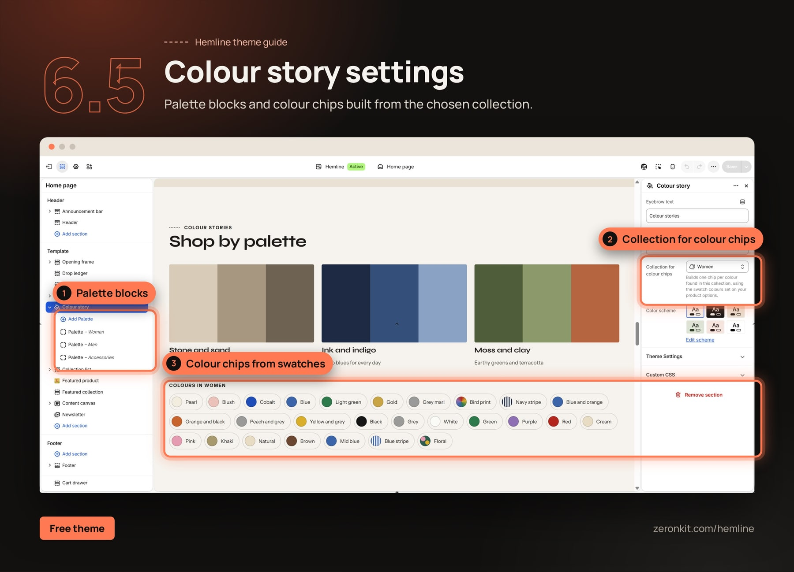](images/section-colour-story-en.jpg)

[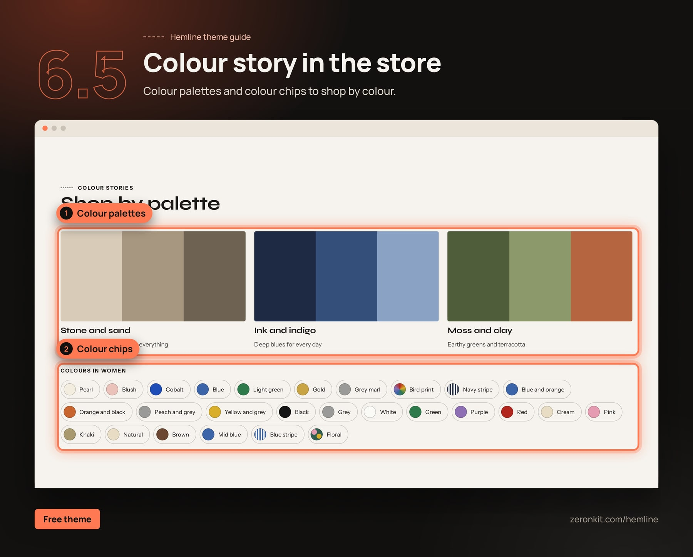](images/sf-colour-story-en.jpg)

### 6.6 Collection list

- `Heading`, `Columns on desktop`, `Color scheme`.
- Blocks: `Collection`. Choose one collection per block.

Automatic: empty blocks show your collections that have products, in order. A collection without an image shows its first product photo.

[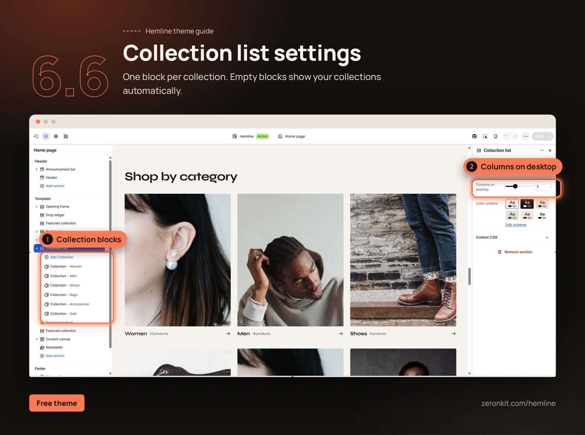](images/section-collection-list-en.jpg)

[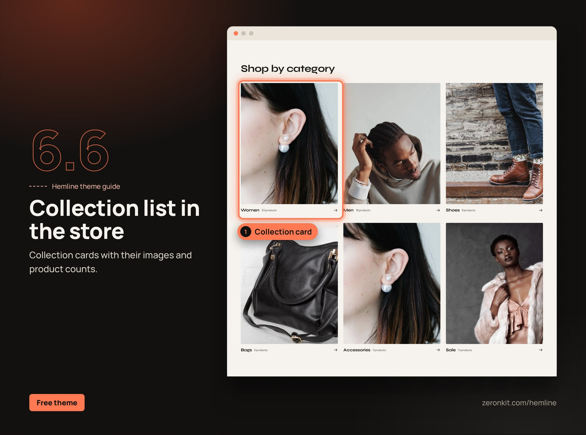](images/sf-collection-list-en.jpg)

### 6.7 Featured product

- `Product`. Empty: the first available product.
- `Eyebrow text`, `Media to show`, `Show accelerated checkout buttons`, `Color scheme`.

Shoppers can choose a colour and size and add to cart without leaving the page.

[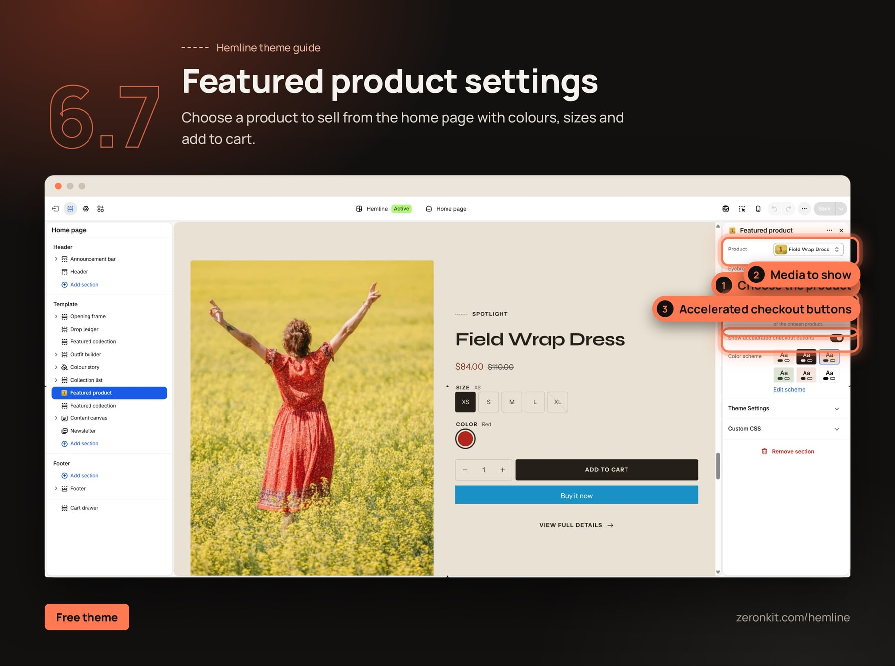](images/section-featured-product-en.jpg)

[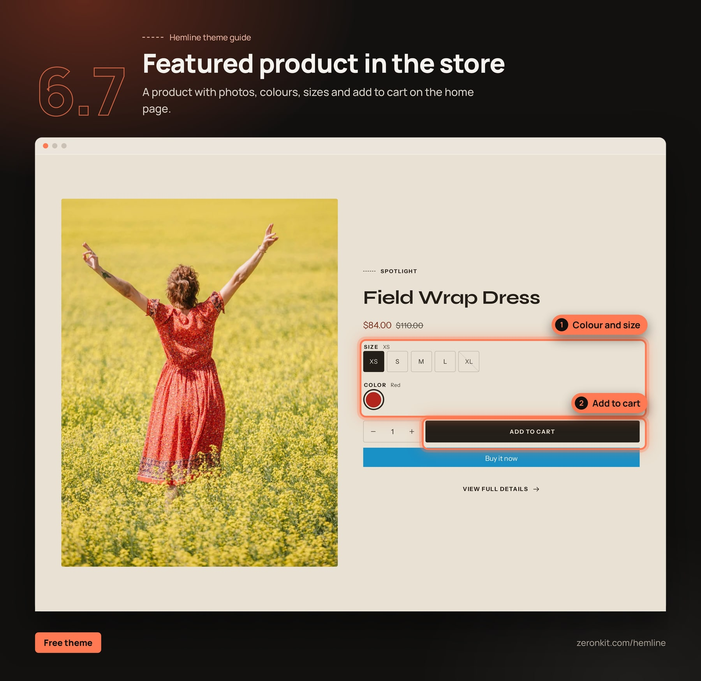](images/sf-featured-product-en.jpg)

### 6.8 Content canvas, rich text and image with text

`Content canvas` is a free section for text and images. The `Add section` list offers it twice: as `Rich text` and as `Image with text`.

- `Layout`: `Stacked` or `Two columns`.
- `Spacing`, `Narrow content`, `Color scheme`.

Blocks (theme blocks, usable in several sections):

- `Heading`: text, `Size` (`Extra large`, `Large`, `Medium`, `Small`), `HTML tag` and `Alignment`.
- `Text`: rich text with `Style` (`Body`, `Large`, `Small`, `Eyebrow`) and `Alignment`.
- `Button`: `Button label`, `Link`, `Style` (`Solid`, `Outline`, `Text link`), `Show arrow`.
- `Image`: `Image`, `Use image from collection`, `Image ratio`, `Width`, `Caption`. Empty: a product photo from the store.
- `Group`: holds other blocks. `Direction` (`Vertical` or `Horizontal`), `Alignment`, `Spacing`, `Use its own color scheme`.
- `Custom Liquid`: for small code snippets.

[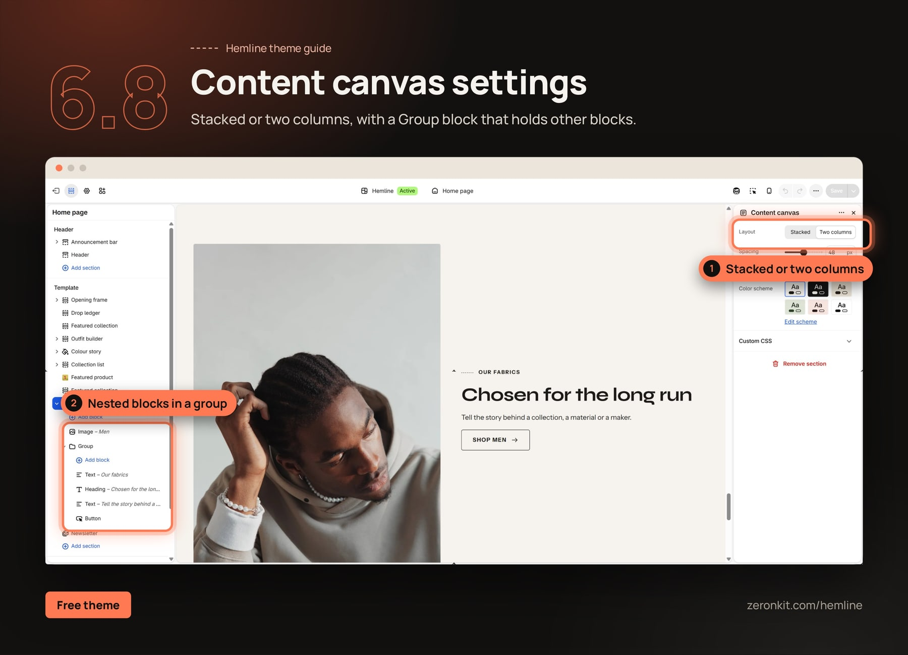](images/section-content-canvas-en.jpg)

### 6.9 Newsletter

- `Heading`, `Text`, `Color scheme`.
- Sign-ups are added to `Customers` with the tag `newsletter`.

### 6.10 Contact form

Can be added to any page, including the home page. See section 9.5.

### 6.11 Apps and Custom Liquid

- `Apps`: holds app blocks from your installed apps.
- `Custom Liquid`: for small code snippets.

---

## 7. Collection and search pages

### 7.1 Collection page (Product grid)

Open a collection in the editor: choose `Collections` > `Default collection` from the page menu at the top.

- `Show collection description` and `Show collection image`.
- `Products per page`: from 8 to 48.
- `Pagination`:
  - `Numbered pages`: page numbers at the bottom.
  - `Load more button`: a button adds the next products to the same page. It shows "Showing 24 of 120".
  - `Infinite scroll`: the next products load by themselves as the shopper scrolls.
- `Let shoppers choose how many products to show`: adds a `Show` selector with 12, 24, 36 or 48 per page. The choice is remembered for the visit.
- `Columns on desktop` and `Columns on mobile`.
- `Enable filtering`: shows the `Filter` button. The filters come from the Search & Discovery app.
- `Show colour bar`: shows the colour filter as a row of colour chips above the products.
- `Enable sorting`.
- `Color scheme`.

### 7.2 Search page

- A large search field with live suggestions grouped as suggestions, products, collections, pages and articles. Use the arrow keys to move through them.
- Before searching: popular searches, recent searches (stored only in the shopper's browser, with a `Clear` button) and new products.
- After searching: tabs `All`, `Products`, `Articles` and `Pages`, matching collections as chips, filters and sort for products.
- When nothing is found: a spelling hint, popular searches and suggested products.

Settings in `Search results`:

- `Products per page`, `Pagination`, `Let shoppers choose how many products to show`, `Columns on desktop`, `Enable filtering`, `Enable sorting`.
- `Suggested collection when nothing is found`. Empty: newest products.
- `Color scheme`.

Popular searches are set in `Theme settings` > `Search`.

---

## 8. Product page

Open a product in the editor: `Products` > `Default product`.

### 8.1 Section settings (Product information)

- `Color scheme`.
- `Gallery layout`: `Contact sheet` (a large first photo, then two columns) or `Single column`.
- `Keep product details in view while scrolling`.
- `Show only the selected colour's images`: the gallery shows only the photos of the chosen colour. See 3.2 and 3.3.

### 8.2 Gallery and lightbox

1. Photos are numbered like frames on a film contact sheet, for example `01 / 04`.
2. When the shopper picks a colour, the gallery shows that colour's photos and the numbers start again.
3. A click on a photo opens a full screen lightbox. Shoppers can swipe, use the arrow buttons or the arrow keys, and close with Esc.
4. Videos and 3D models load only when the shopper presses play. 3D models offer `View in your space` on supported phones.
5. Model notes from `hemline.model_info` appear under each photo.

### 8.3 Blocks

Add, remove and reorder these blocks:

- `Title`: `Show vendor`.
- `Price`: shows sale price, unit price, tax note and shipping note.
- `Variant picker`: `Style` is `Buttons` or `Dropdown`. Colour options show as colour swatches. The swatch colour comes from Shopify's swatch settings on the option value. If none is set, Hemline knows common colour names in English, French, Spanish, German and Arabic. Patterns such as stripes, prints and florals get a small pattern.
- `Fit and size guide`:
  - `Size guide page`: opens in a side drawer.
  - `Default model note`: shown when a product has no model notes.
  - The fit scale appears when `hemline.fit` is set.
  - Size guide order: the product's `hemline.size_guide`, then this setting, then the page with the handle `size-guide`.
- `Buy buttons`: `Show quantity selector`, `Show accelerated checkout buttons` (Shop Pay, Apple Pay and others), `Show pickup availability`. Subscription options and the Shop Pay Installments message appear automatically when available.
- `Description`.
- `Collapsible tab`: see 8.4.
- `Complementary products`: `Heading` and `Products to show`. The products are chosen in the Search & Discovery app.
- `Text`: a short note, for example about sizing help.
- `Custom Liquid` and app blocks.

### 8.4 Collapsible tabs and content sources

Each `Collapsible tab` has:

- `Heading`: the tab title.
- `Content source`:
  - `Automatic, from the heading`: Hemline picks the source from words in the heading.
  - `Materials and care`: product metafields `hemline.materials` (or `custom.material`) and `hemline.care`, then the Materials and Care sections of the description, then your text, then a built-in default.
  - `Shipping and returns`: your text, then the Shipping section of the description, then a built-in default. Links to your shipping and refund policies are added.
  - `Fit`: `hemline.fit_notes`, then the Fit section of the description, then your text, then a built-in default.
  - `Custom text only`: only your text and page.
- `Content`: your own text for the tab.
- `Page content`: adds the content of a page.

A tab is never shown empty. Read the built-in Shipping and returns default and change it if it does not match your store.

### 8.5 Related products

The `Related products` section under the product shows products chosen automatically by Shopify.

- `Heading`, `Products to show`, `Columns on desktop`, `Color scheme`.

### 8.6 Pickup availability

If you use local pickup, the buy box shows where the selected size can be picked up today. Set it up in `Settings` > `Shipping and delivery` > `Local pickup`.

---

## 9. Other pages

### 9.1 Cart drawer and cart page

1. With `Cart type` set to `Drawer`, the cart opens as a side panel after adding a product.
2. Shoppers can change quantities and remove items in the drawer and on the cart page.
3. Discounts are shown per item and for the whole order. Subscription names are shown under each item.
4. Accelerated checkout buttons appear under the checkout button when they are set up.
5. The cart page has an optional order note (`Theme settings` > `Cart` > `Enable order note`).

### 9.2 Gift card page

Customers see this page when they receive a gift card. It shows the balance, the code with a copy button, a QR code, an `Add to Apple Wallet` button and your logo or store name. It has no settings in the editor. The logo comes from `Theme settings` > `Brand assets`.

### 9.3 404 page

Shown when a page does not exist. It has a swinging tag illustration, a search field, links to popular collections and a row of products. In the editor: `Others` > `404 page`. Settings: `Heading` and `Color scheme`.

### 9.4 Blog and articles

- `Blog posts`: `Posts per page` and `Color scheme`. Tags appear as filter chips.
- `Blog post`: `Show author` and `Color scheme`. Comments appear when they are switched on for the blog in Shopify admin.

### 9.5 Pages and the contact form

Normal pages show the page title and content.

The contact page uses the template `page.contact`. It shows the page content, then the `Contact form` section.

1. In Shopify admin, create a page named Contact and choose the template `contact` (or give it the handle `contact`).
2. In the editor open `Pages` > `Contact`.

`Contact form` settings:

- `Show contact form`: switch the form on or off.
- `Heading`, `Intro text`, `Button label`, `Success message`.
- `Layout`: `Form only` or `Form and information column`.
- Side information column: `Contact email`, `Opening hours`, `Address`, `Links menu`.
- `Color scheme`.

Field blocks. Add, remove and reorder them. Each has `Label`, `Placeholder`, `Required` and `Width` (`Half width` or `Full width`):

- `Name field`, `Email field`, `Phone field`, `Order number field`, `Topic dropdown` (with `Topics`, separated by commas), `Message field`, `Consent checkbox` (with `Consent text`).

The email field is always required, so Shopify can send the message. Messages go to your store's sender email (`Settings` > `Notifications` > `Sender email`). Shopify protects the form against spam.

### 9.6 Password page

Shown while your store has a password (`Online Store` > `Preferences` > `Password protection`). It shows your message, an optional newsletter sign-up and a field for the password. Settings: `Show newsletter sign-up` and `Color scheme`.

---

## 10. Footer group

Click the footer in the editor or choose `Footer` in the sidebar.

Settings:

- `Layout`: `Columns`, `Brand and columns` (store name and text on the start side) or `Centred`.
- `Show store name` and `Text under the store name`.
- `Color scheme`.
- `Show social icons`: uses the links from `Theme settings` > `Social media`.
- `Show Follow on Shop`: a follow button for the Shop app. Needs Shop Pay.
- `Show country/region selector` and `Show language selector`.
- `Show payment icons`: icons of the payment methods you accept.
- `Show policy links`: lists every policy you filled in under `Settings` > `Policies`: privacy, terms, refund, shipping and contact information.
- `Show Powered by Shopify`.

Blocks:

- `Menu`: `Heading` and `Menu`. Empty menu: the `Footer menu`, then your common pages and blog.
- `Text`: `Heading` and `Text`.
- `Newsletter`: `Heading` and `Text`. The field is full width with the button below.
- App blocks.

The `Theme by ZeronKit` credit is switched on or off in `Theme settings` > `Theme credit`.

---

## 11. Languages, Arabic and right-to-left

### 11.1 Adding a language

1. Open `Settings` > `Languages` and click `Add language`.
2. Choose the language, for example Arabic, and publish it when the translations are ready.
3. Install the free app Translate & Adapt to translate products, collections, pages, menus and theme texts. It can translate automatically.

### 11.2 What the theme translates itself

- All theme texts, such as `Add to cart`, filter labels, cart messages and form labels, come with English and Arabic translations.
- The theme editor itself is also translated into Arabic.
- Plural forms follow the rules of each language.

### 11.3 Right-to-left

For Arabic, Hebrew, Persian and Urdu, Hemline:

1. Sets the page direction to right-to-left.
2. Flips the layout: menus, drawers, the side bar, arrows, sliders and the price tag.
3. Uses an Arabic-capable font for Arabic letters when the chosen font has none. Or choose `Style` > `Font pairing` > `Arabic friendly`.

### 11.4 Colour names in other languages

When Translate & Adapt translates option values, colour swatches still show the right colour. Hemline maps common colour words in Arabic, French, Spanish and German. For exact colours, set the swatch colour on the option value in Shopify admin: it works in every language.

---

## 12. Performance, accessibility, help

### 12.1 Performance

- One small main script. Other scripts load only on pages that need them.
- Images load in the right size for each screen. Photos further down the page load when they come into view.
- Videos and 3D models load only when the shopper asks.
- Tips: use photos about 2000 px wide, keep `Load image first` on for the first section only, and do not add too many apps.

### 12.2 Accessibility

- Everything works with a keyboard. Focus is always visible.
- Buttons and fields have labels for screen readers.
- Text contrast is 4.5:1 or higher in the ready schemes.
- Touch targets are at least 24 px, most are 44 px.
- Moving parts can be paused, and nothing moves for shoppers who prefer reduced motion.

### 12.3 Troubleshooting

1. **Colour swatches are grey or show a letter.**
   The colour name is not known. Open the product, click the colour option value and set a swatch colour or image. Or use a common colour name such as navy, olive or stone.

2. **Colour swatches show as text buttons.**
   The option name is not recognised. Add your option name to `Theme settings` > `Product cards` > `Colour option names`.

3. **The gallery does not switch photos when I pick a colour.**
   Give each colour variant its own image (3.2) and order the photos by colour. Check that `Show only the selected colour's images` is on.

4. **The gallery shows only one photo for a colour.**
   The photos of that colour are not next to each other in the Media card, or the next colour's variant image comes too early. Reorder the photos.

5. **My home page shows nothing or placeholders.**
   The store has no products yet, or the products are not available on the Online Store sales channel. Sections fill themselves once products exist.

6. **The header menu is empty.**
   The `Menu` setting points to an empty menu. Fill `Main menu` in `Online Store` > `Navigation`, or leave it empty to use the automatic navigation.

7. **I see "Shop" twice in the header.**
   Your first menu item repeats the navigator button. Switch on `Hide the first menu item`, or rename the navigator button.

8. **Filters do not appear on collection pages.**
   Install Search & Discovery and add filters under `Filters`. Check that `Enable filtering` is on.

9. **The colour bar does not appear.**
   You need a colour filter in Search & Discovery and `Show colour bar` switched on.

10. **The size guide link does not appear.**
    Choose a page in the `Fit and size guide` block, set `hemline.size_guide` on the product, or create a page with the handle `size-guide`.

11. **The Shipping and returns tab says free returns but I do not offer them.**
    Write your own text in the tab's `Content` setting or add a Shipping and returns section to the product description.

12. **The contact form does not send.**
    Check `Settings` > `Notifications` > `Sender email`. Also check your spam folder.

13. **Accelerated checkout buttons do not show.**
    Set up Shop Pay, Apple Pay or other wallets in `Settings` > `Payments`. Check the `Show accelerated checkout buttons` setting.

14. **The Arabic page looks left-to-right.**
    The Arabic language must be published in `Settings` > `Languages`, and the address must contain `/ar`. Hemline then flips the layout itself.

15. **Collection images are missing in the menu.**
    Add an image to the collection. Without one, Hemline uses the first product photo, so the collection needs at least one product with a photo.

16. **The "Show" selector on collection pages does nothing.**
    It needs JavaScript and a working cart. Clear the browser cache and try again.

17. **Animations feel too much.**
    Set `Theme settings` > `Style` > `Animations` to `Subtle` or `Off`.

18. **Updating removed my changes.**
    Uploaded themes start fresh. Your old copy still has your settings. Always duplicate before updating (2.4).

### 12.4 Support

- Support is best-effort and on request only. It is not guaranteed.
- Contact: info@zeronkit.com or https://zeronkit.com/contact.
- Updates are released when needed and when time allows, with no schedule.

### 12.5 Changelog

**1.1.0**

- Six header layouts, including a side bar, with logo position and text logo options.
- New navigator with collection image tiles.
- Announcement bar with static, fade and marquee modes.
- Style settings: palettes, background styles, font pairings, corners, buttons, card styles, spacing and animations.
- Six colour schemes and four theme styles.
- Colour-filtered product gallery and lightbox. Colour switching on product cards.
- Search page with suggestions, popular and recent searches, tabs and a helpful empty state.
- Load more, infinite scroll and a per-page selector on collection and search pages.
- Product tabs that never show empty.
- Configurable contact form.
- Designed 404 page.
- Colour swatches and option names that work in English, French, Spanish, German and Arabic.
- New licence: free for your own store, not for resale or redistribution.

**1.0.0**

- First release.
